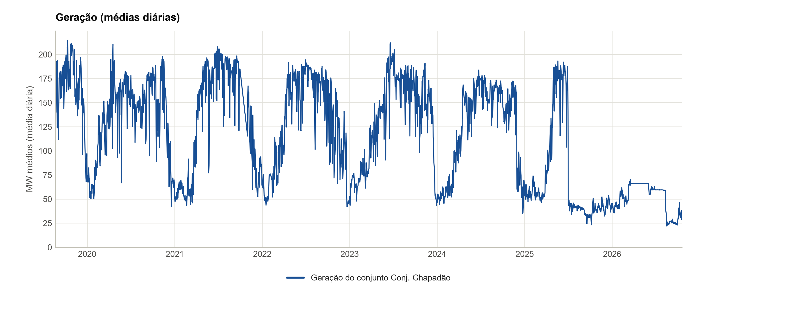
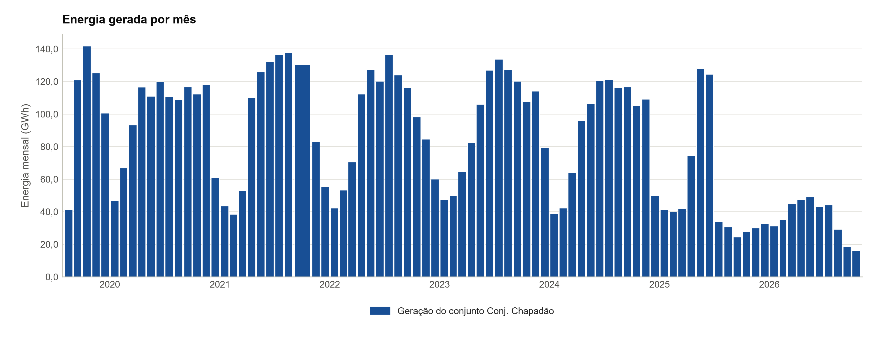
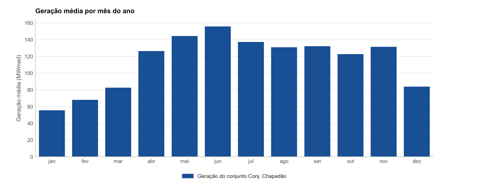
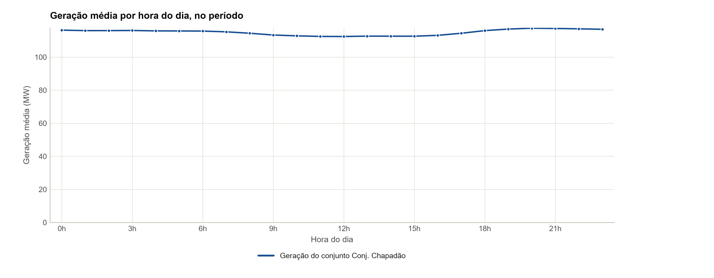
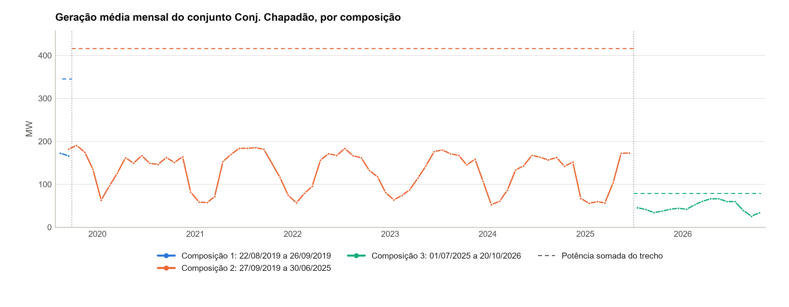

# PCH Bandeirante — Análise do desempenho operacional

**Período**: 22/08/2019 00h a 20/10/2026 23h (62.064 registros horários da série de referência, Geração por usina (conjunto de usinas, id ONS CJU_MSCAO))
**Gerado em**: 22/10/2026 10:00

### Identificação nos dados do ONS

| Item | Valor |
| --- | --- |
| Tipo · modalidade | PCH · TIPO II-C |
| CEG | PCH.PH.MS.032163-0.01 |
| id ONS | MSBDT |
| Conjunto de usinas | CJU_MSCAO (Conj. Chapadão) |
| Programação diária | MSCAO-9761; MSCAO-9762; MSCAO-9763; MSCAO-9766; MSCAO-10205; MSCAO-9764; MSCAO-9765; MSCAO-9784 |
| Estado | MS |
| Agente atual | RIO AGUA CLARA (proprietário); ITATIM (operador) |

Fonte dos dados: Modalidade das usinas (CEG PCH.PH.MS.032163-0.01), obtido em 22/10/2026; Geração por usina (conjunto de usinas, id ONS CJU_MSCAO), obtido em 22/10/2026; Capacidade de geração (CEG PCH.PH.MS.032163-0.01), obtido em 22/10/2026.

### Cadastro no ONS

| Item | Valor |
| --- | --- |
| Usina | PCH BANDEIRANTE (CONEXÃO DEFINITIVA) · CEG PCH.PH.MS.032163-0.01 · id ONS MSBDT |
| Modalidade de operação | TIPO II-C |
| Centro de operação | COSR-S |
| Ponto de conexão | SE CHAPADAO 138,0 kV |
| Potência autorizada | 28,0 MW |
| Estado · situação na ANEEL | MS · A |
| Homônimos excluídos pelo CEG | 4 |

Fonte dos dados: Modalidade das usinas (CEG PCH.PH.MS.032163-0.01), obtido em 22/10/2026. Conferência: potência autorizada e estado conferidos com os parâmetros do projeto: sem divergência.

### Parâmetros técnicos da usina

| Item | Valor |
| --- | --- |
| Potência instalada | 28,0 MW (3 × 9,3 MW) |
| Início da operação comercial | 2019 |

Fonte dos dados: parâmetros do projeto (origem na tabela de parâmetros).

### Indicadores principais

| Indicador | Valor | Detalhe |
| --- | --- | --- |
| Geração média do conjunto Conj. Chapadão | 115,0 MWmed | 7.135,4 GWh em 62.064 horas com valor |
| Horas com geração até 1 MW do conjunto Conj. Chapadão | 0,0% | 0 de 62.064 horas com valor |

Indicadores calculados a partir da série de referência e da disponibilidade publicadas pelo ONS; não substituem os índices regulatórios. Os números do conjunto de usinas são da soma das usinas do conjunto, como o ONS publica, e não são divididos entre elas. Ver notas metodológicas.

Calculado neste relatório a partir de: Geração por usina (conjunto de usinas, id ONS CJU_MSCAO), obtido em 22/10/2026. Sem outra fonte para conferir: geração.

## Sumário

1. [Fonte e cobertura dos dados](#1-fonte-e-cobertura-dos-dados)
2. [A usina no conjunto](#2-a-usina-no-conjunto)
3. [Qualidade dos dados](#3-qualidade-dos-dados)
4. [Operação do conjunto Conj. Chapadão (CJU_MSCAO)](#4-operação-do-conjunto-conj-chapadão-cju_mscao)
5. [Conclusão](#5-conclusão)
6. [Notas metodológicas e limitações](#6-notas-metodológicas-e-limitações)

## 1. Fonte e cobertura dos dados

**Cobertura dos dados.** Série de referência: Geração por usina do conjunto Conj. Chapadão (id ONS CJU_MSCAO), de 22/08/2019 00h a 20/10/2026 23h: 62.064 horas com registro de 62.808 no período (98,82%). 744 horas ausentes, listadas na planilha, sem preenchimento. O período tem 3 trechos, com mudança de modalidade, de composição do conjunto ou de código.

| Item | Valor |
| --- | --- |
| Série de referência | Geração por usina (conjunto de usinas, id ONS CJU_MSCAO) — Portal de Dados Abertos do ONS (https://dados.ons.org.br/dataset/geracao-usina-2) |
| Período | 22/08/2019 00h a 20/10/2026 23h |
| Registros | 62.064 de 62.808 horas do período; 744 horas ausentes em 1 intervalo; 0 horas sem valor |
| Níveis | conjunto de usinas: 62.064 horas |
| Anos parciais | 2019 e 2026 |
| Trechos | 3 (tabela abaixo) |

Fonte dos dados: Geração por usina (conjunto de usinas, id ONS CJU_MSCAO), obtido em 22/10/2026.

### Conjuntos do ONS, nível e identificador

| Conjunto do ONS | Nível | Identificador | Obtenção |
| --- | --- | --- | --- |
| Geração por usina (série de referência) | conjunto | CJU_MSCAO | obtido em 22/10/2026 |
| Programação diária | conjunto | MSCAO-9761; MSCAO-9762; MSCAO-9763; MSCAO-9766; MSCAO-10205; MSCAO-9764; MSCAO-9765; MSCAO-9784 | obtido em 20/10/2026 |
| Modalidade das usinas | usina | CEG PCH.PH.MS.032163-0.01 | obtido em 22/10/2026 |
| Composição dos conjuntos de usinas | conjunto | CJU_MSCAO | obtido em 22/10/2026 |
| Capacidade de geração | usinas do conjunto | CEG das usinas de CJU_MSCAO | obtido em 22/10/2026 |

Fonte dos dados: Geração por usina (conjunto de usinas, id ONS CJU_MSCAO), obtido em 22/10/2026; Programação diária (conjunto de usinas, MSCAO-9761; MSCAO-9762; MSCAO-9763; MSCAO-9766; MSCAO-10205; MSCAO-9764; MSCAO-9765; MSCAO-9784), obtido em 20/10/2026; Modalidade das usinas (CEG PCH.PH.MS.032163-0.01), obtido em 22/10/2026; Composição dos conjuntos de usinas (conjunto de usinas, id ONS CJU_MSCAO), obtido em 22/10/2026.

### Trechos do período

| Trecho | Início | Fim | Modalidade | Nível | Tipos |
| --- | --- | --- | --- | --- | --- |
| 1 | 22/08/2019 00h | 26/09/2019 23h | Conjunto de Usinas | conjunto | PCH; UTE |
| 2 | 27/09/2019 00h | 30/06/2025 23h | Conjunto de Usinas | conjunto | PCH; UTE |
| 3 | 01/07/2025 00h | 20/10/2026 23h | Conjunto de Usinas | conjunto | PCH |

Trecho novo a cada mudança de modalidade, de composição do conjunto ou de código; as usinas de cada composição estão na seção do conjunto.

Calculado neste relatório a partir de: Geração por usina (conjunto de usinas, id ONS CJU_MSCAO), obtido em 22/10/2026; Composição dos conjuntos de usinas (conjunto de usinas, id ONS CJU_MSCAO), obtido em 22/10/2026.

## 2. A usina no conjunto

**A usina no conjunto.** O ONS publica a geração, a programação e os demais dados de operação do conjunto Conj. Chapadão (CJU_MSCAO), e não os da PCH Bandeirante isolada. Peso da usina (28,0 MW) na potência das usinas do conjunto: 6,7% de 27/09/2019 a 30/06/2025 e 35,7% de 01/07/2025 a 20/10/2026; esse peso não estima a geração dela.

Da usina isolada, o ONS publica só a ficha do cadastro (na capa), as unidades geradoras e a entrada no conjunto e, de 01/05/2026 a 20/10/2026, linhas próprias na Geração por usina, todas sem valor; não publica a geração, a disponibilidade nem os indicadores dela. Os dados de operação são os do conjunto, na seção 4, antes da conclusão. A geração da usina isolada consta da medição da CCEE e dos registros do agente, que este relatório não usa: ele se limita aos dados abertos do ONS.

### Peso da usina na potência do conjunto, por composição

| Composição | Início | Fim | Potência da usina (MW) | Potência das usinas do conjunto (MW) | Peso da usina |
| --- | --- | --- | --- | --- | --- |
| 1 | 22/08/2019 | 26/09/2019 | — | 344,8 | — |
| 2 | 27/09/2019 | 30/06/2025 | 28,0 | 415,8 | 6,7% |
| 3 | 01/07/2025 | 20/10/2026 | 28,0 | 78,5 | 35,7% |

Potência das unidades da usina em operação no trecho ÷ potência somada das usinas do conjunto com unidade cadastrada (Capacidade de geração); «—» = unidades da usina ainda fora de operação. É um fato do cadastro, não uma estimativa da geração da usina: a geração do conjunto não é dividida entre as usinas.

Calculado neste relatório a partir de: Composição dos conjuntos de usinas (conjunto de usinas, id ONS CJU_MSCAO), obtido em 22/10/2026; Capacidade de geração (CEG das usinas do conjunto CJU_MSCAO), obtido em 22/10/2026.

## 3. Qualidade dos dados

**Qualidade dos dados.** Nenhuma hora sinalizada na base horária. A Geração por usina traz 4.152 linhas próprias da usina sem valor, de 01/05/2026 a 20/10/2026; a série usada é a do conjunto. O ONS publica a série do conjunto como TÉRMICA (Biomassa) de 01/07/2025 a 20/10/2026, quando a composição tem só PCH; o tipo das usinas vem do CEG.

### Horas sinalizadas na base horária

Nenhuma hora sinalizada.

### Intervalos ausentes da série de referência

| Tipo | Início | Fim | Horas |
| --- | --- | --- | --- |
| mês sem a usina | 01/10/2021 00h | 31/10/2021 23h | 744 |

Até 15 intervalos, os mais longos; nenhuma hora é preenchida. A lista completa está na planilha.

Fonte dos dados: Geração por usina (conjunto de usinas, id ONS CJU_MSCAO), obtido em 22/10/2026.

## 4. Operação do conjunto Conj. Chapadão (CJU_MSCAO)

**Geração.** Geração média do conjunto Conj. Chapadão de 115,0 MWmed nas 62.064 horas com valor (7.135.437 MWh); geração até 1 MW em 0,0% das horas; entre os anos completos, maior média em 2020 (134,5 MWmed) e menor em 2025 (71,8 MWmed).

**Programação diária do ONS.** Nas 17.472 horas com programação e geração verificada do conjunto Conj. Chapadão, geração verificada média de 70,0 MW e programada de 69,3 MW (desvio médio absoluto de 10,8 MW; correlação de 0,92); 0 horas com geração até 1 MW e programação acima de 5 MW.

**Composição do conjunto.** O conjunto Conj. Chapadão (CJU_MSCAO) teve 3 composições no período: de 22/08/2019 a 26/09/2019, 8 usinas (PCH e UTE), geração média do conjunto de 167,6 MWmed; de 27/09/2019 a 30/06/2025, 9 usinas (PCH e UTE), geração média do conjunto de 129,7 MWmed; de 01/07/2025 a 20/10/2026, 4 usinas (PCH), geração média do conjunto de 47,0 MWmed. Os números são do conjunto, sem divisão entre as usinas.

### Indicadores anuais do conjunto

| Ano | Nível | Horas | Com valor | Geração média (MWmed) | Energia (MWh) | Máxima (MW) | Horas até 1 MW | % das horas |
| --- | --- | --- | --- | --- | --- | --- | --- | --- |
| 2019* | conjunto | 3.168 | 3.168 | 167,2 | 529.691 | 224,9 | 0 | 0,0% |
| 2020 | conjunto | 8.784 | 8.784 | 134,5 | 1.181.247 | 227,4 | 0 | 0,0% |
| 2021 | conjunto | 8.016 | 8.016 | 130,6 | 1.046.773 | 223,2 | 0 | 0,0% |
| 2022 | conjunto | 8.760 | 8.760 | 130,7 | 1.144.540 | 208,2 | 0 | 0,0% |
| 2023 | conjunto | 8.760 | 8.760 | 132,3 | 1.159.041 | 246,7 | 0 | 0,0% |
| 2024 | conjunto | 8.784 | 8.784 | 123,6 | 1.086.117 | 197,2 | 0 | 0,0% |
| 2025 | conjunto | 8.760 | 8.760 | 71,8 | 629.352 | 207,9 | 0 | 0,0% |
| 2026* | conjunto | 7.032 | 7.032 | 51,0 | 358.675 | 73,9 | 0 | 0,0% |

\* Ano parcial. Geração média = média das horas com valor; horas até 1 MW = horas com geração até esse limiar, sobre as horas com valor. Nível: usina, ou conjunto de usinas quando o ONS publica só a soma do conjunto (decisão de não dividir os números do conjunto entre as usinas).

Calculado neste relatório a partir de: Geração por usina (conjunto de usinas, id ONS CJU_MSCAO), obtido em 22/10/2026; parâmetros do projeto (origem na tabela de parâmetros). Sem outra fonte para conferir: geração.

### Série temporal da geração do conjunto

Médias diárias da geração, de 22/08/2019 a 20/10/2026. A série do conjunto Conj. Chapadão é a soma das usinas do conjunto, como o ONS publica.

Calculado neste relatório a partir de: Geração por usina (conjunto de usinas, id ONS CJU_MSCAO), obtido em 22/10/2026. Sem outra fonte para conferir: geração.

### Geração mensal e sazonalidade do conjunto

Energia gerada em cada mês (GWh), pela soma das horas com valor. Maior energia mensal: 141,7 GWh em out/2019. A série do conjunto Conj. Chapadão é a soma das usinas do conjunto, como o ONS publica.

Calculado neste relatório a partir de: Geração por usina (conjunto de usinas, id ONS CJU_MSCAO), obtido em 22/10/2026. Sem outra fonte para conferir: geração.

Geração média por mês do ano, só com a série de pelo menos 12 meses distintos; cada barra junta os anos do período com aquele mês. A série do conjunto Conj. Chapadão é a soma das usinas do conjunto, como o ONS publica.

Calculado neste relatório a partir de: Geração por usina (conjunto de usinas, id ONS CJU_MSCAO), obtido em 22/10/2026. Sem outra fonte para conferir: geração.

### Perfil horário da geração do conjunto

Geração média por hora do dia, no período, sobre as horas com valor. A série do conjunto Conj. Chapadão é a soma das usinas do conjunto, como o ONS publica.

Calculado neste relatório a partir de: Geração por usina (conjunto de usinas, id ONS CJU_MSCAO), obtido em 22/10/2026. Sem outra fonte para conferir: geração.

### Geração do conjunto Conj. Chapadão (CJU_MSCAO) por trecho de composição

| Trecho | Início | Fim | Usinas | Tipos | Horas com valor | Energia (MWh) | Média (MWmed) | Máxima (MW) | Potência somada (MW) |
| --- | --- | --- | --- | --- | --- | --- | --- | --- | --- |
| 1 | 22/08/2019 00h | 26/09/2019 23h | 8 | PCH, UTE | 864 | 144.781 | 167,6 | 204,5 | 344,8 |
| 2 | 27/09/2019 00h | 30/06/2025 23h | 9 | PCH, UTE | 49.752 | 6.452.545 | 129,7 | 246,7 | 415,8 |
| 3 | 01/07/2025 00h | 20/10/2026 23h | 4 | PCH | 11.448 | 538.110 | 47,0 | 184,3 | 78,5 |

Trecho novo a cada mudança da composição do conjunto (Composição dos conjuntos); horas e médias da série do conjunto, sem divisão entre as usinas; potência somada = soma das unidades da Capacidade de geração em operação em algum momento do trecho, das usinas com unidade cadastrada (as demais aparecem com «—» na composição).

Calculado neste relatório a partir de: Geração por usina (conjunto de usinas, id ONS CJU_MSCAO), obtido em 22/10/2026; Composição dos conjuntos de usinas (conjunto de usinas, id ONS CJU_MSCAO), obtido em 22/10/2026; Capacidade de geração (CEG das usinas do conjunto CJU_MSCAO), obtido em 22/10/2026. Sem outra fonte para conferir: geração.

Geração média mensal do conjunto Conj. Chapadão (CJU_MSCAO) (MWmed), uma cor por trecho de composição; linhas verticais nas mudanças de composição. Linhas tracejadas: potência somada das usinas de cada trecho (unidades em operação). Os números são do conjunto, como o ONS publica.

Calculado neste relatório a partir de: Geração por usina (conjunto de usinas, id ONS CJU_MSCAO), obtido em 22/10/2026; Composição dos conjuntos de usinas (conjunto de usinas, id ONS CJU_MSCAO), obtido em 22/10/2026; Capacidade de geração (CEG das usinas do conjunto CJU_MSCAO), obtido em 22/10/2026. Sem outra fonte para conferir: geração.

### Usinas da composição no período

| Usina | Tipo | CEG | Entrada no conjunto | Saída | Potência (MW) |
| --- | --- | --- | --- | --- | --- |
| Indaiá Grande | PCH | PCH.PH.MS.030078-0.01 | 21/03/2012 | — | 20,0 |
| Indaiazinho | PCH | PCH.PH.MS.030079-9.01 | 05/05/2012 | — | 12,5 |
| Bandeirante | PCH | PCH.PH.MS.032163-0.01 | 22/08/2019 | — | 28,0 |
| Areado | PCH | PCH.PH.MS.033893-1.01 | 27/09/2019 | — | 18,0 |
| Porto das Águas | UTE | UTE.AI.GO.029999-5.01 | 10/09/2009 | 01/07/2025 | 80,0 |
| Porto das Águas II | UTE | UTE.AI.GO.055534-7.01 | 10/09/2009 | 01/07/2025 | 80,0 |
| Iaco Agrícola | UTE | UTE.AI.MS.030269-4.01 | 06/01/2011 | 01/07/2025 | 72,4 |
| Costa Rica | UTE | UTE.AI.MS.030037-3.01 | 15/10/2011 | 01/07/2025 | 79,8 |
| Nardini Aporé | UTE | UTE.AI.GO.030105-1.01 | 01/08/2012 | 01/07/2025 | 25,0 |

Entrada e saída da usina no conjunto, como o ONS publica na Composição dos conjuntos; tipo pelo prefixo do CEG; potência = maior soma das unidades em operação num trecho em que a usina está no conjunto.

Calculado neste relatório a partir de: Composição dos conjuntos de usinas (conjunto de usinas, id ONS CJU_MSCAO), obtido em 22/10/2026; Capacidade de geração (CEG das usinas do conjunto CJU_MSCAO), obtido em 22/10/2026.

### Programação diária × geração verificada do conjunto

Programação diária do ONS (conjunto) × geração verificada, de 01/10/2024 a 20/10/2026: 17.472 horas comuns; correlação de 0,92; 20 dias sem arquivo de programação.

### Geração programada × verificada por mês

| Mês | Horas comuns | Verificada (MW) | Programada (MW) | Desvio médio (MW) | Desvio absoluto (MW) | Horas parada c/ programação |
| --- | --- | --- | --- | --- | --- | --- |
| out/2024 | 744 | 141,6 | 146,0 | -4,5 | 16,4 | 0 |
| nov/2024 | 720 | 151,5 | 152,7 | -1,2 | 18,9 | 0 |
| dez/2024 | 744 | 67,0 | 86,2 | -19,2 | 25,2 | 0 |
| jan/2025 | 744 | 55,5 | 55,5 | -0,0 | 6,1 | 0 |
| fev/2025 | 672 | 59,5 | 59,0 | 0,5 | 7,8 | 0 |
| mar/2025 | 720 | 56,3 | 53,5 | 2,8 | 7,6 | 0 |
| abr/2025 | 720 | 103,4 | 87,9 | 15,5 | 20,2 | 0 |
| mai/2025 | 744 | 172,0 | 162,9 | 9,1 | 22,3 | 0 |
| jun/2025 | 696 | 172,2 | 172,6 | -0,3 | 19,1 | 0 |
| jul/2025 | 696 | 45,5 | 67,8 | -22,3 | 25,7 | 0 |
| ago/2025 | 720 | 41,1 | 41,1 | -0,0 | 2,2 | 0 |
| set/2025 | 720 | 34,0 | 36,0 | -2,1 | 3,0 | 0 |
| out/2025 | 744 | 37,4 | 35,8 | 1,6 | 5,7 | 0 |
| nov/2025 | 648 | 42,0 | 41,4 | 0,5 | 4,9 | 0 |
| dez/2025 | 744 | 44,1 | 37,0 | 7,1 | 9,1 | 0 |
| jan/2026 | 696 | 41,9 | 40,2 | 1,7 | 4,2 | 0 |
| fev/2026 | 528 | 51,3 | 49,3 | 2,0 | 8,1 | 0 |
| mar/2026 | 696 | 61,0 | 48,0 | 13,0 | 14,4 | 0 |
| abr/2026 | 696 | 66,0 | 48,6 | 17,4 | 17,5 | 0 |
| mai/2026 | 720 | 66,0 | 62,3 | 3,7 | 5,1 | 0 |
| jun/2026 | 672 | 59,9 | 61,0 | -1,1 | 3,7 | 0 |
| jul/2026 | 744 | 59,5 | 60,0 | -0,5 | 0,5 | 0 |
| ago/2026 | 744 | 39,3 | 47,2 | -7,9 | 8,6 | 0 |
| set/2026 | 720 | 25,5 | 25,6 | -0,1 | 2,7 | 0 |
| out/2026 | 480 | 33,7 | 30,2 | 3,5 | 7,7 | 0 |

Horas comuns às duas fontes, no mesmo nível. Desvio = verificada − programada; horas parada c/ programação = geração até 1 MW com programação acima de 5 MW.

Calculado neste relatório a partir de: Programação diária (conjunto de usinas, MSCAO-9761; MSCAO-9762; MSCAO-9763; MSCAO-9766; MSCAO-10205; MSCAO-9764; MSCAO-9765; MSCAO-9784), obtido em 20/10/2026; Geração por usina (conjunto de usinas, id ONS CJU_MSCAO), obtido em 22/10/2026. Sem outra fonte para conferir: programação diária, geração.

## 5. Conclusão

Sem itens: as regras da conclusão usam só dados do nível da usina, e o ONS publica para esta usina só os números do conjunto Conj. Chapadão; os motivos estão nas notas metodológicas.

## 6. Notas metodológicas e limitações

- Fonte: Portal de Dados Abertos do ONS. Série de referência: Geração por usina (conjunto de usinas, id ONS CJU_MSCAO), varrida em todos os arquivos publicados; o período vai da primeira à última hora com valor. Os dados passam por consistência recorrente e podem ser revisados pelo ONS após a publicação.
- Base horária comum: uma linha por hora da série de referência, com a disponibilidade e a programação do ONS na mesma hora, quando há. Os horários são os publicados pelo ONS (hora de início do intervalo).
- Nenhum valor é preenchido: as 744 horas ausentes estão listadas na planilha, e as horas sinalizadas ficam na base e nos totais, com o código da regra.
- Granularidade: o ONS publica a geração do conjunto Conj. Chapadão (CJU_MSCAO), e não a da usina isolada. Os números do conjunto são identificados como tais e não são divididos entre as usinas; a conclusão da usina não usa números do conjunto.
- O período começa na entrada da usina no conjunto (Composição dos conjuntos): antes dela, a geração do conjunto não inclui a usina. A composição de cada trecho vem da Composição dos conjuntos e a potência, das unidades da Capacidade de geração (pelo CEG de cada usina, inclusive as cadastradas em outro estado); a geração do conjunto não é dividida pela potência somada nem entre as usinas.
- Conclusão: indícios gerados pelas regras do catálogo para PCH, iguais para as usinas do tipo e só com dados do nível da usina, a partir dos resultados das seções: C2 unidade com limitação forçada de potência em ≥ 50% dos meses ou, com a TEIF de referência no perfil, com ≥ 2/3 da TEIFa acima dela; C5 disponibilidade operacional, DISPF ou taxas piores que as referências do perfil; C8 geração acima da disponibilidade declarada em ≥ 100 h; C10 indisponibilidade total ≥ 30 dias, ou programada ≥ 20% numa unidade num ano completo; C20 TEIFa ou TEIP operativa do mês mais recente a 1 p.p. ou mais da oficial. O relatório mostra até 5 itens por lista, na ordem das regras; todos estão na aba CONCLUSAO da planilha. Não avaliadas nesta usina: C1, C2, C3, C4, C5, C6, C7, C8, C9, C10, C11 e C20 (motivos na tabela abaixo).
- As seções e as regras sem base para a usina e as conferências que não se aplicam a ela estão nas tabelas abaixo, com o motivo de cada uma.

### Seções e regras sem base para a usina

| Seção ou regra | Motivo |
| --- | --- |
| Disponibilidade e geração por ano | sem a Disponibilidade por usina (cobertura: ausente) |
| Indicadores oficiais do ONS por unidade geradora | sem os Indicadores de desempenho do ONS (cobertura: ausente) |
| Disponibilidade operacional e sincronizada | sem a Disponibilidade por usina (cobertura: ausente) |
| Afluência, vertimento e nível do reservatório | sem os Dados hidrológicos (cobertura: ausente) |
| Conferência da geração entre fontes | nenhuma conferência entre fontes de geração se aplica à usina (ver as conferências não aplicáveis) |
| C1 | regra da base de EVT, que a usina não tem |
| C2 | sem os Indicadores de desempenho do ONS no nível da usina |
| C3 | regra da base de EVT, que a usina não tem |
| C4 | regra da base de EVT, que a usina não tem |
| C5 | sem a Disponibilidade por usina nem os Indicadores de desempenho do ONS no nível da usina |
| C6 | regra da base de EVT, que a usina não tem |
| C7 | regra da base de EVT, que a usina não tem |
| C8 | sem a Disponibilidade por usina no nível da usina |
| C9 | regra da base de EVT, que a usina não tem |
| C10 | sem a Disponibilidade por usina nem os Indicadores de desempenho do ONS no nível da usina |
| C11 | regra da base de EVT, que a usina não tem |
| C20 | sem as Taxas TEIFa Oper e TEIP Oper no nível da usina |

Calculado neste relatório a partir de: parâmetros do projeto (origem na tabela de parâmetros).

### Conferências que não se aplicam à usina

| Conferência | Motivo |
| --- | --- |
| geração da base de EVT × Geração por usina | conjunto Energia Vertida Turbinável não coletado para a usina (cobertura: ausente) |
| disponibilidade declarada da base de EVT × Disponibilidade por usina | conjunto Energia Vertida Turbinável não coletado para a usina (cobertura: ausente) |
| vazões da base de EVT × Dados hidrológicos | conjunto Energia Vertida Turbinável não coletado para a usina (cobertura: ausente) |
| DISPF × horas por estado operativo | conjunto Indicadores de desempenho do ONS não coletado para a usina (cobertura: ausente) |
| TEIFa e TEIP refeitas a partir das horas | conjunto Indicadores de desempenho do ONS não coletado para a usina (cobertura: ausente) |
| G1. geração da usina entre fontes | não se aplica a PCH: conferência de EOL e UFV |
| G2. soma das usinas do conjunto × geração do conjunto | não se aplica a PCH: conferência de EOL e UFV |
| G3. Programação diária × geração programada do despacho | não se aplica a PCH: conferência de UTE e UTN |
| G4. geração verificada do despacho × Geração por usina | não se aplica a PCH: conferência de UTE e UTN |
| G5. Programação diária × geração programada do Fator de capacidade | não se aplica a PCH: conferência de EOL e UFV |
| hora dos Dados hidrológicos conferida pela geração da usina | conjunto Dados hidrológicos não coletado para a usina (cobertura: ausente) |

Calculado neste relatório a partir de: parâmetros do projeto (origem na tabela de parâmetros).

### Parâmetros utilizados

| Grupo | Parâmetro | Valor | Unidade | Origem |
| --- | --- | --- | --- | --- |
| Usina | Tipo · modalidade | PCH · TIPO II-C |  | perfil da usina |
| Usina | Potência instalada | 28,0 | MW | ONS, dados abertos: Capacidade de geração e Modalidade das usinas, publicados em 20/10/2026 |
| Usina | Unidades geradoras | 3 |  | ONS, dados abertos: Capacidade de geração e Modalidade das usinas, publicados em 20/10/2026 |
| Usina | Início da operação comercial | 2019 |  | ONS, dados abertos: Capacidade de geração e Modalidade das usinas, publicados em 20/10/2026 |
| Análise | Geração até o limiar | geração ≤ 1,0 | MW | Parâmetro de análise |
| Análise | Indisponibilidade total | disponibilidade ≤ 0,001 | MW | Parâmetro de análise |
| Análise | Unidade sincronizada | disponibilidade sincronizada > 1,0 | MW | Parâmetro de análise |
| Análise | Desvio da programação | geração ≤ 1,0 e programação > 5,0 | MW | Parâmetro de análise |
| Análise | Sazonalidade | ≥ 12 meses distintos |  | Parâmetro de análise |
| Validação | Tolerância de geração acima da disponibilidade (R7) | 1,0 | MW | Parâmetro de análise |
| Fonte | Série de referência | Geração por usina (conjunto de usinas, id ONS CJU_MSCAO) |  | https://dados.ons.org.br/dataset/geracao-usina-2 |
| Fonte | Programação diária | conjunto: MSCAO-9761; MSCAO-9762; MSCAO-9763; MSCAO-9766; MSCAO-10205; MSCAO-9764; MSCAO-9765; MSCAO-9784 |  | https://dados.ons.org.br/dataset/programacao_diaria |
| Fonte | Modalidade das usinas | CEG PCH.PH.MS.032163-0.01 |  | https://dados.ons.org.br/dataset/modalidade-usina |

Fonte dos dados: parâmetros do projeto (origem na tabela de parâmetros).

