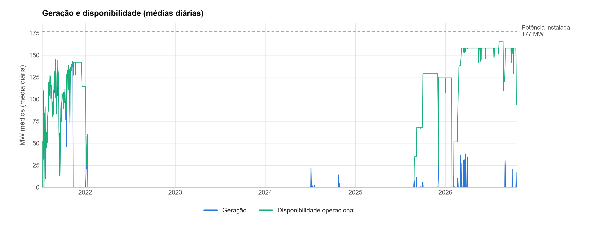
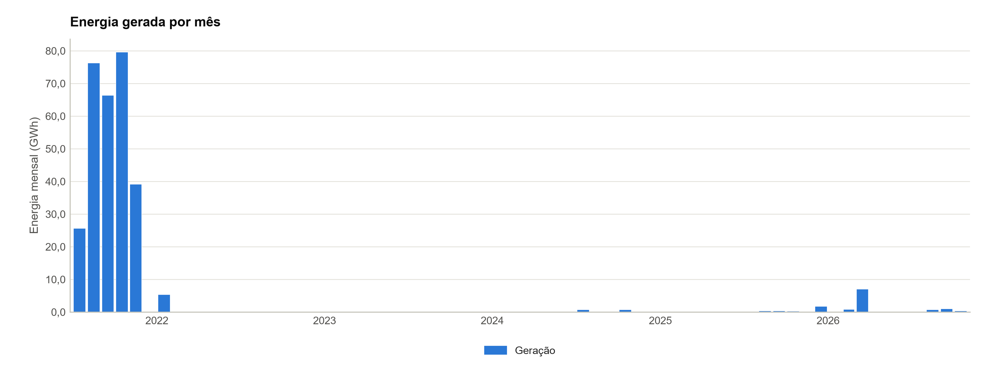
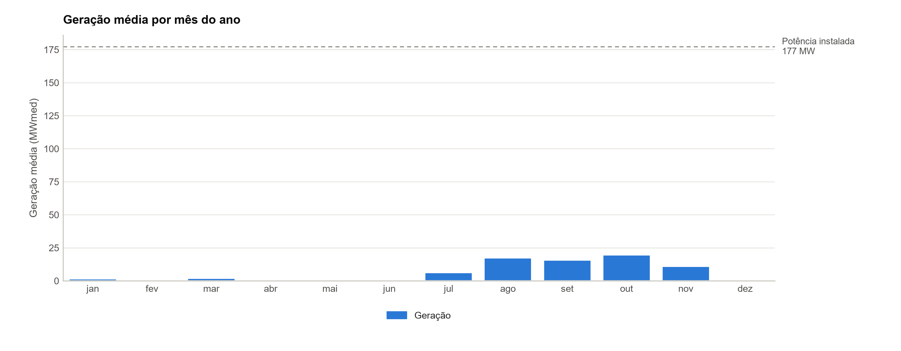
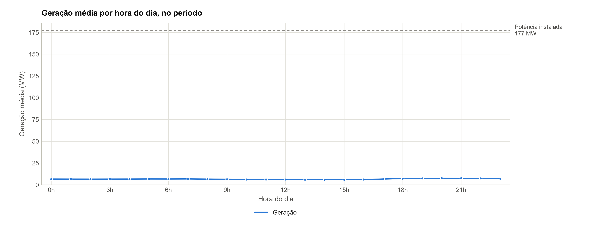
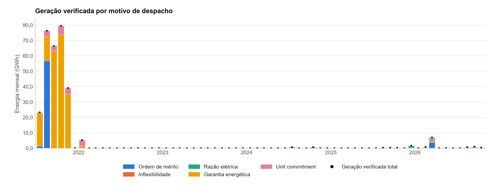
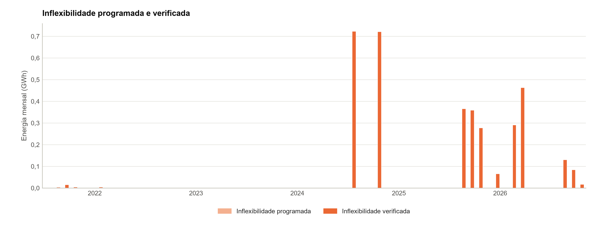
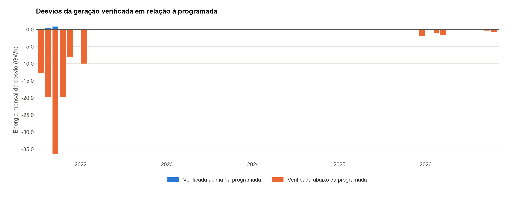
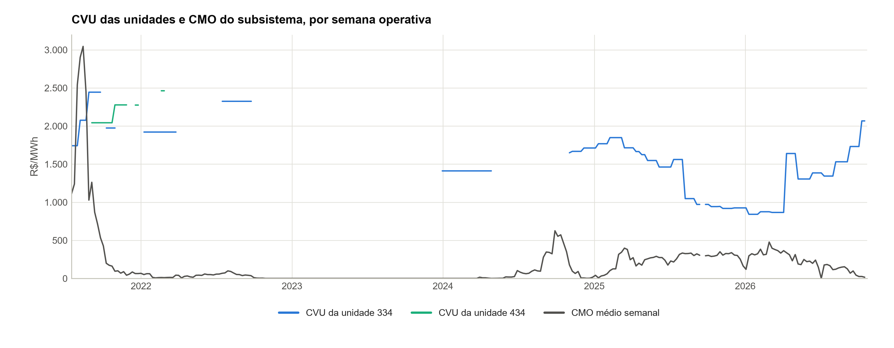
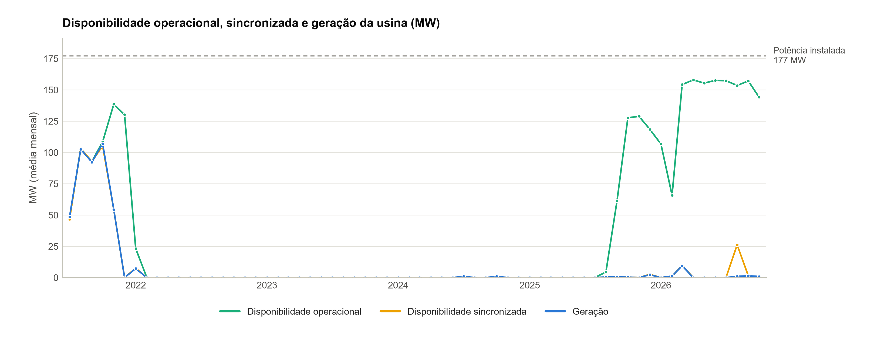

# UTE William Arjona — Análise do desempenho operacional

**Período**: 10/07/2021 00h a 18/10/2026 23h (46.243 registros horários da série de referência, Geração por usina (id ONS MSUTWI))
**Gerado em**: 20/10/2026 09:00

### Identificação nos dados do ONS

| Item | Valor |
| --- | --- |
| Tipo · modalidade | UTE · TIPO I |
| CEG | UTE.GN.MS.027075-0.01 |
| id ONS | MSUTWI |
| Programação diária | MSUTWI |
| Estado | MS |
| Subsistema | SE |
| Códigos de planejamento | 34 (01/2013 a 08/2018); 334 (desde 07/2021); 434 (08/2021 a 01/2026) |
| Agente atual | DELTA GERAÇÃO (proprietário e operador) |

Fonte dos dados: Modalidade das usinas (CEG UTE.GN.MS.027075-0.01), obtido em 20/10/2026; Geração por usina (id ONS MSUTWI), obtido em 20/10/2026; Capacidade de geração (CEG UTE.GN.MS.027075-0.01), obtido em 20/10/2026; Geração térmica por motivo de despacho (CEG UTE.GN.MS.027075-0.01; códigos de planejamento 34, 334, 434), obtido em 20/10/2026.

### Cadastro no ONS

| Item | Valor |
| --- | --- |
| Usina | UTE WILLIAM ARJONA (UTWI) · CEG UTE.GN.MS.027075-0.01 · id ONS MSUTWI |
| Modalidade de operação | TIPO I |
| Centro de operação | COSR-S |
| Ponto de conexão |  |
| Potência autorizada | 177,1 MW |
| Estado · situação na ANEEL | MS · A |
| Homônimos excluídos pelo CEG | 0 |

Fonte dos dados: Modalidade das usinas (CEG UTE.GN.MS.027075-0.01), obtido em 20/10/2026. Conferência: potência autorizada e estado conferidos com os parâmetros do projeto: sem divergência.

### Parâmetros técnicos da usina

| Item | Valor |
| --- | --- |
| Potência instalada | 177,1 MW (5 unidades: 39,2, 39,2, 33,0, 33,1 e 32,7 MW) |
| Combustível | GÁS |
| Início da operação comercial | 2021 |

Fonte dos dados: parâmetros do projeto (origem na tabela de parâmetros).

### Indicadores principais

| Indicador | Valor | Detalhe |
| --- | --- | --- |
| Geração média | 6,6 MWmed | 306,7 GWh em 46.243 horas com valor |
| Horas com despacho | 7,1% | 3.264 de 46.248 horas do despacho com geração programada acima de 1 MW |
| Disponibilidade operacional média | 21,7% | da potência instalada (38,4 MW), nas 46.243 horas com o dado |
| Disponibilidade apurada pelo ONS (DISPF) | 39,7% | média das unidades; TEIFa 30,07% em set/2026 |

Indicadores calculados a partir da série de referência e da disponibilidade publicadas pelo ONS; não substituem os índices regulatórios. Ver notas metodológicas.

Calculado neste relatório a partir de: Geração por usina (id ONS MSUTWI), obtido em 20/10/2026; Disponibilidade por usina (id ONS MSUTWI), obtido em 20/10/2026; Indicadores de disponibilidade por unidade geradora, base mensal (CEG UTE.GN.MS.027075-0.01), obtido em 20/10/2026; Taxas TEIFa e TEIP (CEG UTE.GN.MS.027075-0.01), obtido em 20/10/2026. Conferência: DISPF conferido com as horas por estado operativo (Parâmetros das taxas TEIFa e TEIP): 52 divergências (meses-unidade), listadas na aba ONS_DIVERGENCIAS; TEIFa e TEIP recalculadas conferidas com as publicadas em Taxas TEIFa e TEIP: 0 de 4 meses reproduzidos (diferença máxima de 2,067 p.p.). Sem outra fonte para conferir: geração.

## Sumário

1. [Fonte e cobertura dos dados](#1-fonte-e-cobertura-dos-dados)
2. [Indicadores anuais](#2-indicadores-anuais)
3. [Disponibilidade e geração por ano](#3-disponibilidade-e-geração-por-ano)
4. [Indicadores oficiais do ONS por unidade geradora](#4-indicadores-oficiais-do-ons-por-unidade-geradora)
5. [Série temporal da geração e da disponibilidade](#5-série-temporal-da-geração-e-da-disponibilidade)
6. [Geração mensal e sazonalidade](#6-geração-mensal-e-sazonalidade)
7. [Perfil horário da geração](#7-perfil-horário-da-geração)
8. [Geração por motivo de despacho e inflexibilidade](#8-geração-por-motivo-de-despacho-e-inflexibilidade)
9. [Atendimento ao despacho](#9-atendimento-ao-despacho)
10. [Disponível sem despacho e CVU × CMO](#10-disponível-sem-despacho-e-cvu--cmo)
11. [Programação diária × geração verificada](#11-programação-diária--geração-verificada)
12. [Disponibilidade operacional e sincronizada (ONS)](#12-disponibilidade-operacional-e-sincronizada-ons)
13. [Qualidade dos dados](#13-qualidade-dos-dados)
14. [Conclusão](#14-conclusão)
15. [Notas metodológicas e limitações](#15-notas-metodológicas-e-limitações)

## 1. Fonte e cobertura dos dados

**Cobertura dos dados.** Série de referência: Geração por usina (id ONS MSUTWI), de 10/07/2021 00h a 18/10/2026 23h: 46.243 horas com registro de 46.248 no período (99,99%). 5 horas ausentes, listadas na planilha, sem preenchimento. O período tem 3 trechos, com mudança de modalidade, de composição do conjunto ou de código.

| Item | Valor |
| --- | --- |
| Série de referência | Geração por usina (id ONS MSUTWI) — Portal de Dados Abertos do ONS (https://dados.ons.org.br/dataset/geracao-usina-2) |
| Período | 10/07/2021 00h a 18/10/2026 23h |
| Registros | 46.243 de 46.248 horas do período; 5 horas ausentes em 4 intervalos; 0 horas sem valor |
| Níveis | usina: 46.243 horas |
| Anos parciais | 2021 e 2026 |
| Trechos | 3 (tabela abaixo) |

Fonte dos dados: Geração por usina (id ONS MSUTWI), obtido em 20/10/2026.

### Conjuntos do ONS, nível e identificador

| Conjunto do ONS | Nível | Identificador | Obtenção |
| --- | --- | --- | --- |
| Geração por usina (série de referência) | usina | MSUTWI | obtido em 20/10/2026 |
| Programação diária | usina | MSUTWI | obtido em 20/10/2026 |
| Disponibilidade por usina | usina | MSUTWI | obtido em 20/10/2026 |
| Indicadores de desempenho do ONS | usina | CEG UTE.GN.MS.027075-0.01 | obtido em 20/10/2026 |
| Modalidade das usinas | usina | CEG UTE.GN.MS.027075-0.01 | obtido em 20/10/2026 |

Fonte dos dados: Geração por usina (id ONS MSUTWI), obtido em 20/10/2026; Programação diária (MSUTWI), obtido em 20/10/2026; Disponibilidade por usina (id ONS MSUTWI), obtido em 20/10/2026; Indicadores de disponibilidade por unidade geradora, base mensal (CEG UTE.GN.MS.027075-0.01), obtido em 20/10/2026; Modalidade das usinas (CEG UTE.GN.MS.027075-0.01), obtido em 20/10/2026.

### Trechos do período

| Trecho | Início | Fim | Modalidade | Nível | Composição (CEG) | Tipos |
| --- | --- | --- | --- | --- | --- | --- |
| 1 | 10/07/2021 00h | 31/07/2021 23h | TIPO I | usina |  |  |
| 2 | 01/08/2021 00h | 31/01/2026 23h | TIPO I | usina |  |  |
| 3 | 01/02/2026 00h | 18/10/2026 23h | TIPO I | usina |  |  |

Trecho novo a cada mudança de modalidade, de composição do conjunto ou de código; composição pelos CEGs das usinas do conjunto.

Calculado neste relatório a partir de: Geração por usina (id ONS MSUTWI), obtido em 20/10/2026.

## 2. Indicadores anuais

**Geração.** Geração média de 6,6 MWmed nas 46.243 horas com valor (306.749 MWh); geração até 1 MW em 92,8% das horas; entre os anos completos, maior média em 2022 (0,6 MWmed) e menor em 2023 (0,0 MWmed).

| Ano | Nível | Horas | Com valor | Geração média (MWmed) | Energia (MWh) | Máxima (MW) | Horas até 1 MW | % das horas | Disp. média (MW) | Disp. (% Pinst) | Disp. sem despacho (h) |
| --- | --- | --- | --- | --- | --- | --- | --- | --- | --- | --- | --- |
| 2021* | usina | 4.200 | 4.200 | 68,4 | 287.178 | 154,9 | 1.316 | 31,3% | 106,1 | 59,9% | 1.178 |
| 2022 | usina | 8.760 | 8.760 | 0,6 | 5.384 | 63,7 | 8.592 | 98,1% | 2,0 | 1,1% | 80 |
| 2023 | usina | 8.760 | 8.760 | 0,0 | 0 | 0,0 | 8.760 | 100,0% | 0,0 | 0,0% | 1 |
| 2024 | usina | 8.784 | 8.784 | 0,2 | 1.444 | 43,5 | 8.724 | 99,3% | 0,0 | 0,0% | 0 |
| 2025 | usina | 8.760 | 8.760 | 0,3 | 2.741 | 121,4 | 8.686 | 99,2% | 36,9 | 20,9% | 2.943 |
| 2026* | usina | 6.979 | 6.979 | 1,4 | 10.002 | 154,7 | 6.847 | 98,1% | 141,5 | 79,9% | 6.654 |

\* Ano parcial. Geração média = média das horas com valor; horas até 1 MW = horas com geração até esse limiar, sobre as horas com valor; disp. = disponibilidade operacional média da usina (Disponibilidade por usina); disp. sem despacho = horas disponíveis, sem programação e sem geração no despacho.

Calculado neste relatório a partir de: Geração por usina (id ONS MSUTWI), obtido em 20/10/2026; Disponibilidade por usina (id ONS MSUTWI), obtido em 20/10/2026; parâmetros do projeto (origem na tabela de parâmetros). Sem outra fonte para conferir: geração.

## 3. Disponibilidade e geração por ano

**Disponibilidade.** Disponibilidade operacional média de 38,4 MW (21,7% da potência instalada) e sincronizada de 7,0 MW, nas 46.243 horas com o dado; indisponibilidade total em 32.140 horas (22 eventos); geração acima da disponibilidade declarada em 1.322 horas.

### Disponibilidade e geração da usina por ano

| Ano | Horas com o dado | Disp. operacional (MW) | Disp. (% Pinst) | Disp. sincronizada (MW) | Geração (MW) | Horas indisp. total | Horas paradas disponível | Horas geração > disp. |
| --- | --- | --- | --- | --- | --- | --- | --- | --- |
| 2021* | 4.200 | 106,1 | 59,9% | 68,0 | 68,4 | 142 | 1.180 | 1.214 |
| 2022 | 8.760 | 2,0 | 1,1% | 0,6 | 0,6 | 8.515 | 80 | 20 |
| 2023 | 8.760 | 0,0 | 0,0% | 0,0 | 0,0 | 8.759 | 1 | 0 |
| 2024 | 8.784 | 0,0 | 0,0% | 0,0 | 0,2 | 8.784 | 0 | 60 |
| 2025 | 8.760 | 36,9 | 20,9% | 0,3 | 0,3 | 5.750 | 2.944 | 17 |
| 2026* | 6.979 | 141,5 | 79,9% | 4,1 | 1,4 | 190 | 6.657 | 11 |

\* Ano parcial. Só as horas com a disponibilidade e a geração da usina. Indisponibilidade total = disponibilidade operacional até 0,001 MW; parada disponível = geração até 1 MW com disponibilidade acima desse valor; geração > disp. = regra R7 (tolerância de 1,0 MW).

Calculado neste relatório a partir de: Disponibilidade por usina (id ONS MSUTWI), obtido em 20/10/2026; Geração por usina (id ONS MSUTWI), obtido em 20/10/2026. Sem outra fonte para conferir: disponibilidade sincronizada, geração.

### Indisponibilidade total com pelo menos 24 h

| Início | Fim | Duração (h) | Geração média (MW) |
| --- | --- | --- | --- |
| 30/01/2023 19h | 27/08/2025 16h | 22.558 | 0,07 |
| 11/01/2022 21h | 30/01/2023 17h | 9.213 | 0,00 |
| 30/01/2026 20h | 04/02/2026 17h | 118 | 0,00 |
| 27/01/2026 15h | 30/01/2026 02h | 60 | 0,00 |
| 10/07/2021 00h | 12/07/2021 05h | 54 | 0,49 |
| 24/07/2021 11h | 25/07/2021 16h | 30 | 0,00 |
| 17/07/2021 23h | 19/07/2021 04h | 30 | 0,00 |

Até 15 eventos, os mais longos; a lista completa está na planilha.

Calculado neste relatório a partir de: Disponibilidade por usina (id ONS MSUTWI), obtido em 20/10/2026; Geração por usina (id ONS MSUTWI), obtido em 20/10/2026.

## 4. Indicadores oficiais do ONS por unidade geradora

### Disponibilidade da usina por ano: operacional (Disponibilidade por usina) e DISPF apurado pelo ONS

| Ano | Disp. operacional (% Pinst) | DISPF (média das UGs) | Indisp. programada | Indisp. forçada | Δ DISPF vs ref. GF |
| --- | --- | --- | --- | --- | --- |
| 2021* | 59,9% | 82,7% | 2,3% | 15,0% | – |
| 2022 | 1,1% | 63,7% | 36,0% | 0,4% | – |
| 2023 | 0,0% | 0,0% | 99,1% | 0,9% | – |
| 2024 | 0,0% | 0,0% | 89,4% | 10,6% | – |
| 2025 | 20,9% | 30,8% | 67,3% | 1,8% | – |
| 2026* | 79,9% | 99,1% | 0,8% | 0,0% | – |

\* Ano parcial. DISPF da usina = média das unidades ponderada pela potência e pelas horas da série de referência em cada mês; Δ = diferença para a disponibilidade de referência da garantia física, quando o perfil a informa.

Calculado neste relatório a partir de: Disponibilidade por usina (id ONS MSUTWI), obtido em 20/10/2026; Indicadores de disponibilidade por unidade geradora, base mensal (CEG UTE.GN.MS.027075-0.01), obtido em 20/10/2026. Conferência: DISPF conferido com as horas por estado operativo (Parâmetros das taxas TEIFa e TEIP): 52 divergências (meses-unidade), listadas na aba ONS_DIVERGENCIAS.

### TEIFa e TEIP mais recentes: contribuição de cada unidade e parcela de horas

| Taxa | UG | Parcela | Horas na janela | Contribuição (p.p.) | Participação na taxa |
| --- | --- | --- | --- | --- | --- |
| TEIFa | UG1 | HDF (desligamentos forçados) | 1.804,1 | 3,236 | 10,7% |
| TEIFa | UG1 | HEDF (operação com limitação forçada de potência) | 1.960,5 | 3,516 | 11,7% |
| TEIFa | UG2 | HDF (desligamentos forçados) | 4.165,2 | 7,471 | 24,8% |
| TEIFa | UG2 | HEDF (operação com limitação forçada de potência) | 2.101,0 | 3,768 | 12,5% |
| TEIFa | UG3 | HDF (desligamentos forçados) | 2.522,9 | 3,813 | 12,6% |
| TEIFa | UG3 | HEDF (operação com limitação forçada de potência) | 668,8 | 1,011 | 3,4% |
| TEIFa | UG4 | HDF (desligamentos forçados) | 2.009,1 | 3,046 | 10,1% |
| TEIFa | UG4 | HEDF (operação com limitação forçada de potência) | 1.659,3 | 2,516 | 8,3% |
| TEIFa | UG5 | HDF (desligamentos forçados) | 897,6 | 1,344 | 4,5% |
| TEIFa | UG5 | HEDF (operação com limitação forçada de potência) | 288,0 | 0,431 | 1,4% |
| TEIP | UG1 | HDP (desligamentos programados) | 30.817,7 | 15,862 | 22,2% |
| TEIP | UG1 | HEDP (operação com limitação programada de potência) | 3,1 | 0,002 | 0,0% |
| TEIP | UG2 | HDP (desligamentos programados) | 28.527,3 | 14,683 | 20,6% |
| TEIP | UG2 | HEDP (operação com limitação programada de potência) | 9,0 | 0,005 | 0,0% |
| TEIP | UG3 | HDP (desligamentos programados) | 31.737,2 | 13,766 | 19,3% |
| TEIP | UG3 | HEDP (operação com limitação programada de potência) | 0,0 | 0,000 | 0,0% |
| TEIP | UG4 | HDP (desligamentos programados) | 31.522,9 | 13,714 | 19,2% |
| TEIP | UG4 | HEDP (operação com limitação programada de potência) | 3,8 | 0,002 | 0,0% |
| TEIP | UG5 | HDP (desligamentos programados) | 30.872,7 | 13,268 | 18,6% |
| TEIP | UG5 | HEDP (operação com limitação programada de potência) | 3,8 | 0,002 | 0,0% |

Calculado neste relatório a partir de: Parâmetros das taxas TEIFa e TEIP (CEG UTE.GN.MS.027075-0.01), obtido em 20/10/2026; Taxas TEIFa e TEIP (CEG UTE.GN.MS.027075-0.01), obtido em 20/10/2026. Conferência: TEIFa e TEIP recalculadas conferidas com as publicadas em Taxas TEIFa e TEIP: 0 de 4 meses reproduzidos (diferença máxima de 2,067 p.p.).

### Indicadores anuais por unidade geradora (base anual do ONS)

| Ano | UG | DISPF | INDISPPF | INDISPFF | DMDFF (h) |
| --- | --- | --- | --- | --- | --- |
| 2021* | UG1 | 91,63% | 0,62% | 7,75% | 19,5 |
| 2021* | UG2 | 84,75% | 0,40% | 14,85% | 20,4 |
| 2021* | UG3 | 64,08% | 9,80% | 26,11% | 28,8 |
| 2021* | UG4 | 89,60% | 2,42% | 7,98% | 5,2 |
| 2021* | UG5 | 75,98% | 1,78% | 22,24% | 15,8 |
| 2022 | UG1 | 63,72% | 35,78% | 0,50% | 10,9 |
| 2022 | UG2 | 63,80% | 35,78% | 0,42% | 37,2 |
| 2022 | UG3 | 62,85% | 36,69% | 0,46% | 40,1 |
| 2022 | UG4 | 63,74% | 35,80% | 0,46% | 40,1 |
| 2022 | UG5 | 64,17% | 35,80% | 0,04% | 3,1 |
| 2023 | UG1 | 0,00% | 98,53% | 1,47% | 129,0 |
| 2023 | UG2 | 0,00% | 100,00% | 0,00% | 0,0 |
| 2023 | UG3 | 0,00% | 98,52% | 1,48% | 130,0 |
| 2023 | UG4 | 0,00% | 98,54% | 1,46% | 128,0 |
| 2023 | UG5 | 0,00% | 100,00% | 0,00% | 0,0 |
| 2024 | UG1 | 0,00% | 82,14% | 17,86% | 523,1 |
| 2024 | UG2 | 0,00% | 100,00% | 0,00% | 0,0 |
| 2024 | UG3 | 0,00% | 82,14% | 17,86% | 523,1 |
| 2024 | UG4 | 0,00% | 82,14% | 17,86% | 523,1 |
| 2024 | UG5 | 0,00% | 100,00% | 0,00% | 0,0 |
| 2025 | UG1 | 33,97% | 65,39% | 0,64% | 18,7 |
| 2025 | UG2 | 31,60% | 68,15% | 0,25% | 10,8 |
| 2025 | UG3 | 24,60% | 74,85% | 0,56% | 48,8 |
| 2025 | UG4 | 24,72% | 75,09% | 0,20% | 17,4 |
| 2025 | UG5 | 38,63% | 53,27% | 8,10% | 354,7 |
| 2026* | UG1 | 97,40% | 2,60% | 0,00% | 0,0 |
| 2026* | UG2 | 99,55% | 0,45% | 0,00% | 0,0 |
| 2026* | UG3 | 99,51% | 0,30% | 0,19% | 12,6 |
| 2026* | UG4 | 99,81% | 0,19% | 0,00% | 0,0 |
| 2026* | UG5 | 99,72% | 0,28% | 0,00% | 0,0 |

\* Ano parcial. DISPF, INDISPPF e INDISPFF em % do tempo; DMDFF = duração média dos desligamentos forçados (h).

Fonte dos dados: Indicadores de disponibilidade por unidade geradora, base anual (CEG UTE.GN.MS.027075-0.01), obtido em 20/10/2026. Conferência: DISPF conferido com as horas por estado operativo (Parâmetros das taxas TEIFa e TEIP): 52 divergências (meses-unidade), listadas na aba ONS_DIVERGENCIAS.

### Horas por estado operativo, por ano e unidade geradora

| Ano | UG | Meses | HP | HS | HRD | HDP | HDF | HDCE | HEDP | HEDF |
| --- | --- | --- | --- | --- | --- | --- | --- | --- | --- | --- |
| 2021* | UG1 | 6 | 4.032 | 2.009 | 952 | 25 | 312 | 4 | 3 | 726 |
| 2021* | UG2 | 6 | 4.128 | 1.775 | 915 | 16 | 613 | 2 | 9 | 797 |
| 2021* | UG3 | 5 | 2.976 | 772 | 712 | 292 | 777 | 0 | 0 | 423 |
| 2021* | UG4 | 6 | 4.032 | 1.671 | 901 | 98 | 322 | 4 | 4 | 1.033 |
| 2021* | UG5 | 6 | 4.200 | 1.728 | 1.032 | 75 | 934 | 4 | 4 | 423 |
| 2022 | UG1 | 12 | 8.760 | 18 | 126 | 8.520 | 44 | 0 | 0 | 52 |
| 2022 | UG2 | 12 | 8.760 | 93 | 61 | 4.429 | 4.120 | 0 | 0 | 57 |
| 2022 | UG3 | 12 | 8.760 | 0 | 0 | 8.513 | 247 | 0 | 0 | 0 |
| 2022 | UG4 | 12 | 8.760 | 0 | 60 | 8.502 | 178 | 0 | 0 | 20 |
| 2022 | UG5 | 12 | 8.760 | 39 | 71 | 8.633 | 3 | 0 | 0 | 14 |
| 2023 | UG1 | 12 | 8.760 | 0 | 0 | 8.631 | 129 | 0 | 0 | 0 |
| 2023 | UG2 | 12 | 8.760 | 0 | 0 | 8.760 | 0 | 0 | 0 | 0 |
| 2023 | UG3 | 12 | 8.760 | 0 | 0 | 8.630 | 130 | 0 | 0 | 0 |
| 2023 | UG4 | 12 | 8.760 | 0 | 0 | 8.632 | 128 | 0 | 0 | 0 |
| 2023 | UG5 | 12 | 8.760 | 0 | 0 | 8.760 | 0 | 0 | 0 | 0 |
| 2024 | UG1 | 12 | 8.784 | 0 | 0 | 7.215 | 1.569 | 0 | 0 | 0 |
| 2024 | UG2 | 12 | 8.784 | 0 | 0 | 8.784 | 0 | 0 | 0 | 0 |
| 2024 | UG3 | 12 | 8.784 | 0 | 0 | 7.215 | 1.569 | 0 | 0 | 0 |
| 2024 | UG4 | 12 | 8.784 | 0 | 0 | 7.215 | 1.569 | 0 | 0 | 0 |
| 2024 | UG5 | 12 | 8.784 | 0 | 0 | 8.784 | 0 | 0 | 0 | 0 |
| 2025 | UG1 | 12 | 8.760 | 12 | 2.560 | 5.728 | 56 | 0 | 0 | 403 |
| 2025 | UG2 | 12 | 8.760 | 19 | 2.346 | 5.970 | 22 | 0 | 0 | 403 |
| 2025 | UG3 | 12 | 8.760 | 14 | 2.057 | 6.556 | 49 | 0 | 0 | 84 |
| 2025 | UG4 | 12 | 8.760 | 26 | 1.843 | 6.577 | 17 | 0 | 0 | 297 |
| 2025* | UG5 | 8 | 5.376 | 0 | 0 | 4.667 | 709 | 0 | 0 | 0 |
| 2026* | UG1 | 9 | 6.552 | 65 | 4.711 | 719 | 0 | 0 | 0 | 1.057 |
| 2026* | UG2 | 9 | 6.552 | 524 | 4.322 | 578 | 9 | 0 | 0 | 1.118 |
| 2026* | UG3 | 9 | 6.552 | 71 | 5.617 | 551 | 85 | 0 | 0 | 228 |
| 2026* | UG4 | 9 | 6.552 | 53 | 5.150 | 596 | 39 | 0 | 0 | 715 |
| 2026* | UG5 | 8 | 5.232 | 43 | 5.146 | 19 | 0 | 0 | 0 | 24 |

\* Ano parcial.

Fonte dos dados: Parâmetros das taxas TEIFa e TEIP (CEG UTE.GN.MS.027075-0.01), obtido em 20/10/2026. Conferência: DISPF conferido com as horas por estado operativo (Parâmetros das taxas TEIFa e TEIP): 52 divergências (meses-unidade), listadas na aba ONS_DIVERGENCIAS.

### Meses em que o indicador DISPF e as horas do TEIP divergem

| Mês | UG | HS | HRD | HDP (TEIP) | Programadas pelo DISPF (h) | HDF (TEIP) | Forçadas pelo DISPF (h) |
| --- | --- | --- | --- | --- | --- | --- | --- |
| jan/2022 | UG1 | 18,1 | 125,8 | 504,4 | 0,0 | 43,8 | 43,7 |
| jan/2022 | UG2 | 92,9 | 60,8 | 13,4 | 0,0 | 520,4 | 37,2 |
| jan/2022 | UG3 | 0,0 | 0,0 | 497,3 | 80,0 | 246,7 | 40,1 |
| jan/2022 | UG4 | 0,0 | 60,0 | 486,1 | 0,0 | 177,9 | 40,1 |
| jan/2022 | UG5 | 39,3 | 70,8 | 617,1 | 0,0 | 3,1 | 3,1 |
| fev/2022 | UG1 | 0,0 | 0,0 | 672,0 | 0,0 | 0,0 | 0,0 |
| fev/2022 | UG2 | 0,0 | 0,0 | 0,0 | 0,0 | 672,0 | 0,0 |
| fev/2022 | UG3 | 0,0 | 0,0 | 672,0 | 0,0 | 0,0 | 0,0 |
| fev/2022 | UG4 | 0,0 | 0,0 | 672,0 | 0,0 | 0,0 | 0,0 |
| fev/2022 | UG5 | 0,0 | 0,0 | 672,0 | 0,0 | 0,0 | 0,0 |
| mar/2022 | UG1 | 0,0 | 0,0 | 744,0 | 0,0 | 0,0 | 0,0 |
| mar/2022 | UG2 | 0,0 | 0,0 | 0,0 | 0,0 | 744,0 | 0,0 |
| mar/2022 | UG3 | 0,0 | 0,0 | 744,0 | 0,0 | 0,0 | 0,0 |
| mar/2022 | UG4 | 0,0 | 0,0 | 744,0 | 0,0 | 0,0 | 0,0 |
| mar/2022 | UG5 | 0,0 | 0,0 | 744,0 | 0,0 | 0,0 | 0,0 |
| abr/2022 | UG1 | 0,0 | 0,0 | 720,0 | 0,0 | 0,0 | 0,0 |
| abr/2022 | UG2 | 0,0 | 0,0 | 0,0 | 0,0 | 720,0 | 0,0 |
| abr/2022 | UG3 | 0,0 | 0,0 | 720,0 | 0,0 | 0,0 | 0,0 |
| abr/2022 | UG4 | 0,0 | 0,0 | 720,0 | 1,9 | 0,0 | 0,0 |
| abr/2022 | UG5 | 0,0 | 0,0 | 720,0 | 1,9 | 0,0 | 0,0 |
| mai/2022 | UG1 | 0,0 | 0,0 | 744,0 | 0,0 | 0,0 | 0,0 |
| mai/2022 | UG2 | 0,0 | 0,0 | 0,0 | 0,0 | 744,0 | 0,0 |
| mai/2022 | UG3 | 0,0 | 0,0 | 744,0 | 0,0 | 0,0 | 0,0 |
| mai/2022 | UG4 | 0,0 | 0,0 | 744,0 | 0,0 | 0,0 | 0,0 |
| mai/2022 | UG5 | 0,0 | 0,0 | 744,0 | 0,0 | 0,0 | 0,0 |
| jun/2022 | UG1 | 0,0 | 0,0 | 720,0 | 0,0 | 0,0 | 0,0 |
| jun/2022 | UG2 | 0,0 | 0,0 | 0,0 | 0,0 | 720,0 | 0,0 |
| jun/2022 | UG3 | 0,0 | 0,0 | 720,0 | 0,0 | 0,0 | 0,0 |
| jun/2022 | UG4 | 0,0 | 0,0 | 720,0 | 0,0 | 0,0 | 0,0 |
| jun/2022 | UG5 | 0,0 | 0,0 | 720,0 | 0,0 | 0,0 | 0,0 |
| jul/2022 | UG1 | 0,0 | 0,0 | 744,0 | 0,0 | 0,0 | 0,0 |
| jul/2022 | UG2 | 0,0 | 0,0 | 744,0 | 0,0 | 0,0 | 0,0 |
| jul/2022 | UG3 | 0,0 | 0,0 | 744,0 | 0,0 | 0,0 | 0,0 |
| jul/2022 | UG4 | 0,0 | 0,0 | 744,0 | 0,0 | 0,0 | 0,0 |
| jul/2022 | UG5 | 0,0 | 0,0 | 744,0 | 0,0 | 0,0 | 0,0 |
| ago/2022 | UG1 | 0,0 | 0,0 | 744,0 | 206,0 | 0,0 | 0,0 |
| ago/2022 | UG2 | 0,0 | 0,0 | 744,0 | 206,0 | 0,0 | 0,0 |
| ago/2022 | UG3 | 0,0 | 0,0 | 744,0 | 206,0 | 0,0 | 0,0 |
| ago/2022 | UG4 | 0,0 | 0,0 | 744,0 | 206,0 | 0,0 | 0,0 |
| ago/2022 | UG5 | 0,0 | 0,0 | 744,0 | 206,0 | 0,0 | 0,0 |
| ago/2025 | UG5 | 0,0 | 0,0 | 288,0 | 111,5 | 0,0 | 0,0 |
| jan/2026 | UG1 | 0,0 | 514,2 | 105,0 | 0,0 | 0,0 | 0,0 |
| jan/2026 | UG2 | 0,0 | 546,6 | 105,0 | 0,0 | 0,0 | 0,0 |
| jan/2026 | UG3 | 0,0 | 594,1 | 81,5 | 0,0 | 36,1 | 12,6 |
| jan/2026 | UG4 | 0,0 | 535,7 | 105,0 | 0,0 | 0,0 | 0,0 |
| fev/2026 | UG1 | 5,0 | 153,1 | 443,7 | 0,0 | 0,0 | 0,0 |
| fev/2026 | UG2 | 6,4 | 136,8 | 444,0 | 0,0 | 2,0 | 0,0 |
| fev/2026 | UG3 | 3,7 | 153,5 | 449,5 | 0,0 | 48,0 | 0,0 |
| fev/2026 | UG4 | 4,2 | 174,6 | 450,2 | 0,0 | 0,4 | 0,0 |
| mar/2026 | UG2 | 29,5 | 538,7 | 0,0 | 0,0 | 7,2 | 0,0 |
| mar/2026 | UG4 | 40,4 | 609,0 | 0,0 | 0,0 | 3,2 | 0,0 |
| mai/2026 | UG4 | 0,0 | 607,1 | 27,9 | 0,0 | 35,3 | 0,0 |

Fonte dos dados: Indicadores de disponibilidade por unidade geradora, base mensal (CEG UTE.GN.MS.027075-0.01), obtido em 20/10/2026; Parâmetros das taxas TEIFa e TEIP (CEG UTE.GN.MS.027075-0.01), obtido em 20/10/2026. Conferência: DISPF conferido com as horas por estado operativo (Parâmetros das taxas TEIFa e TEIP): 52 divergências (meses-unidade), listadas na aba ONS_DIVERGENCIAS.

## 5. Série temporal da geração e da disponibilidade

Médias diárias da geração e da disponibilidade operacional da usina, de 10/07/2021 a 18/10/2026. Linha tracejada: potência instalada da usina (177 MW).

Calculado neste relatório a partir de: Geração por usina (id ONS MSUTWI), obtido em 20/10/2026; Disponibilidade por usina (id ONS MSUTWI), obtido em 20/10/2026. Sem outra fonte para conferir: geração.

## 6. Geração mensal e sazonalidade

Energia gerada em cada mês (GWh), pela soma das horas com valor. Maior energia mensal: 79,6 GWh em out/2021.

Calculado neste relatório a partir de: Geração por usina (id ONS MSUTWI), obtido em 20/10/2026. Sem outra fonte para conferir: geração.

Geração média por mês do ano, só com a série de pelo menos 12 meses distintos; cada barra junta os anos do período com aquele mês.

Calculado neste relatório a partir de: Geração por usina (id ONS MSUTWI), obtido em 20/10/2026. Sem outra fonte para conferir: geração.

## 7. Perfil horário da geração

Geração média por hora do dia, no período, sobre as horas com valor.

Calculado neste relatório a partir de: Geração por usina (id ONS MSUTWI), obtido em 20/10/2026. Sem outra fonte para conferir: geração.

## 8. Geração por motivo de despacho e inflexibilidade

**Despacho por motivo.** Geração verificada do despacho de 304.357 MWh de 10/07/2021 a 18/10/2026 (unidades de planejamento 334 e 434); geração programada em 3.264 horas. Maior motivo verificado: garantia energética, com 69,6% da geração verificada.

Despacho de 10/07/2021 a 18/10/2026 (46.248 horas), com as unidades de planejamento 334 e 434.

### Geração por motivo de despacho no período

| Motivo | Programada (MWh) | Verificada (MWh) | % da programada | % da verificada |
| --- | --- | --- | --- | --- |
| Geração total | 412.027 | 304.357 | 100,0% | 100,0% |
| Ordem de mérito | 78.848 | 62.378 | 19,1% | 20,5% |
| Inflexibilidade | 0 | 3.524 | 0,0% | 1,2% |
| Razão elétrica | 5.488 | 2.940 | 1,3% | 1,0% |
| Garantia energética | 298.210 | 211.904 | 72,4% | 69,6% |
| Unit commitment | 29.218 | 23.611 | 7,1% | 7,8% |
| Inflexibilidade pura (detalhe) | 0 | 3.512 | 0,0% | 1,2% |
| Inflexibilidade embutida no mérito (detalhe) | 0 | 12 | 0,0% | 0,0% |
| Ordem de demérito acima da inflexibilidade (detalhe) | 78.848 | 62.378 | 19,1% | 20,5% |
| Ordem de demérito de referência (detalhe) | 89.544 | — | 21,7% | — |
| Constrained-off (detalhe) | 3.048 | 2.379 | 0,7% | 0,8% |

Motivos e totais como publicados pelo ONS, somadas as unidades de planejamento. Os motivos podem se sobrepor (os marcados como detalhe compõem ou se sobrepõem a outros), e a soma das parcelas pode diferir de 100 %; a parcela é sobre a geração total publicada. Só os motivos com energia no período.

Calculado neste relatório a partir de: Geração térmica por motivo de despacho (CEG UTE.GN.MS.027075-0.01; códigos de planejamento 34, 334, 434), obtido em 20/10/2026. Conferência: geração verificada da Geração térmica por motivo de despacho conferida com Geração por usina (G4): 46.121 de 46.243 horas coincidentes (99,7%), 122 divergências, listadas na aba CONF_G4_DIVERGENCIAS, 5 horas só numa das fontes. Sem outra fonte para conferir: motivos de despacho.

### Geração programada e verificada do despacho por ano

| Ano | Programada (MWh) | Verificada (MWh) | Horas com despacho | Inflexibilidade programada (MWh) | Inflexibilidade verificada (MWh) |
| --- | --- | --- | --- | --- | --- |
| 2021* | 380.210 | 284.786 | 2.924 | 0 | 23 |
| 2022 | 15.392 | 5.384 | 197 | 0 | 4 |
| 2023 | 0 | 0 | 0 | 0 | 0 |
| 2024 | 0 | 1.444 | 0 | 0 | 1.444 |
| 2025 | 3.548 | 2.741 | 32 | 0 | 1.067 |
| 2026* | 12.876 | 10.002 | 111 | 0 | 985 |

\* Ano parcial. Horas com despacho = horas com geração programada acima de 1 MW.

Calculado neste relatório a partir de: Geração térmica por motivo de despacho (CEG UTE.GN.MS.027075-0.01; códigos de planejamento 34, 334, 434), obtido em 20/10/2026. Conferência: programação diária conferida com o programado da Geração térmica por motivo de despacho (G3): 5.760 de 5.760 horas coincidentes (100,0%); geração verificada da Geração térmica por motivo de despacho conferida com Geração por usina (G4): 46.121 de 46.243 horas coincidentes (99,7%), 122 divergências, listadas na aba CONF_G4_DIVERGENCIAS, 5 horas só numa das fontes.

Geração verificada mensal por motivo de despacho (GWh), de jul/2021 a out/2026, somadas as unidades de planejamento; o ponto marca a geração verificada total publicada.

Calculado neste relatório a partir de: Geração térmica por motivo de despacho (CEG UTE.GN.MS.027075-0.01; códigos de planejamento 34, 334, 434), obtido em 20/10/2026. Conferência: geração verificada da Geração térmica por motivo de despacho conferida com Geração por usina (G4): 46.121 de 46.243 horas coincidentes (99,7%), 122 divergências, listadas na aba CONF_G4_DIVERGENCIAS, 5 horas só numa das fontes. Sem outra fonte para conferir: motivos de despacho.

Inflexibilidade programada e verificada por mês (GWh), de jul/2021 a out/2026.

Calculado neste relatório a partir de: Geração térmica por motivo de despacho (CEG UTE.GN.MS.027075-0.01; códigos de planejamento 34, 334, 434), obtido em 20/10/2026. Sem outra fonte para conferir: motivos de despacho.

## 9. Atendimento ao despacho

**Atendimento ao despacho.** Nas 3.264 horas com geração programada, a verificada ficou mais de 5 MW abaixo da programada em 2.821 horas (112.233 MWh) e acima em 86 horas (1.828 MWh); sem programação, geração acima de 5 MW em 114 horas.

### Atendimento ao despacho por ano

| Ano | Horas com programação | Horas abaixo | Energia abaixo (MWh) | Horas acima | Energia acima (MWh) | Horas sem programação, com geração | Energia sem programação (MWh) |
| --- | --- | --- | --- | --- | --- | --- | --- |
| 2021* | 2.924 | 2.604 | 96.590 | 75 | 1.506 | 0 | 0 |
| 2022 | 197 | 112 | 9.998 | 0 | 0 | 0 | 0 |
| 2023 | 0 | 0 | 0 | 0 | 0 | 0 | 0 |
| 2024 | 0 | 0 | 0 | 0 | 0 | 53 | 1.424 |
| 2025 | 32 | 27 | 1.868 | 3 | 57 | 42 | 989 |
| 2026* | 111 | 78 | 3.777 | 8 | 265 | 19 | 615 |

\* Ano parcial. Nas horas com geração programada acima de 1 MW, desvio = verificada − programada; abaixo e acima = desvio além de 5 MW. Sem programação, com geração = programada até 1 MW e verificada mais de 5 MW acima dela.

Calculado neste relatório a partir de: Geração térmica por motivo de despacho (CEG UTE.GN.MS.027075-0.01; códigos de planejamento 34, 334, 434), obtido em 20/10/2026. Conferência: programação diária conferida com o programado da Geração térmica por motivo de despacho (G3): 5.760 de 5.760 horas coincidentes (100,0%); geração verificada da Geração térmica por motivo de despacho conferida com Geração por usina (G4): 46.121 de 46.243 horas coincidentes (99,7%), 122 divergências, listadas na aba CONF_G4_DIVERGENCIAS, 5 horas só numa das fontes.

### Maiores desvios entre a geração verificada e a programada

| Hora | Programada (MW) | Verificada (MW) | Desvio (MW) |
| --- | --- | --- | --- |
| 10/09/2021 10h | 177,0 | 0,0 | -177,0 |
| 10/09/2021 11h | 177,0 | 0,0 | -177,0 |
| 04/01/2022 09h | 177,0 | 0,0 | -177,0 |
| 04/01/2022 10h | 177,0 | 0,0 | -177,0 |
| 06/01/2022 10h | 177,0 | 0,0 | -177,0 |
| 06/01/2022 11h | 177,0 | 0,0 | -177,0 |
| 06/01/2022 12h | 177,0 | 0,0 | -177,0 |
| 06/01/2022 13h | 177,0 | 0,0 | -177,0 |
| 06/01/2022 14h | 177,0 | 0,0 | -177,0 |
| 06/01/2022 15h | 177,0 | 0,0 | -177,0 |
| 06/01/2022 16h | 177,0 | 0,0 | -177,0 |
| 06/01/2022 17h | 177,0 | 0,0 | -177,0 |
| 06/01/2022 18h | 177,0 | 0,0 | -177,0 |
| 06/01/2022 19h | 177,0 | 0,0 | -177,0 |
| 06/01/2022 09h | 177,0 | 6,8 | -170,2 |

Até 15 horas, as de maior desvio absoluto; a lista completa está na planilha.

Fonte dos dados: Geração térmica por motivo de despacho (CEG UTE.GN.MS.027075-0.01; códigos de planejamento 34, 334, 434), obtido em 20/10/2026. Conferência: geração verificada da Geração térmica por motivo de despacho conferida com Geração por usina (G4): 46.121 de 46.243 horas coincidentes (99,7%), 122 divergências, listadas na aba CONF_G4_DIVERGENCIAS, 5 horas só numa das fontes.

Energia mensal das horas com a geração verificada mais de 5 MW abaixo (barras para baixo) e acima (para cima) da programada, de jul/2021 a out/2026.

Calculado neste relatório a partir de: Geração térmica por motivo de despacho (CEG UTE.GN.MS.027075-0.01; códigos de planejamento 34, 334, 434), obtido em 20/10/2026. Conferência: programação diária conferida com o programado da Geração térmica por motivo de despacho (G3): 5.760 de 5.760 horas coincidentes (100,0%); geração verificada da Geração térmica por motivo de despacho conferida com Geração por usina (G4): 46.121 de 46.243 horas coincidentes (99,7%), 122 divergências, listadas na aba CONF_G4_DIVERGENCIAS, 5 horas só numa das fontes.

## 10. Disponível sem despacho e CVU × CMO

**Disponível sem despacho.** Disponível, sem programação e sem geração em 10.856 das 46.243 horas com a disponibilidade e o despacho (23,5%), com a potência disponível média de 134,0 MW.

**CVU e CMO.** Unidade 334: CVU abaixo do CMO em 4 e acima em 154 das 274 semanas; unidade 434: CVU abaixo do CMO em 0 e acima em 17 das 267 semanas; nas semanas com algum CVU abaixo do CMO, 0 horas disponíveis sem despacho.

### Horas disponíveis sem despacho por ano

| Ano | Horas com disponibilidade e despacho | Horas disponíveis sem despacho | % das horas | Potência disponível média nelas (MW) |
| --- | --- | --- | --- | --- |
| 2021* | 4.200 | 1.178 | 28,0% | 133,7 |
| 2022 | 8.760 | 80 | 0,9% | 114,5 |
| 2023 | 8.760 | 1 | 0,0% | 3,0 |
| 2024 | 8.784 | 0 | 0,0% | — |
| 2025 | 8.760 | 2.943 | 33,6% | 108,3 |
| 2026* | 6.979 | 6.654 | 95,3% | 145,7 |

\* Ano parcial. Disponibilidade operacional acima de 0,001 MW, com programação e geração até 1 MW.

Calculado neste relatório a partir de: Disponibilidade por usina (id ONS MSUTWI), obtido em 20/10/2026; Geração térmica por motivo de despacho (CEG UTE.GN.MS.027075-0.01; códigos de planejamento 34, 334, 434), obtido em 20/10/2026. Conferência: geração verificada da Geração térmica por motivo de despacho conferida com Geração por usina (G4): 46.121 de 46.243 horas coincidentes (99,7%), 122 divergências, listadas na aba CONF_G4_DIVERGENCIAS, 5 horas só numa das fontes.

### CVU de cada unidade × CMO médio semanal do subsistema

| Unidade de planejamento | Semanas | CVU abaixo do CMO (semanas) | Geração nessas semanas (MWh) | CVU acima do CMO (semanas) | Geração nessas semanas (MWh) | CVU igual ao CMO (semanas) | Sem comparação (semanas) |
| --- | --- | --- | --- | --- | --- | --- | --- |
| 334 | 274 | 4 | 66.405 | 154 | 83.885 | 0 | 116 |
| 434 | 267 | 0 | 0 | 17 | 145.401 | 0 | 250 |

Por semana operativa (sábado a sexta). CVU da revisão mais recente; CVU ausente, zero ou negativo fica sem comparação. A comparação não avalia o despacho.

Calculado neste relatório a partir de: CVU das usinas térmicas (códigos de planejamento 34, 334, 434), obtido em 20/10/2026; CMO semanal (subsistema SE, agregado), obtido em 20/10/2026; Geração térmica por motivo de despacho (CEG UTE.GN.MS.027075-0.01; códigos de planejamento 34, 334, 434), obtido em 20/10/2026. Sem outra fonte para conferir: CVU e CMO.

CVU semanal de cada unidade de planejamento e CMO médio semanal do subsistema SE (R$/MWh), de jul/2021 a out/2026; a linha se interrompe nas semanas com CVU ausente, zero ou negativo.

Calculado neste relatório a partir de: CVU das usinas térmicas (códigos de planejamento 34, 334, 434), obtido em 20/10/2026; CMO semanal (subsistema SE, agregado), obtido em 20/10/2026. Sem outra fonte para conferir: CVU e CMO.

## 11. Programação diária × geração verificada

**Programação diária do ONS.** Nas 5.760 horas com programação e geração verificada, geração verificada média de 1,6 MW e programada de 2,0 MW (desvio médio absoluto de 0,7 MW; correlação de 0,93); 3 horas com geração até 1 MW e programação acima de 5 MW.

Programação diária do ONS (usina) × geração verificada, de 13/02/2026 a 18/10/2026: 5.760 horas comuns; correlação de 0,93; 20 dias sem arquivo de programação.

### Geração programada × verificada por mês

| Mês | Horas comuns | Verificada (MW) | Programada (MW) | Desvio médio (MW) | Desvio absoluto (MW) | Horas parada c/ programação |
| --- | --- | --- | --- | --- | --- | --- |
| fev/2026 | 336 | 1,5 | 2,2 | -0,7 | 2,3 | 0 |
| mar/2026 | 696 | 9,1 | 10,6 | -1,5 | 2,7 | 0 |
| abr/2026 | 696 | 0,0 | 0,0 | 0,0 | 0,0 | 0 |
| mai/2026 | 720 | 0,0 | 0,0 | 0,0 | 0,0 | 0 |
| jun/2026 | 672 | 0,0 | 0,0 | 0,0 | 0,0 | 0 |
| jul/2026 | 744 | 0,0 | 0,0 | 0,0 | 0,0 | 0 |
| ago/2026 | 744 | 1,0 | 1,2 | -0,2 | 0,6 | 1 |
| set/2026 | 720 | 1,4 | 1,7 | -0,3 | 0,6 | 1 |
| out/2026 | 432 | 0,9 | 2,5 | -1,5 | 1,6 | 1 |

Horas comuns às duas fontes, no mesmo nível. Desvio = verificada − programada; horas parada c/ programação = geração até 1 MW com programação acima de 5 MW.

Calculado neste relatório a partir de: Programação diária (MSUTWI), obtido em 20/10/2026; Geração por usina (id ONS MSUTWI), obtido em 20/10/2026. Sem outra fonte para conferir: programação diária, geração.

### Horas consecutivas com geração até 1 MW e programação acima de 5 MW

| Início | Fim | Duração (h) | Programação média (MW) |
| --- | --- | --- | --- |
| 31/08/2026 16h | 31/08/2026 16h | 1 | 20,0 |
| 01/09/2026 17h | 01/09/2026 17h | 1 | 90,0 |
| 15/10/2026 16h | 15/10/2026 16h | 1 | 20,0 |

Até 15 eventos, os mais longos; a lista completa está na planilha.

Calculado neste relatório a partir de: Programação diária (MSUTWI), obtido em 20/10/2026; Geração por usina (id ONS MSUTWI), obtido em 20/10/2026. Sem outra fonte para conferir: programação diária, geração.

## 12. Disponibilidade operacional e sincronizada (ONS)

Médias mensais da disponibilidade operacional e sincronizada publicadas pelo ONS e da geração da usina, nas horas com os dois dados. Linha tracejada: potência instalada (177 MW).

Calculado neste relatório a partir de: Disponibilidade por usina (id ONS MSUTWI), obtido em 20/10/2026; Geração por usina (id ONS MSUTWI), obtido em 20/10/2026. Sem outra fonte para conferir: disponibilidade sincronizada.

## 13. Qualidade dos dados

**Qualidade dos dados.** 1.322 horas sinalizadas (2,86% das horas; R7, geração acima da disponibilidade declarada: 1.322 h), mantidas na base e nos totais.

### Horas sinalizadas na base horária

| Código | Descrição | Horas | % das horas |
| --- | --- | --- | --- |
| R7 | geração acima da disponibilidade declarada | 1.322 | 2,86% |

Sinalização não exclui o registro: as horas ficam na base e nos totais.

Calculado neste relatório a partir de: Geração por usina (id ONS MSUTWI), obtido em 20/10/2026; Disponibilidade por usina (id ONS MSUTWI), obtido em 20/10/2026.

### Intervalos ausentes da série de referência

| Tipo | Início | Fim | Horas |
| --- | --- | --- | --- |
| horas | 30/01/2026 03h | 30/01/2026 03h | 1 |
| horas | 30/01/2026 05h | 30/01/2026 05h | 1 |
| horas | 30/01/2026 14h | 30/01/2026 15h | 2 |
| horas | 30/01/2026 19h | 30/01/2026 19h | 1 |

Até 15 intervalos, os mais longos; nenhuma hora é preenchida. A lista completa está na planilha.

Fonte dos dados: Geração por usina (id ONS MSUTWI), obtido em 20/10/2026.

## 14. Conclusão

Indícios a confirmar, gerados pelas regras descritas nas notas metodológicas a partir dos resultados das seções indicadas; não afirmam causa nem avaliam o desempenho da usina.

### Possíveis problemas

- Geração acima da disponibilidade declarada em 1.322 h, segundo a regra R7 (seção 13).
- Geração verificada mais de 5 MW abaixo da programada pelo ONS em 2.821 h (112.233 MWh) (seção 9).

### A confirmar com o agente

- Critério e horário da declaração de disponibilidade ao ONS, dado que a geração superou a disponibilidade declarada em 1.322 h (seção 13).
- Causa e documentação da indisponibilidade total de 30/01/2023 a 27/08/2025, com 22.558 h, e das paradas programadas longas de todas as unidades em 2022, 2023, 2024 e 2025 (seções 3 e 4).
- Motivo da geração verificada mais de 5 MW abaixo da programada pelo ONS em 2.821 h (112.233 MWh) (seção 9).
- Programação do ONS correspondente à geração verificada em 114 h sem programação, com 3.028 MWh acima da programada (seção 9).

### A verificar em campo

- Plano e registros de manutenção preventiva e corretiva das unidades geradoras, em especial de 2022, 2023, 2024 e 2025 (seções 3 e 4).

## 15. Notas metodológicas e limitações

- Fonte: Portal de Dados Abertos do ONS. Série de referência: Geração por usina (id ONS MSUTWI), varrida em todos os arquivos publicados; o período vai da primeira à última hora com valor. Os dados passam por consistência recorrente e podem ser revisados pelo ONS após a publicação.
- Base horária comum: uma linha por hora da série de referência, com a disponibilidade e a programação do ONS na mesma hora, quando há. Os horários são os publicados pelo ONS (hora de início do intervalo).
- Nenhum valor é preenchido: as 5 horas ausentes estão listadas na planilha, e as horas sinalizadas ficam na base e nos totais, com o código da regra.
- Despacho térmico: Geração térmica por motivo de despacho, pelo CEG, com os códigos de planejamento do perfil: 34 (01/2013 a 08/2018); 334 (desde 07/2021); 434 (08/2021 a 01/2026). As unidades são somadas por hora, na hora de início do intervalo. CVU: o da revisão mais recente de cada semana operativa; CVU ausente, zero ou negativo é sinalizado e mantido, sem comparação. CMO: o médio semanal do subsistema SE, dado agregado, contexto do subsistema e não da usina.
- Conclusão: indícios gerados pelas regras do catálogo para UTE, iguais para as usinas do tipo e só com dados do nível da usina, a partir dos resultados das seções: C2 unidade com limitação forçada de potência em ≥ 50% dos meses ou, com a TEIF de referência no perfil, com ≥ 2/3 da TEIFa acima dela; C5 disponibilidade operacional, DISPF ou taxas piores que as referências do perfil; C8 geração acima da disponibilidade declarada em ≥ 100 h; C10 indisponibilidade total ≥ 30 dias, ou programada ≥ 20% numa unidade num ano completo; C12 geração verificada mais de 5 MW abaixo da programada em ≥ 24 h; C13 disponível sem despacho em ≥ 168 h nas semanas com o CVU de alguma unidade abaixo do CMO; C14 inflexibilidade programada não verificada ≥ 5% da programada; C15 geração mais de 5 MW acima da programada, sem programação, em ≥ 24 h. O relatório mostra até 5 itens por lista, na ordem das regras; todos estão na aba CONCLUSAO da planilha. Não avaliadas nesta usina: C5 (motivos na tabela abaixo).
- As seções e as regras sem base para a usina e as conferências que não se aplicam a ela estão nas tabelas abaixo, com o motivo de cada uma.

### Seções e regras sem base para a usina

| Seção ou regra | Motivo |
| --- | --- |
| Conferência da geração entre fontes | seção ainda não gerada pelo pipeline; os resultados da G3 e da G4 estão nas legendas de fonte das seções de térmica e nas abas CONF_G3 e CONF_G4 da planilha |
| C5 | sem IP e TEIF de referência no perfil da usina |

Calculado neste relatório a partir de: parâmetros do projeto (origem na tabela de parâmetros).

### Conferências que não se aplicam à usina

| Conferência | Motivo |
| --- | --- |
| geração da base de EVT × Geração por usina | não se aplica a UTE: conferência de UHE, PCH e CGH |
| disponibilidade declarada da base de EVT × Disponibilidade por usina | não se aplica a UTE: conferência de UHE, PCH e CGH |
| vazões da base de EVT × Dados hidrológicos | não se aplica a UTE: conferência de UHE, PCH e CGH |
| G1. geração da usina entre fontes | não se aplica a UTE: conferência de EOL e UFV |
| G2. soma das usinas do conjunto × geração do conjunto | não se aplica a UTE: conferência de EOL e UFV |
| G5. Programação diária × geração programada do Fator de capacidade | não se aplica a UTE: conferência de EOL e UFV |

Calculado neste relatório a partir de: parâmetros do projeto (origem na tabela de parâmetros).

### Parâmetros utilizados

| Grupo | Parâmetro | Valor | Unidade | Origem |
| --- | --- | --- | --- | --- |
| Usina | Tipo · modalidade | UTE · TIPO I |  | perfil da usina |
| Usina | Potência instalada | 177,1 | MW | ONS, dados abertos: Capacidade de geração e Modalidade das usinas, publicados em 18/10/2026 |
| Usina | Unidades geradoras | 5 |  | ONS, dados abertos: Capacidade de geração e Modalidade das usinas, publicados em 18/10/2026 |
| Usina | Combustível | GÁS |  | ONS, dados abertos: Capacidade de geração e Modalidade das usinas, publicados em 18/10/2026 |
| Usina | Início da operação comercial | 2021 |  | ONS, dados abertos: Capacidade de geração e Modalidade das usinas, publicados em 18/10/2026 |
| Análise | Geração até o limiar | geração ≤ 1,0 | MW | Parâmetro de análise |
| Análise | Indisponibilidade total | disponibilidade ≤ 0,001 | MW | Parâmetro de análise |
| Análise | Unidade sincronizada | disponibilidade sincronizada > 1,0 | MW | Parâmetro de análise |
| Análise | Desvio da programação | geração ≤ 1,0 e programação > 5,0 | MW | Parâmetro de análise |
| Análise | Sazonalidade | ≥ 12 meses distintos |  | Parâmetro de análise |
| Análise | Desvio do despacho | |verificada − programada| > 5,0 | MW | Parâmetro de análise |
| Validação | Tolerância de geração acima da disponibilidade (R7) | 1,0 | MW | Parâmetro de análise |
| Fonte | Série de referência | Geração por usina (id ONS MSUTWI) |  | https://dados.ons.org.br/dataset/geracao-usina-2 |
| Fonte | Programação diária | usina: MSUTWI |  | https://dados.ons.org.br/dataset/programacao_diaria |
| Fonte | Disponibilidade por usina | usina: MSUTWI |  | https://dados.ons.org.br/dataset/disponibilidade_usina |
| Fonte | Modalidade das usinas | CEG UTE.GN.MS.027075-0.01 |  | https://dados.ons.org.br/dataset/modalidade-usina |
| Fonte | Geração térmica por motivo de despacho | CEG UTE.GN.MS.027075-0.01; códigos 34 (01/2013 a 08/2018); 334 (desde 07/2021); 434 (08/2021 a 01/2026) |  | https://dados.ons.org.br/dataset/geracao-termica-despacho-2 |
| Fonte | CVU das usinas térmicas | códigos 34 (01/2013 a 08/2018); 334 (desde 07/2021); 434 (08/2021 a 01/2026) |  | https://dados.ons.org.br/dataset/cvu-usitermica |
| Fonte | CMO semanal | subsistema SE (agregado) |  | https://dados.ons.org.br/dataset/cmo-semanal |

Fonte dos dados: parâmetros do projeto (origem na tabela de parâmetros).

