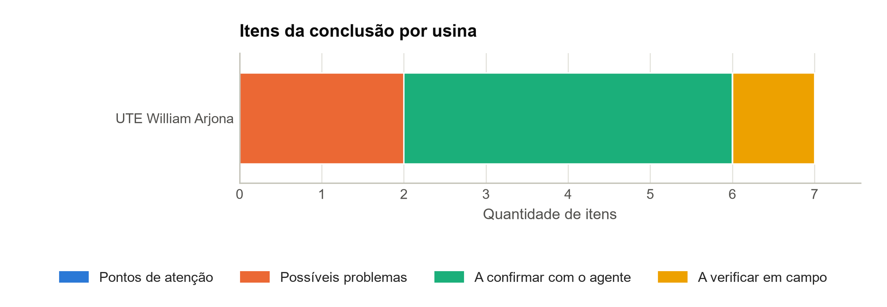

# Relatório de carteira — UTE no Brasil

Usinas do recorte a partir dos resultados gravados das análises

Recorte: usinas do tipo UTE do Brasil no catálogo de usinas do ONS montado em 22/10/2026 12:46 UTC.

617 usinas no recorte: 1 com resultado e 616 sem resultado. Gerado em 22/10/2026 14:00, só a partir dos resultados gravados; nenhuma etapa foi executada.

## 1. Usinas com resultado

Usinas com perfil conferido e com as Análises concluídas, na ordem da seção 3.

| Usina | UF | Tipo | Modalidade | Potência (MW) | Cobertura | Nível da geração | Período |
| --- | --- | --- | --- | ---: | --- | --- | --- |
| UTE William Arjona | MS | UTE | TIPO I | 177,1 | própria | usina | 10/07/2021 a 18/10/2026 |

Fonte dos dados: Modalidade das usinas (CEG de cada usina), publicado em 20/10/2026, pelo catálogo de usinas montado em 22/10/2026 12:46 UTC, com a cobertura de cada usina nos conjuntos de série do ONS; nome e potência: perfil de cada usina; período e nível da geração: resultados gravados das Análises de cada usina.

## 2. Indicadores comparáveis

Os indicadores da tabela anual do relatório de cada usina, no último ano completo da série, cada um do nível da usina, salvo os identificados.

| Usina | Ano | Disponibilidade | TEIFa | Atendimento ao despacho |
| --- | --- | ---: | ---: | ---: |
| UTE William Arjona | 2025 | 20,9% | 30,5% | 6,2% (2 de 32 h) |

Calculado neste relatório a partir de: resultados gravados das Análises de cada usina, que vêm da série de referência e da Disponibilidade por usina (fator de capacidade e disponibilidade), das Taxas TEIFa e TEIP (TEIFa), da Restrição com detalhe (energia cortada) e da Geração térmica por motivo de despacho (atendimento ao despacho); o identificador e a data de obtenção de cada conjunto estão na legenda da tabela anual do relatório de cada usina.

—: o indicador não se aplica ao tipo, ou a usina não tem a base.

## 3. Ordenação pelos itens da conclusão

Usinas ordenadas pela quantidade de itens em "Possíveis problemas" e, no empate, em "Pontos de atenção" e pelo nome.

| Posição | Usina | Tipo | Possíveis problemas | Pontos de atenção | A confirmar com o agente | A verificar em campo | Regras avaliadas |
| ---: | --- | --- | ---: | ---: | ---: | ---: | ---: |
| 1 | UTE William Arjona | UTE | 2 | 0 | 4 | 1 | 7 de 8 |

Calculado neste relatório a partir de: itens da conclusão dos resultados gravados das Análises de cada usina (aba CONCLUSAO do relatório de cada usina).

Quantidade de todos os itens de cada lista da conclusão, inclusive os que passam do limite de 5 por lista do relatório da usina.

*Figura 1 – Itens da conclusão por usina, na ordem da ordenação (todos os itens de cada lista).*

Calculado neste relatório a partir de: itens da conclusão dos resultados gravados das Análises de cada usina (aba CONCLUSAO do relatório de cada usina).

## 4. Usinas sem resultado

616 usinas sem resultado, por motivo: só agregado no ONS (ver o panorama), 393; sem perfil, 223. A cobertura é a do catálogo: própria, conjunto, agregado ou ausente (sem série no ONS).

| Usina | UF | Tipo | Modalidade | Cobertura | Motivo |
| --- | --- | --- | --- | --- | --- |
| CGH UNIÃO E INDÚSTRIA | PE | UTE | TIPO III | agregado | só agregado no ONS (ver o panorama) |
| USINA BIOMETANO CAMPOS NOVOS | SC | UTE | TIPO III | agregado | só agregado no ONS (ver o panorama) |
| UTE 3 TENTOS IJUÍ | RS | UTE | TIPO III | agregado | só agregado no ONS (ver o panorama) |
| UTE 3 TENTOS VERA | MT | UTE | TIPO III | agregado | só agregado no ONS (ver o panorama) |
| UTE AGROPÉU | MG | UTE | TIPO III | agregado | só agregado no ONS (ver o panorama) |
| UTE AGROVALE | BA | UTE | TIPO III | agregado | só agregado no ONS (ver o panorama) |
| UTE ALCON | ES | UTE | TIPO III | agregado | só agregado no ONS (ver o panorama) |
| UTE ALCÍDIA | SP | UTE | TIPO III | agregado | só agregado no ONS (ver o panorama) |
| UTE ALGAR AGRO | MG | UTE | TIPO III | agregado | só agregado no ONS (ver o panorama) |
| UTE ALTA MOGIANA | SP | UTE | TIPO III | agregado | só agregado no ONS (ver o panorama) |
| UTE ALTEROSA | MG | UTE | TIPO III | agregado | só agregado no ONS (ver o panorama) |
| UTE ALVORADA | MG | UTE | TIPO III | agregado | só agregado no ONS (ver o panorama) |
| UTE ALVORADA BIOENERGIA | MT | UTE | TIPO III | agregado | só agregado no ONS (ver o panorama) |
| UTE AMITEC | PR | UTE | TIPO III | agregado | só agregado no ONS (ver o panorama) |
| UTE ANGELICA | MS | UTE | TIPO III | agregado | só agregado no ONS (ver o panorama) |
| UTE ANGELICA I | MS | UTE | TIPO III | agregado | só agregado no ONS (ver o panorama) |
| UTE APE ROHDEN | RS | UTE | TIPO III | agregado | só agregado no ONS (ver o panorama) |
| UTE ARACRUZ | ES | UTE | TIPO III | agregado | só agregado no ONS (ver o panorama) |
| UTE AREVALE | SP | UTE | TIPO III | agregado | só agregado no ONS (ver o panorama) |
| UTE ASJA BH | MG | UTE | TIPO III | agregado | só agregado no ONS (ver o panorama) |
| UTE ASJA JABOATÃO | PE | UTE | TIPO III (EM DIT) | agregado | só agregado no ONS (ver o panorama) |
| UTE ASJA JOÃO PESSOA | PB | UTE | TIPO III | agregado | só agregado no ONS (ver o panorama) |
| UTE ASJA SABARÁ | MG | UTE | TIPO III | agregado | só agregado no ONS (ver o panorama) |
| UTE ATOS ENERGIA | MT | UTE | TIPO III | agregado | só agregado no ONS (ver o panorama) |
| UTE AVELINO BRAGAGNOLO | SC | UTE | TIPO III | agregado | só agregado no ONS (ver o panorama) |
| UTE AVG I-II | MG | UTE | TIPO III | agregado | só agregado no ONS (ver o panorama) |
| UTE AÇOMINAS | MG | UTE | TIPO III | agregado | só agregado no ONS (ver o panorama) |
| UTE BAHIA ETANOL ENERGIA RENOVÁVEL | BA | UTE | TIPO III | agregado | só agregado no ONS (ver o panorama) |
| UTE BAHIA PULP | BA | UTE | TIPO III | agregado | só agregado no ONS (ver o panorama) |
| UTE BALDIN | SP | UTE | TIPO III | agregado | só agregado no ONS (ver o panorama) |
| UTE BAMBUÍ | MG | UTE | TIPO III | agregado | só agregado no ONS (ver o panorama) |
| UTE BANDEIRANTES | SP | UTE | TIPO III | agregado | só agregado no ONS (ver o panorama) |
| UTE BARRA | SP | UTE | TIPO III | agregado | só agregado no ONS (ver o panorama) |
| UTE BARRALCOOL | MT | UTE | TIPO III | agregado | só agregado no ONS (ver o panorama) |
| UTE BARUERI | SP | UTE | TIPO III | agregado | só agregado no ONS (ver o panorama) |
| UTE BAZAN | SP | UTE | TIPO III (EM DIT) | agregado | só agregado no ONS (ver o panorama) |
| UTE BAÍA FORMOSA | RN | UTE | TIPO III | agregado | só agregado no ONS (ver o panorama) |
| UTE BBF BENJAMIN CONSTANT | AM | UTE | TIPO III | agregado | só agregado no ONS (ver o panorama) |
| UTE BBF TEFÉ | AM | UTE | TIPO III | agregado | só agregado no ONS (ver o panorama) |
| UTE BELA VISTA | SP | UTE | TIPO III (EM DIT) | agregado | só agregado no ONS (ver o panorama) |
| UTE BEN BIOENERGIA | AL | UTE | TIPO III | agregado | só agregado no ONS (ver o panorama) |
| UTE BERNECK LAGES | SC | UTE | TIPO III | agregado | só agregado no ONS (ver o panorama) |
| UTE BIANCOGRÊS | ES | UTE | TIPO III | agregado | só agregado no ONS (ver o panorama) |
| UTE BIO ALVORADA | MG | UTE | TIPO III | agregado | só agregado no ONS (ver o panorama) |
| UTE BIO COOPCANA | PR | UTE | TIPO III | agregado | só agregado no ONS (ver o panorama) |
| UTE BIOENERGIA MOCOCA | SP | UTE | TIPO III (EM DIT) | agregado | só agregado no ONS (ver o panorama) |
| UTE BIOENERGÉTICA AROEIRA | MG | UTE | TIPO III | agregado | só agregado no ONS (ver o panorama) |
| UTE BIOFLEX CAETÉ | AL | UTE | TIPO III | agregado | só agregado no ONS (ver o panorama) |
| UTE BIOGÁS BONFIM | SP | UTE | TIPO III | agregado | só agregado no ONS (ver o panorama) |
| UTE BIOLINS | SP | UTE | TIPO III | agregado | só agregado no ONS (ver o panorama) |
| UTE BIOTERMICA ENERGIA SA - GIRUÁ | RS | UTE | TIPO III | agregado | só agregado no ONS (ver o panorama) |
| UTE BIOTERMICA ENERGIA SA - SANTA MARIA | RS | UTE | TIPO III | agregado | só agregado no ONS (ver o panorama) |
| UTE BIOTERMICA ENERGIA SA - VICTOR GRAEFF | RS | UTE | TIPO III | agregado | só agregado no ONS (ver o panorama) |
| UTE BIOTÉRMICA RECREIO | RS | UTE | TIPO III | agregado | só agregado no ONS (ver o panorama) |
| UTE BOA ESPERANÇA (ANTIGA UTE CERRADÃO 3) | MG | UTE | TIPO III | agregado | só agregado no ONS (ver o panorama) |
| UTE BOM SUCESSO | GO | UTE | TIPO III | agregado | só agregado no ONS (ver o panorama) |
| UTE BONFIM | SP | UTE | TIPO III | agregado | só agregado no ONS (ver o panorama) |
| UTE BORTOLO CAROLO | SP | UTE | TIPO III | agregado | só agregado no ONS (ver o panorama) |
| UTE BRANCO PERES | SP | UTE | TIPO III | agregado | só agregado no ONS (ver o panorama) |
| UTE BROTAS | SP | UTE | TIPO III | agregado | só agregado no ONS (ver o panorama) |
| UTE BROTAS II | SP | UTE | TIPO III | agregado | só agregado no ONS (ver o panorama) |
| UTE BURITI | SP | UTE | TIPO III | agregado | só agregado no ONS (ver o panorama) |
| UTE C.VALE UPL | PR | UTE | TIPO III | agregado | só agregado no ONS (ver o panorama) |
| UTE CAAL | RS | UTE | TIPO III | agregado | só agregado no ONS (ver o panorama) |
| UTE CAARAPÓ | MS | UTE | TIPO III | agregado | só agregado no ONS (ver o panorama) |
| UTE CABOT MAUA | SP | UTE | TIPO III | agregado | só agregado no ONS (ver o panorama) |
| UTE CALDEIRA 6 KAIRÓS | PR | UTE | TIPO III | agregado | só agregado no ONS (ver o panorama) |
| UTE CAMBUÍ | GO | UTE | TIPO III | agregado | só agregado no ONS (ver o panorama) |
| UTE CAMIL CAMBAÍ | RS | UTE | TIPO III | agregado | só agregado no ONS (ver o panorama) |
| UTE CAMPO FLORIDO | MG | UTE | TIPO III | agregado | só agregado no ONS (ver o panorama) |
| UTE CAMPO LINDO | SE | UTE | TIPO III | agregado | só agregado no ONS (ver o panorama) |
| UTE CANABRAVA | RJ | UTE | TIPO III | agregado | só agregado no ONS (ver o panorama) |
| UTE CANAÃ | SP | UTE | TIPO III (EM DIT) | agregado | só agregado no ONS (ver o panorama) |
| UTE CANÁPOLIS 2 | MG | UTE | TIPO III | agregado | só agregado no ONS (ver o panorama) |
| UTE CANÁRIO I | BA | UTE | TIPO III | agregado | só agregado no ONS (ver o panorama) |
| UTE CARAMURU SORRISO | MT | UTE | TIPO III | agregado | só agregado no ONS (ver o panorama) |
| UTE CARNEIRINHO | MG | UTE | TIPO III | agregado | só agregado no ONS (ver o panorama) |
| UTE CASA DE FORÇA | SP | UTE | TIPO III | agregado | só agregado no ONS (ver o panorama) |
| UTE CATANDUVA I (ANTIGA CERRADINHO) | SP | UTE | TIPO III | agregado | só agregado no ONS (ver o panorama) |
| UTE CDR PEDREIRA I | SP | UTE | TIPO III | agregado | só agregado no ONS (ver o panorama) |
| UTE CEDRO | MS | UTE | TIPO III | agregado | só agregado no ONS (ver o panorama) |
| UTE CELPAV IV | SP | UTE | TIPO III | agregado | só agregado no ONS (ver o panorama) |
| UTE CELULOSE IRANI | SC | UTE | TIPO III | agregado | só agregado no ONS (ver o panorama) |
| UTE CEM (EX-CAMEN) | GO | UTE | TIPO III | agregado | só agregado no ONS (ver o panorama) |
| UTE CENPES | RJ | UTE | TIPO III | agregado | só agregado no ONS (ver o panorama) |
| UTE CENTRAL ENERGÉTICA ALTA MOGIANA | SP | UTE | TIPO III | agregado | só agregado no ONS (ver o panorama) |
| UTE CENTRAL ENERGÉTICA ALTA MOGIANA | SP | UTE | TIPO III | agregado | só agregado no ONS (ver o panorama) |
| UTE CENTRAL ENERGÉTICA TUPACIGUARA (EX BIOENERGÉTICA AROEIRA 2) | MG | UTE | TIPO III | agregado | só agregado no ONS (ver o panorama) |
| UTE CENTRAL OLHO D`ÁGUA | PE | UTE | TIPO III | agregado | só agregado no ONS (ver o panorama) |
| UTE CERB | SP | UTE | TIPO III | agregado | só agregado no ONS (ver o panorama) |
| UTE CERRADINHO MS1 | MS | UTE | TIPO III | agregado | só agregado no ONS (ver o panorama) |
| UTE CERRADÃO | MG | UTE | TIPO III | agregado | só agregado no ONS (ver o panorama) |
| UTE CERRADÃO 2 | MG | UTE | TIPO III | agregado | só agregado no ONS (ver o panorama) |
| UTE CEVASA | SP | UTE | TIPO III | agregado | só agregado no ONS (ver o panorama) |
| UTE CICLUS | RJ | UTE | TIPO III | agregado | só agregado no ONS (ver o panorama) |
| UTE CIF MINERAÇÃO | MG | UTE | TIPO III | agregado | só agregado no ONS (ver o panorama) |
| UTE CIMENTO  APODI | CE | UTE | TIPO III | agregado | só agregado no ONS (ver o panorama) |
| UTE CITROVITA CATANDUVA | SP | UTE | TIPO III | agregado | só agregado no ONS (ver o panorama) |
| UTE CLEALCO CLEMENTINA | SP | UTE | TIPO III | agregado | só agregado no ONS (ver o panorama) |
| UTE CLEALCO QUEIROZ | SP | UTE | TIPO III | agregado | só agregado no ONS (ver o panorama) |
| UTE COAF | PE | UTE | TIPO III | agregado | só agregado no ONS (ver o panorama) |
| UTE COCAL | SP | UTE | TIPO III (EM DIT) | agregado | só agregado no ONS (ver o panorama) |
| UTE COCAMAR MARINGÁ | PR | UTE | TIPO III | agregado | só agregado no ONS (ver o panorama) |
| UTE COGERAÇÃO LAGES | SC | UTE | TIPO III | agregado | só agregado no ONS (ver o panorama) |
| UTE COLOMBO - SANTA ALBERTINA - 138 KV | SP | UTE | TIPO III | agregado | só agregado no ONS (ver o panorama) |
| UTE COLOMBO ARIRANHA 1 | SP | UTE | TIPO III | agregado | só agregado no ONS (ver o panorama) |
| UTE COLOMBO ARIRANHA 2 | SP | UTE | TIPO III | agregado | só agregado no ONS (ver o panorama) |
| UTE COLORADO | SP | UTE | TIPO III | agregado | só agregado no ONS (ver o panorama) |
| UTE COMPERJ | RJ | UTE | TIPO III | agregado | só agregado no ONS (ver o panorama) |
| UTE COMVAP | PI | UTE | TIPO III | agregado | só agregado no ONS (ver o panorama) |
| UTE CONQUISTA DO PONTAL | SP | UTE | TIPO III | agregado | só agregado no ONS (ver o panorama) |
| UTE CONSELVAN | MT | UTE | TIPO III | agregado | só agregado no ONS (ver o panorama) |
| UTE COOPER RUBI | GO | UTE | TIPO III | agregado | só agregado no ONS (ver o panorama) |
| UTE COPESUL | RS | UTE | TIPO III | agregado | só agregado no ONS (ver o panorama) |
| UTE COPRODIA | MT | UTE | TIPO III | agregado | só agregado no ONS (ver o panorama) |
| UTE CORURIPE - AL | AL | UTE | TIPO III | agregado | só agregado no ONS (ver o panorama) |
| UTE CORURIPE - CAMPO FLORIDO | MG | UTE | TIPO III | agregado | só agregado no ONS (ver o panorama) |
| UTE CORURIPE - ITURAMA | MG | UTE | TIPO III | agregado | só agregado no ONS (ver o panorama) |
| UTE CORURIPE AÇÚCAR E ÁLCOOL | MG | UTE | TIPO III | agregado | só agregado no ONS (ver o panorama) |
| UTE COSIMA | MA | UTE | TIPO III | agregado | só agregado no ONS (ver o panorama) |
| UTE COSTA BIOENERGIA | PR | UTE | TIPO III | agregado | só agregado no ONS (ver o panorama) |
| UTE COSTA PINTO | SP | UTE | TIPO III | agregado | só agregado no ONS (ver o panorama) |
| UTE CRV | GO | UTE | TIPO III | agregado | só agregado no ONS (ver o panorama) |
| UTE CST | ES | UTE | TIPO III | agregado | só agregado no ONS (ver o panorama) |
| UTE CTR JUIZ DE FORA | MG | UTE | TIPO III | agregado | só agregado no ONS (ver o panorama) |
| UTE CUCAÚ | PE | UTE | TIPO III | agregado | só agregado no ONS (ver o panorama) |
| UTE CURITIBA ENERGIA | PR | UTE | TIPO III | agregado | só agregado no ONS (ver o panorama) |
| UTE CVW ENERGÉTICA | AL | UTE | TIPO III | agregado | só agregado no ONS (ver o panorama) |
| UTE DA SERRA | SP | UTE | TIPO III | agregado | só agregado no ONS (ver o panorama) |
| UTE DELLA COLETTA | SP | UTE | TIPO III | agregado | só agregado no ONS (ver o panorama) |
| UTE DELTA | MG | UTE | TIPO III | agregado | só agregado no ONS (ver o panorama) |
| UTE DESTILARIA JB | PE | UTE | TIPO III | agregado | só agregado no ONS (ver o panorama) |
| UTE DESTILARIA MELHORAMENTOS | PR | UTE | TIPO III | agregado | só agregado no ONS (ver o panorama) |
| UTE DESTILARIA MELHORAMENTOS – NOVA LONDRINA | PR | UTE | TIPO III | agregado | só agregado no ONS (ver o panorama) |
| UTE DIANA | SP | UTE | TIPO III | agregado | só agregado no ONS (ver o panorama) |
| UTE DOIS VIZINHOS | PR | UTE | TIPO III | agregado | só agregado no ONS (ver o panorama) |
| UTE DVPA | MG | UTE | TIPO III | agregado | só agregado no ONS (ver o panorama) |
| UTE ECOLUZ | PR | UTE | TIPO III | agregado | só agregado no ONS (ver o panorama) |
| UTE EGÍDIO | MT | UTE | TIPO III | agregado | só agregado no ONS (ver o panorama) |
| UTE ELDORADO BRASIL | MS | UTE | TIPO III | agregado | só agregado no ONS (ver o panorama) |
| UTE ENERGIA MADEIRAS | SC | UTE | TIPO III | agregado | só agregado no ONS (ver o panorama) |
| UTE ENERGIR | RS | UTE | TIPO III | agregado | só agregado no ONS (ver o panorama) |
| UTE ENERGY WORKS MOGI | SP | UTE | TIPO III | agregado | só agregado no ONS (ver o panorama) |
| UTE ENERVALE | MG | UTE | TIPO III | agregado | só agregado no ONS (ver o panorama) |
| UTE ENGENHO CORADINI | RS | UTE | TIPO III | agregado | só agregado no ONS (ver o panorama) |
| UTE ENTRE RIOS | GO | UTE | TIPO III | agregado | só agregado no ONS (ver o panorama) |
| UTE EQUIPAV | SP | UTE | TIPO III | agregado | só agregado no ONS (ver o panorama) |
| UTE EQUIPAV II | SP | UTE | TIPO III | agregado | só agregado no ONS (ver o panorama) |
| UTE ESPLANADA (EX UTE JALLES MACHADO) | GO | UTE | TIPO III | agregado | só agregado no ONS (ver o panorama) |
| UTE ESTER | SP | UTE | TIPO III | agregado | só agregado no ONS (ver o panorama) |
| UTE ESTIVAS | RN | UTE | TIPO III | agregado | só agregado no ONS (ver o panorama) |
| UTE F&S AGRI SOLUTIONS | MT | UTE | TIPO III | agregado | só agregado no ONS (ver o panorama) |
| UTE F&S PRIMAVERA | MT | UTE | TIPO III | agregado | só agregado no ONS (ver o panorama) |
| UTE FARTURA | SP | UTE | TIPO III | agregado | só agregado no ONS (ver o panorama) |
| UTE FERGUMINAS | MG | UTE | TIPO III | agregado | só agregado no ONS (ver o panorama) |
| UTE FERRARI | SP | UTE | TIPO III | agregado | só agregado no ONS (ver o panorama) |
| UTE FLORAPLAC | PA | UTE | TIPO III | agregado | só agregado no ONS (ver o panorama) |
| UTE FORESPEL | RS | UTE | TIPO III | agregado | só agregado no ONS (ver o panorama) |
| UTE FRUTAL | MG | UTE | TIPO III | agregado | só agregado no ONS (ver o panorama) |
| UTE FUMACENSE ALIMENTOS | SC | UTE | TIPO III | agregado | só agregado no ONS (ver o panorama) |
| UTE FURLAN AVARÉ | SP | UTE | TIPO III | agregado | só agregado no ONS (ver o panorama) |
| UTE FÊNIX | MT | UTE | TIPO III | agregado | só agregado no ONS (ver o panorama) |
| UTE GALO BRAVO | SP | UTE | TIPO III | agregado | só agregado no ONS (ver o panorama) |
| UTE GALVANI | SP | UTE | TIPO III | agregado | só agregado no ONS (ver o panorama) |
| UTE GALVANI SERRA DO SALITRE | MG | UTE | TIPO III | agregado | só agregado no ONS (ver o panorama) |
| UTE GEO ELÉTRICA TAMBOARA | PR | UTE | TIPO III | agregado | só agregado no ONS (ver o panorama) |
| UTE GIASA II | PB | UTE | TIPO III | agregado | só agregado no ONS (ver o panorama) |
| UTE GLOBO | RJ | UTE | TIPO III | agregado | só agregado no ONS (ver o panorama) |
| UTE GOIANÉSIA | GO | UTE | TIPO III | agregado | só agregado no ONS (ver o panorama) |
| UTE GOIASA | GO | UTE | TIPO III | agregado | só agregado no ONS (ver o panorama) |
| UTE GOODYEAR | SP | UTE | TIPO III | agregado | só agregado no ONS (ver o panorama) |
| UTE GOODYEAR | SP | UTE | TIPO III | agregado | só agregado no ONS (ver o panorama) |
| UTE GRANJA SÃO ROQUE | SC | UTE | TIPO III | agregado | só agregado no ONS (ver o panorama) |
| UTE GUAMA AMBIENTAL | PA | UTE | TIPO III | agregado | só agregado no ONS (ver o panorama) |
| UTE GUARANI | SP | UTE | TIPO III | agregado | só agregado no ONS (ver o panorama) |
| UTE GUARANI CRUZ ALTA | SP | UTE | TIPO III | agregado | só agregado no ONS (ver o panorama) |
| UTE GUARANI CRUZ ALTA 2 | SP | UTE | TIPO III | agregado | só agregado no ONS (ver o panorama) |
| UTE GUARIROBA | SP | UTE | TIPO III | agregado | só agregado no ONS (ver o panorama) |
| UTE GUATAPARÁ | SP | UTE | TIPO III | agregado | só agregado no ONS (ver o panorama) |
| UTE GUAXUMA | AL | UTE | TIPO III | agregado | só agregado no ONS (ver o panorama) |
| UTE GUAÇU | MT | UTE | TIPO III | agregado | só agregado no ONS (ver o panorama) |
| UTE GUAÍRA | SP | UTE | TIPO III | agregado | só agregado no ONS (ver o panorama) |
| UTE GUSA NORDESTE | MA | UTE | TIPO III | agregado | só agregado no ONS (ver o panorama) |
| UTE HERINGER | PR | UTE | TIPO III | agregado | só agregado no ONS (ver o panorama) |
| UTE IACANGA | SP | UTE | TIPO III | agregado | só agregado no ONS (ver o panorama) |
| UTE IBITIÚVA ( EX DESTILARIA ANDRADE) | SP | UTE | TIPO III | agregado | só agregado no ONS (ver o panorama) |
| UTE IGUAÇU CARAMBEÍ (EX UTE RICKLI) | PR | UTE | TIPO III | agregado | só agregado no ONS (ver o panorama) |
| UTE INPASA | MT | UTE | TIPO III | agregado | só agregado no ONS (ver o panorama) |
| UTE INPASA BALSAS | MA | UTE | TIPO III | agregado | só agregado no ONS (ver o panorama) |
| UTE INPASA DOURADOS | MS | UTE | TIPO III | agregado | só agregado no ONS (ver o panorama) |
| UTE INPASA LEM | BA | UTE | TIPO III | agregado | só agregado no ONS (ver o panorama) |
| UTE INPASA MUTUM | MT | UTE | TIPO III | agregado | só agregado no ONS (ver o panorama) |
| UTE INPASA RIO VERDE | GO | UTE | TIPO III | agregado | só agregado no ONS (ver o panorama) |
| UTE INPASA RONDONÓPOLIS | MT | UTE | TIPO III | agregado | só agregado no ONS (ver o panorama) |
| UTE INPASA SIDROLÂNDIA | MS | UTE | TIPO III | agregado | só agregado no ONS (ver o panorama) |
| UTE IOLANDO LEITE | SE | UTE | TIPO III | agregado | só agregado no ONS (ver o panorama) |
| UTE IPIRANGA BIOENERGIA MOCOCA II | SP | UTE | TIPO III | agregado | só agregado no ONS (ver o panorama) |
| UTE IPOJUCA | PE | UTE | TIPO III | agregado | só agregado no ONS (ver o panorama) |
| UTE IRACEMA | SP | UTE | TIPO III | agregado | só agregado no ONS (ver o panorama) |
| UTE ITACOATIARA | AM | UTE | TIPO III | agregado | só agregado no ONS (ver o panorama) |
| UTE ITAENGA | PE | UTE | TIPO III | agregado | só agregado no ONS (ver o panorama) |
| UTE ITAJAÍ | SC | UTE | TIPO III | agregado | só agregado no ONS (ver o panorama) |
| UTE ITAJAÍ | SC | UTE | TIPO III | agregado | só agregado no ONS (ver o panorama) |
| UTE ITAMARATI | MT | UTE | TIPO III | agregado | só agregado no ONS (ver o panorama) |
| UTE ITAQUI | RS | UTE | TIPO III | agregado | só agregado no ONS (ver o panorama) |
| UTE J. A. KONZEN - SÃO MIGUEL | MT | UTE | TIPO III | agregado | só agregado no ONS (ver o panorama) |
| UTE J. PILON | SP | UTE | TIPO III | agregado | só agregado no ONS (ver o panorama) |
| UTE JACAREZINHO | PR | UTE | TIPO III | agregado | só agregado no ONS (ver o panorama) |
| UTE JACAREZINHO 2 | PR | UTE | TIPO III (EM DIT) | agregado | só agregado no ONS (ver o panorama) |
| UTE JACAREZINHO 2 | PR | UTE | TIPO III (EM DIT) | agregado | só agregado no ONS (ver o panorama) |
| UTE JACAREÍ | SP | UTE | TIPO III | agregado | só agregado no ONS (ver o panorama) |
| UTE JAGUARIÚNA | SP | UTE | TIPO III | agregado | só agregado no ONS (ver o panorama) |
| UTE JAPUNGU | PB | UTE | TIPO III | agregado | só agregado no ONS (ver o panorama) |
| UTE JITITUBA SANTO ANTÔNIO | AL | UTE | TIPO III | agregado | só agregado no ONS (ver o panorama) |
| UTE JOÃO NEIVA | ES | UTE | TIPO III | agregado | só agregado no ONS (ver o panorama) |
| UTE JUNQUEIRA (EX ALTO ALEGRE - UJU) | PR | UTE | TIPO III | agregado | só agregado no ONS (ver o panorama) |
| UTE KLABIN CORREIA PINTO | SC | UTE | TIPO III | agregado | só agregado no ONS (ver o panorama) |
| UTE KLABIN OTACÍLIO COSTA | SC | UTE | TIPO III | agregado | só agregado no ONS (ver o panorama) |
| UTE KLABIN T. BORBA | PR | UTE | TIPO III | agregado | só agregado no ONS (ver o panorama) |
| UTE LAGINHA | AL | UTE | TIPO III | agregado | só agregado no ONS (ver o panorama) |
| UTE LAGINHA - V. PARANAÍBA | MG | UTE | TIPO III | agregado | só agregado no ONS (ver o panorama) |
| UTE LAGINHA TRIÁLCOOL | MG | UTE | TIPO III | agregado | só agregado no ONS (ver o panorama) |
| UTE LAGO AZUL | GO | UTE | TIPO III | agregado | só agregado no ONS (ver o panorama) |
| UTE LAGUNA | MS | UTE | TIPO III | agregado | só agregado no ONS (ver o panorama) |
| UTE LAR COOPERATIVA AGROINDUSTRIAL | MS | UTE | TIPO III | agregado | só agregado no ONS (ver o panorama) |
| UTE LASA | ES | UTE | TIPO III | agregado | só agregado no ONS (ver o panorama) |
| UTE LD CELULOSE | MG | UTE | TIPO III | agregado | só agregado no ONS (ver o panorama) |
| UTE LDC BIOENERGIA LAGOA DA PRATA | MG | UTE | TIPO III | agregado | só agregado no ONS (ver o panorama) |
| UTE LDC BIOENERGIA LEME (EX CRESCIUMAL) | SP | UTE | TIPO III | agregado | só agregado no ONS (ver o panorama) |
| UTE LDC BIOENERGIA RIO BRILHANTE | MS | UTE | TIPO III | agregado | só agregado no ONS (ver o panorama) |
| UTE LEVORIN | SP | UTE | TIPO III | agregado | só agregado no ONS (ver o panorama) |
| UTE LIMEIRA DO OESTE | MG | UTE | TIPO III | agregado | só agregado no ONS (ver o panorama) |
| UTE LUBNOR | CE | UTE | TIPO III | agregado | só agregado no ONS (ver o panorama) |
| UTE LUCÉLIA | SP | UTE | TIPO III | agregado | só agregado no ONS (ver o panorama) |
| UTE MACAÍBA | RN | UTE | TIPO III | agregado | só agregado no ONS (ver o panorama) |
| UTE MADECAL | SC | UTE | TIPO III | agregado | só agregado no ONS (ver o panorama) |
| UTE MANDU | SP | UTE | TIPO III | agregado | só agregado no ONS (ver o panorama) |
| UTE MARACAÍ | SP | UTE | TIPO III | agregado | só agregado no ONS (ver o panorama) |
| UTE MARITUBA | AL | UTE | TIPO III | agregado | só agregado no ONS (ver o panorama) |
| UTE MARTINS | MT | UTE | TIPO III | agregado | só agregado no ONS (ver o panorama) |
| UTE MB | SP | UTE | TIPO III | agregado | só agregado no ONS (ver o panorama) |
| UTE METALSIDER | MG | UTE | TIPO III | agregado | só agregado no ONS (ver o panorama) |
| UTE MIRIRI | PB | UTE | TIPO III | agregado | só agregado no ONS (ver o panorama) |
| UTE MOEMA | SP | UTE | TIPO III | agregado | só agregado no ONS (ver o panorama) |
| UTE MOGIANA BIO ENERGIA | SP | UTE | TIPO III | agregado | só agregado no ONS (ver o panorama) |
| UTE MONTE ALEGRE - MG | MG | UTE | TIPO III | agregado | só agregado no ONS (ver o panorama) |
| UTE MONTE ALEGRE - PB | PB | UTE | TIPO III | agregado | só agregado no ONS (ver o panorama) |
| UTE MONTEVERDE | MS | UTE | TIPO III | agregado | só agregado no ONS (ver o panorama) |
| UTE MOSAIC ARAXÁ | MG | UTE | TIPO III | agregado | só agregado no ONS (ver o panorama) |
| UTE N O BIOENERGIA | SP | UTE | TIPO III | agregado | só agregado no ONS (ver o panorama) |
| UTE NARDINI - SP | SP | UTE | TIPO III | agregado | só agregado no ONS (ver o panorama) |
| UTE NEGRO DE FUMO | SP | UTE | TIPO III | agregado | só agregado no ONS (ver o panorama) |
| UTE NG BIOENERGIA I | GO | UTE | TIPO III | agregado | só agregado no ONS (ver o panorama) |
| UTE NOVA GERAÇÃO | GO | UTE | TIPO III | agregado | só agregado no ONS (ver o panorama) |
| UTE NOVA IGUAÇU | RJ | UTE | TIPO III | agregado | só agregado no ONS (ver o panorama) |
| UTE NOVO MILÊNIO | MT | UTE | TIPO III | agregado | só agregado no ONS (ver o panorama) |
| UTE OLEOPLAN VERANÓPOLIS | RS | UTE | TIPO III | agregado | só agregado no ONS (ver o panorama) |
| UTE OUROESTE | SP | UTE | TIPO III | agregado | só agregado no ONS (ver o panorama) |
| UTE PAGRISA | PA | UTE | TIPO III | agregado | só agregado no ONS (ver o panorama) |
| UTE PAMESA | PE | UTE | TIPO III | agregado | só agregado no ONS (ver o panorama) |
| UTE PASSA TEMPO | MS | UTE | TIPO III | agregado | só agregado no ONS (ver o panorama) |
| UTE PCT SLC ALIMENTOS | RS | UTE | TIPO III | agregado | só agregado no ONS (ver o panorama) |
| UTE PEDRO AFONSO | TO | UTE | TIPO III | agregado | só agregado no ONS (ver o panorama) |
| UTE PETRIBU | PE | UTE | TIPO III | agregado | só agregado no ONS (ver o panorama) |
| UTE PETROCOQUE | SP | UTE | TIPO III | agregado | só agregado no ONS (ver o panorama) |
| UTE PIONEIROS I | SP | UTE | TIPO III | agregado | só agregado no ONS (ver o panorama) |
| UTE PIRAPAMA | PE | UTE | TIPO III | agregado | só agregado no ONS (ver o panorama) |
| UTE PIRATINI | RS | UTE | TIPO III | agregado | só agregado no ONS (ver o panorama) |
| UTE PITANGUEIRAS | SP | UTE | TIPO III | agregado | só agregado no ONS (ver o panorama) |
| UTE PLANTAR | MG | UTE | TIPO III | agregado | só agregado no ONS (ver o panorama) |
| UTE POLO PARGO | RJ | UTE | TIPO III | agregado | só agregado no ONS (ver o panorama) |
| UTE POTENCIAL 1 | PR | UTE | TIPO III | agregado | só agregado no ONS (ver o panorama) |
| UTE POTIRENDABA I ( EX CERRADINHO POTIRENDABA) | SP | UTE | TIPO III | agregado | só agregado no ONS (ver o panorama) |
| UTE RAFARD | SP | UTE | TIPO III | agregado | só agregado no ONS (ver o panorama) |
| UTE RAÇÕES PATENSE | MG | UTE | TIPO III | agregado | só agregado no ONS (ver o panorama) |
| UTE REFINARIA ALBERTO PASQUALINI - REFAP | RS | UTE | TIPO III | agregado | só agregado no ONS (ver o panorama) |
| UTE REFINARIA GABRIEL PASSOS - REGAP | MG | UTE | TIPO III | agregado | só agregado no ONS (ver o panorama) |
| UTE REFINARIA GETÚLIO VARGAS - REPAR | PR | UTE | TIPO III | agregado | só agregado no ONS (ver o panorama) |
| UTE REFINARIA LANDULPHO ALVES - RLAM | BA | UTE | TIPO III | agregado | só agregado no ONS (ver o panorama) |
| UTE REPLAN | SP | UTE | TIPO III | agregado | só agregado no ONS (ver o panorama) |
| UTE RHODIA PAULÍNEA | SP | UTE | TIPO III | agregado | só agregado no ONS (ver o panorama) |
| UTE RIGESA | SC | UTE | TIPO III | agregado | só agregado no ONS (ver o panorama) |
| UTE RIO CLARO DE GOIÁS | GO | UTE | TIPO III | agregado | só agregado no ONS (ver o panorama) |
| UTE RIO PARDO | SP | UTE | TIPO III | agregado | só agregado no ONS (ver o panorama) |
| UTE RJR | RJ | UTE | TIPO III | agregado | só agregado no ONS (ver o panorama) |
| UTE RUETTE | SP | UTE | TIPO III | agregado | só agregado no ONS (ver o panorama) |
| UTE SADIA CHAPECÓ | SC | UTE | TIPO III | agregado | só agregado no ONS (ver o panorama) |
| UTE SADIA CONCÓRDIA | SC | UTE | TIPO III | agregado | só agregado no ONS (ver o panorama) |
| UTE SAFRA BIOENERGIA | MT | UTE | TIPO III | agregado | só agregado no ONS (ver o panorama) |
| UTE SALVADOR | BA | UTE | TIPO III | agregado | só agregado no ONS (ver o panorama) |
| UTE SANTA ADÉLIA | SP | UTE | TIPO III | agregado | só agregado no ONS (ver o panorama) |
| UTE SANTA CRUZ AB | SP | UTE | TIPO III | agregado | só agregado no ONS (ver o panorama) |
| UTE SANTA CÂNDIDA I | SP | UTE | TIPO III | agregado | só agregado no ONS (ver o panorama) |
| UTE SANTA CÂNDIDA II | SP | UTE | TIPO III | agregado | só agregado no ONS (ver o panorama) |
| UTE SANTA ELISA UNIDADE I | SP | UTE | TIPO III | agregado | só agregado no ONS (ver o panorama) |
| UTE SANTA ELISA UNIDADE II | SP | UTE | TIPO III | agregado | só agregado no ONS (ver o panorama) |
| UTE SANTA FÉ | SP | UTE | TIPO III | agregado | só agregado no ONS (ver o panorama) |
| UTE SANTA HELENA | SP | UTE | TIPO III | agregado | só agregado no ONS (ver o panorama) |
| UTE SANTA JULIANA | MG | UTE | TIPO III | agregado | só agregado no ONS (ver o panorama) |
| UTE SANTA LUCIA - BLUE VILLE | RS | UTE | TIPO III | agregado | só agregado no ONS (ver o panorama) |
| UTE SANTA TERESA | PE | UTE | TIPO III | agregado | só agregado no ONS (ver o panorama) |
| UTE SANTA TEREZINHA - PARANACITY | PR | UTE | TIPO III | agregado | só agregado no ONS (ver o panorama) |
| UTE SANTA TEREZINHA - TAPEJARA | PR | UTE | TIPO III | agregado | só agregado no ONS (ver o panorama) |
| UTE SANTO ANGELO | MG | UTE | TIPO III (EM DIT) | agregado | só agregado no ONS (ver o panorama) |
| UTE SANTO ANTÔNIO | SP | UTE | TIPO III | agregado | só agregado no ONS (ver o panorama) |
| UTE SANTO INÁCIO | PR | UTE | TIPO III | agregado | só agregado no ONS (ver o panorama) |
| UTE SAO JOAO | SP | UTE | TIPO III | agregado | só agregado no ONS (ver o panorama) |
| UTE SELECTA | MG | UTE | TIPO III | agregado | só agregado no ONS (ver o panorama) |
| UTE SERRA GRANDE | AL | UTE | TIPO III | agregado | só agregado no ONS (ver o panorama) |
| UTE SERRANÓPOLIS | GO | UTE | TIPO III | agregado | só agregado no ONS (ver o panorama) |
| UTE SIDERÚRGICA BARÃO DE MAUÁ | MG | UTE | TIPO III | agregado | só agregado no ONS (ver o panorama) |
| UTE SIDROLÂNDIA | MS | UTE | TIPO III | agregado | só agregado no ONS (ver o panorama) |
| UTE SIMASA | MA | UTE | TIPO III | agregado | só agregado no ONS (ver o panorama) |
| UTE SINIMBÚ | AL | UTE | TIPO III | agregado | só agregado no ONS (ver o panorama) |
| UTE SOL | ES | UTE | TIPO III | agregado | só agregado no ONS (ver o panorama) |
| UTE SONORA (SE SOZINHO) | MS | UTE | TIPO III | agregado | só agregado no ONS (ver o panorama) |
| UTE SUZANO MUCURI | BA | UTE | TIPO III | agregado | só agregado no ONS (ver o panorama) |
| UTE SVA | RS | UTE | TIPO III | agregado | só agregado no ONS (ver o panorama) |
| UTE SÃO BORJA | RS | UTE | TIPO III | agregado | só agregado no ONS (ver o panorama) |
| UTE SÃO DOMINGOS | SP | UTE | TIPO III | agregado | só agregado no ONS (ver o panorama) |
| UTE SÃO FRANCISCO - BIOENERGIA | SP | UTE | TIPO III | agregado | só agregado no ONS (ver o panorama) |
| UTE SÃO FRANCISCO - COSAN | SP | UTE | TIPO III | agregado | só agregado no ONS (ver o panorama) |
| UTE SÃO GONÇALO | RJ | UTE | TIPO III | agregado | só agregado no ONS (ver o panorama) |
| UTE SÃO JOSÉ | PE | UTE | TIPO III | agregado | só agregado no ONS (ver o panorama) |
| UTE SÃO JOSÉ - MACATUBA | SP | UTE | TIPO III | agregado | só agregado no ONS (ver o panorama) |
| UTE SÃO JOSÉ 2 (ANTIGA UTE PLANALTO BIOENERGIA) | SP | UTE | TIPO III | agregado | só agregado no ONS (ver o panorama) |
| UTE SÃO JOSÉ COLINA | SP | UTE | TIPO III | agregado | só agregado no ONS (ver o panorama) |
| UTE SÃO JOSÉ DO PINHEIRO | SE | UTE | TIPO III | agregado | só agregado no ONS (ver o panorama) |
| UTE SÃO JOÃO | SP | UTE | TIPO III | agregado | só agregado no ONS (ver o panorama) |
| UTE SÃO JUDAS TADEU | MG | UTE | TIPO III | agregado | só agregado no ONS (ver o panorama) |
| UTE SÃO LUIZ | SP | UTE | TIPO III | agregado | só agregado no ONS (ver o panorama) |
| UTE SÃO LUIZ (ABENGOA) - SP | SP | UTE | TIPO III | agregado | só agregado no ONS (ver o panorama) |
| UTE SÃO LUIZ II | SP | UTE | TIPO III | agregado | só agregado no ONS (ver o panorama) |
| UTE SÃO MARTINHO | SP | UTE | TIPO III | agregado | só agregado no ONS (ver o panorama) |
| UTE SÃO MARTINHO BIOENERGIA | SP | UTE | TIPO III | agregado | só agregado no ONS (ver o panorama) |
| UTE SÃO MARTINHO BOA VISTA | GO | UTE | TIPO III | agregado | só agregado no ONS (ver o panorama) |
| UTE SÃO MARTINHO ENERGIA | SP | UTE | TIPO III | agregado | só agregado no ONS (ver o panorama) |
| UTE TABU | PB | UTE | TIPO III | agregado | só agregado no ONS (ver o panorama) |
| UTE TAQUARI | SE | UTE | TIPO III | agregado | só agregado no ONS (ver o panorama) |
| UTE TARUMÃ | SP | UTE | TIPO III | agregado | só agregado no ONS (ver o panorama) |
| UTE TECIPAR | SP | UTE | TIPO III | agregado | só agregado no ONS (ver o panorama) |
| UTE TERMOVERDE CAIEIRAS | SP | UTE | TIPO III | agregado | só agregado no ONS (ver o panorama) |
| UTE TERRANOVA I | SC | UTE | TIPO III | agregado | só agregado no ONS (ver o panorama) |
| UTE TORRE ELDORADO | SP | UTE | TIPO III | agregado | só agregado no ONS (ver o panorama) |
| UTE TOTAL | MG | UTE | TIPO III | agregado | só agregado no ONS (ver o panorama) |
| UTE TRAPICHE | PE | UTE | TIPO III | agregado | só agregado no ONS (ver o panorama) |
| UTE TREMEMBÉ | SP | UTE | TIPO III | agregado | só agregado no ONS (ver o panorama) |
| UTE TRIUNFO | AL | UTE | TIPO III | agregado | só agregado no ONS (ver o panorama) |
| UTE TRIÂNGULO | MG | UTE | TIPO III | agregado | só agregado no ONS (ver o panorama) |
| UTE TROMBINI | SC | UTE | TIPO III | agregado | só agregado no ONS (ver o panorama) |
| UTE UBERABA 2 | MG | UTE | TIPO III | agregado | só agregado no ONS (ver o panorama) |
| UTE UBERLÂNDIA | MG | UTE | TIPO III | agregado | só agregado no ONS (ver o panorama) |
| UTE UFA | SP | UTE | TIPO III (EM DIT) | agregado | só agregado no ONS (ver o panorama) |
| UTE UFL | PR | UTE | TIPO III | agregado | só agregado no ONS (ver o panorama) |
| UTE UGPU ITABIRITO | MG | UTE | TIPO III | agregado | só agregado no ONS (ver o panorama) |
| UTE UJU BIO | PR | UTE | TIPO III | agregado | só agregado no ONS (ver o panorama) |
| UTE UNIALCO | SP | UTE | TIPO III | agregado | só agregado no ONS (ver o panorama) |
| UTE UNIVALEM | SP | UTE | TIPO III | agregado | só agregado no ONS (ver o panorama) |
| UTE URBANO JARAGUÁ | SC | UTE | TIPO III | agregado | só agregado no ONS (ver o panorama) |
| UTE URUBA | AL | UTE | TIPO III | agregado | só agregado no ONS (ver o panorama) |
| UTE USACIGA | PR | UTE | TIPO III | agregado | só agregado no ONS (ver o panorama) |
| UTE USAÇÚCAR TERRA RICA | PR | UTE | TIPO III | agregado | só agregado no ONS (ver o panorama) |
| UTE USI BIO | PR | UTE | TIPO III | agregado | só agregado no ONS (ver o panorama) |
| UTE USIMINAS 2 | MG | UTE | TIPO III | agregado | só agregado no ONS (ver o panorama) |
| UTE USINA BIOGÁS AGROTER | SC | UTE | TIPO III | agregado | só agregado no ONS (ver o panorama) |
| UTE USINA DA PEDRA | SP | UTE | TIPO III | agregado | só agregado no ONS (ver o panorama) |
| UTE USIPAR INDUSTRIA E COMERCIO | MG | UTE | TIPO III | agregado | só agregado no ONS (ver o panorama) |
| UTE UTGCA | SP | UTE | TIPO III | agregado | só agregado no ONS (ver o panorama) |
| UTE VALE DO IVAÍ | PR | UTE | TIPO III | agregado | só agregado no ONS (ver o panorama) |
| UTE VALE DO PARACATU | MG | UTE | TIPO III | agregado | só agregado no ONS (ver o panorama) |
| UTE VALE DO PONTAL (EX UTE CABRERA) | MG | UTE | TIPO III | agregado | só agregado no ONS (ver o panorama) |
| UTE VALE DO PONTAL 2 | MG | UTE | TIPO III | agregado | só agregado no ONS (ver o panorama) |
| UTE VALE DO ROSÁRIO | SP | UTE | TIPO III | agregado | só agregado no ONS (ver o panorama) |
| UTE VALE DO TIJUCO | MG | UTE | TIPO III | agregado | só agregado no ONS (ver o panorama) |
| UTE VALE DO TIJUCO II | MG | UTE | TIPO III | agregado | só agregado no ONS (ver o panorama) |
| UTE VALINHO | MG | UTE | TIPO III | agregado | só agregado no ONS (ver o panorama) |
| UTE VALORGAS CATANDUVA | SP | UTE | TIPO III | agregado | só agregado no ONS (ver o panorama) |
| UTE VEOLIA BIGUAÇU | SC | UTE | TIPO III | agregado | só agregado no ONS (ver o panorama) |
| UTE VEOLIA IPERÓ | SP | UTE | TIPO III | agregado | só agregado no ONS (ver o panorama) |
| UTE VERTENTE | SP | UTE | TIPO III | agregado | só agregado no ONS (ver o panorama) |
| UTE VETORIAL CORUMBÁ | MS | UTE | TIPO III | agregado | só agregado no ONS (ver o panorama) |
| UTE VETORIAL SIDERURGIA - UNIDADE RIBAS DO RIO PARDO | MS | UTE | TIPO III | agregado | só agregado no ONS (ver o panorama) |
| UTE VIENA | MA | UTE | TIPO III | agregado | só agregado no ONS (ver o panorama) |
| UTE VILA DE EXTREMA | RO | UTE | TIPO III | agregado | só agregado no ONS (ver o panorama) |
| UTE VIRALCOOL | SP | UTE | TIPO III | agregado | só agregado no ONS (ver o panorama) |
| UTE VIRALCOOL 2 | SP | UTE | TIPO III | agregado | só agregado no ONS (ver o panorama) |
| UTE VISTA ALEGRE - SP | SP | UTE | TIPO III | agregado | só agregado no ONS (ver o panorama) |
| UTE VISTA ALEGRE I | MS | UTE | TIPO III | agregado | só agregado no ONS (ver o panorama) |
| UTE VISTA ALEGRE II | MS | UTE | TIPO III | agregado | só agregado no ONS (ver o panorama) |
| UTE VOLTA GRANDE | MG | UTE | TIPO III | agregado | só agregado no ONS (ver o panorama) |
| UTE WD | MG | UTE | TIPO III | agregado | só agregado no ONS (ver o panorama) |
| UTE ZANIN | SP | UTE | TIPO III | agregado | só agregado no ONS (ver o panorama) |
| UTE ÁGUA BONITA | SP | UTE | TIPO III | agregado | só agregado no ONS (ver o panorama) |
| GERAMAR I (ANTIGA TOCANTINÓPOLIS) | MA | UTE | TIPO I | própria | sem perfil |
| GERAMAR II (ANTIGA NOVA OLINDA) | MA | UTE | TIPO I | própria | sem perfil |
| UTE  SANTA CRUZ | RJ | UTE | TIPO I | própria | sem perfil |
| UTE ALTO TAQUARI | MT | UTE | TIPO II-C | conjunto | sem perfil |
| UTE ALTOS I | RJ | UTE | TIPO I | ausente | sem perfil |
| UTE AMANDINA | MS | UTE | TIPO II-B | ausente | sem perfil |
| UTE AMANDINA II | MS | UTE | TIPO II-B | própria | sem perfil |
| UTE AMARRAÇÃO EPP | PI | UTE | TIPO I | ausente | sem perfil |
| UTE APARECIDA PARTE I | AM | UTE | TIPO I | própria | sem perfil |
| UTE APOENA | BA | UTE | TIPO II-A | ausente | sem perfil |
| UTE APOENA | BA | UTE | TIPO II-A | ausente | sem perfil |
| UTE ARACATI - NF6 | RJ | UTE | TIPO I | ausente | sem perfil |
| UTE ARAUCARIA | PR | UTE | TIPO I | própria | sem perfil |
| UTE ASOLO 2 | GO | UTE | TIPO II-B | própria | sem perfil |
| UTE AVB | MA | UTE | TIPO II-B | ausente | sem perfil |
| UTE AZULÃO | AM | UTE | TIPO I | própria | sem perfil |
| UTE AZULÃO II | AM | UTE | TIPO I | ausente | sem perfil |
| UTE BAIXADA FLUMINENSE | RJ | UTE | TIPO I | própria | sem perfil |
| UTE BARRA BIOENERGIA | SP | UTE | TIPO II-B | própria | sem perfil |
| UTE BARRA BONITA I | PR | UTE | TIPO II-A | própria | sem perfil |
| UTE BARRA GRANDE 2 | SP | UTE | TIPO II-C | ausente | sem perfil |
| UTE BARRA GRANDE LENÇÓIS | SP | UTE | TIPO II-C | ausente | sem perfil |
| UTE BBF BALIZA | RR | UTE | TIPO I | própria | sem perfil |
| UTE BERNECK - 230 KV | PR | UTE | TIPO II-B | própria | sem perfil |
| UTE BOA VISTA | GO | UTE | TIPO II-C | conjunto | sem perfil |
| UTE BONFIM | RR | UTE | TIPO I | própria | sem perfil |
| UTE BRACELL | SP | UTE | TIPO II-C | conjunto | sem perfil |
| UTE BVE (EX UTE CENI) | SP | UTE | TIPO II-C | conjunto | sem perfil |
| UTE CACHOEIRA DOURADA | GO | UTE | TIPO II-C | conjunto | sem perfil |
| UTE CAMAÇARI MURICY II | PE | UTE | TIPO I | ausente | sem perfil |
| UTE CAMAÇARI MURICY II | PE | UTE | TIPO I | própria | sem perfil |
| UTE CAMBARÁ | RS | UTE | TIPO II-A | ausente | sem perfil |
| UTE CAMPINA GRANDE | PB | UTE | TIPO I | própria | sem perfil |
| UTE CANDIOTA III | RS | UTE | TIPO I | própria | sem perfil |
| UTE CANOAS | RS | UTE | TIPO I | própria | sem perfil |
| UTE CANTÁ | RR | UTE | TIPO I | própria | sem perfil |
| UTE CARAMURU ITUMBIARA | GO | UTE | TIPO II-B | própria | sem perfil |
| UTE CAÇU I | GO | UTE | TIPO II-B | própria | sem perfil |
| UTE CGVE INNOVA | RS | UTE | TIPO II-B | própria | sem perfil |
| UTE CIDADE DO LIVRO | SP | UTE | TIPO II-A | ausente | sem perfil |
| UTE CMPC | RS | UTE | TIPO II-B | própria | sem perfil |
| UTE CODORA | GO | UTE | TIPO II-B | própria | sem perfil |
| UTE COSTA RICA | MS | UTE | TIPO II-B | própria | sem perfil |
| UTE CSP | CE | UTE | TIPO II-B | ausente | sem perfil |
| UTE CUBATÃO | SP | UTE | TIPO I | própria | sem perfil |
| UTE CUIABÁ (ANTIGA UTE MARIO COVAS) | MT | UTE | TIPO I | própria | sem perfil |
| UTE DA MATA | SP | UTE | TIPO II-C | conjunto | sem perfil |
| UTE DA MATA 2 | SP | UTE | TIPO II-C | conjunto | sem perfil |
| UTE DA PEDRA | SP | UTE | TIPO II-B | própria | sem perfil |
| UTE DAIA | GO | UTE | TIPO I | própria | sem perfil |
| UTE DECASA | SP | UTE | TIPO II-B | própria | sem perfil |
| UTE DISTRITO I | RR | UTE | TIPO II-A | ausente | sem perfil |
| UTE DISTRITO II | RR | UTE | TIPO II-A | ausente | sem perfil |
| UTE DO ATLÂNTICO | RJ | UTE | TIPO I | ausente | sem perfil |
| UTE EDLUX X | MT | UTE | TIPO I | ausente | sem perfil |
| UTE ELDORADO | MS | UTE | TIPO II-C | própria | sem perfil |
| UTE EPP II | MT | UTE | TIPO I | ausente | sem perfil |
| UTE EPP IV | MT | UTE | TIPO I | ausente | sem perfil |
| UTE ERB CANDEIAS | BA | UTE | TIPO II-A | própria | sem perfil |
| UTE FIBRIA - MS (EX UTE VCP - MS) | MS | UTE | TIPO II-C | conjunto | sem perfil |
| UTE FIBRIA MS-II | MS | UTE | TIPO II-C | conjunto | sem perfil |
| UTE FIGUEIRA | PR | UTE | TIPO II-A | própria | sem perfil |
| UTE FS SORRISO | MT | UTE | TIPO II-B | ausente | sem perfil |
| UTE GASA | SP | UTE | TIPO II-B | própria | sem perfil |
| UTE GDE MANAUS I | AM | UTE | TIPO I | ausente | sem perfil |
| UTE GLOBAL I | BA | UTE | TIPO I | ausente | sem perfil |
| UTE GLOBAL I | BA | UTE | TIPO I | própria | sem perfil |
| UTE GLOBAL II | BA | UTE | TIPO I | própria | sem perfil |
| UTE GLOBAL II | BA | UTE | TIPO I | ausente | sem perfil |
| UTE GNA I | RJ | UTE | TIPO I | própria | sem perfil |
| UTE GNA II | RJ | UTE | TIPO I | própria | sem perfil |
| UTE GOIANIA II | GO | UTE | TIPO I | ausente | sem perfil |
| UTE GUARANI | BA | UTE | TIPO II-A | ausente | sem perfil |
| UTE GUARANI TANABI | SP | UTE | TIPO II-C | conjunto | sem perfil |
| UTE GUARANI TANABI 2 | SP | UTE | TIPO II-C | conjunto | sem perfil |
| UTE IACO AGRÍCOLA | MS | UTE | TIPO II-B | própria | sem perfil |
| UTE IBIRITÉ (ALTERAÇÃO DE CARACTERÍSTICA - ACAT) | MG | UTE | TIPO I | própria | sem perfil |
| UTE IGUATU | CE | UTE | TIPO II-A | ausente | sem perfil |
| UTE INTERLAGOS | SP | UTE | TIPO II-C | conjunto | sem perfil |
| UTE IPAUSSU | SP | UTE | TIPO II-B | própria | sem perfil |
| UTE IPÊ (EX UTE CENI) | SP | UTE | TIPO II-C | conjunto | sem perfil |
| UTE ITUIUTABA | MG | UTE | TIPO II-B | própria | sem perfil |
| UTE ITUMBIARA | GO | UTE | TIPO II-C | conjunto | sem perfil |
| UTE JAGUATIRICA II | RR | UTE | TIPO I | própria | sem perfil |
| UTE JANDAIA II | CE | UTE | TIPO I | ausente | sem perfil |
| UTE JANDAIA III | CE | UTE | TIPO I | ausente | sem perfil |
| UTE JARAQUI | AM | UTE | TIPO I | própria | sem perfil |
| UTE JATAÍ | GO | UTE | TIPO II-C | conjunto | sem perfil |
| UTE JORGE LACERDA I E II | SC | UTE | TIPO I | própria | sem perfil |
| UTE JORGE LACERDA III | SC | UTE | TIPO I | própria | sem perfil |
| UTE JORGE LACERDA IV | SC | UTE | TIPO I | própria | sem perfil |
| UTE JOÃO PESSOA | PB | UTE | TIPO II-A | ausente | sem perfil |
| UTE JUIZ DE FORA | MG | UTE | TIPO I | própria | sem perfil |
| UTE KARKEY 013 | RJ | UTE | TIPO I | própria | sem perfil |
| UTE KARKEY 019 | RJ | UTE | TIPO I | própria | sem perfil |
| UTE KLABIN CELULOSE | PR | UTE | TIPO II-C | própria | sem perfil |
| UTE LUIZ OSCAR RODRIGUES DE MELO (LORM) | ES | UTE | TIPO I | própria | sem perfil |
| UTE LWARCEL | SP | UTE | TIPO II-C | conjunto | sem perfil |
| UTE MANAUS I | AM | UTE | TIPO I | própria | sem perfil |
| UTE MARACANAU I | CE | UTE | TIPO I | própria | sem perfil |
| UTE MARANHAO III | MA | UTE | TIPO I | própria | sem perfil |
| UTE MARANHÃO IV | MA | UTE | TIPO I | própria | sem perfil |
| UTE MARANHÃO V | MA | UTE | TIPO I | própria | sem perfil |
| UTE MARLIM AZUL (CONEXÃO DEFINITIVA SE LAGOS 500 KV) | RJ | UTE | TIPO I | própria | sem perfil |
| UTE MAUÁ 3 | AM | UTE | TIPO I | própria | sem perfil |
| UTE MC2 NOVA VENÉCIA 2 | MA | UTE | TIPO I | própria | sem perfil |
| UTE MENDONÇA | SP | UTE | TIPO II-C | ausente | sem perfil |
| UTE MERIDIANO I (EX UTE MERIDIANO) | SP | UTE | TIPO II-C | conjunto | sem perfil |
| UTE MERIDIANO II (EX UTE NOBLE ENERGIA II) | SP | UTE | TIPO II-C | conjunto | sem perfil |
| UTE MONTE CRISTO SUCUBA | RR | UTE | TIPO I | própria | sem perfil |
| UTE MONTE CRISTO SUCUBA | RR | UTE | TIPO I | própria | sem perfil |
| UTE MONTE FUJI M1 | PE | UTE | TIPO I | ausente | sem perfil |
| UTE MORRO VERMELHO | GO | UTE | TIPO II-C | conjunto | sem perfil |
| UTE NARDINI | GO | UTE | TIPO II-B | própria | sem perfil |
| UTE NORTE FLUMINENSE | RJ | UTE | TIPO I | própria | sem perfil |
| UTE NOVA ERA | RJ | UTE | TIPO II-A | ausente | sem perfil |
| UTE NOVA PIRATININGA | SP | UTE | TIPO I | própria | sem perfil |
| UTE NOVO HORIZONTE | SP | UTE | TIPO II-C | ausente | sem perfil |
| UTE NOVO TEMPO BARCARENA | PA | UTE | TIPO I | própria | sem perfil |
| UTE OESTE DE CANOAS I | MA | UTE | TIPO II-A | ausente | sem perfil |
| UTE ONÇA PINTADA | MS | UTE | TIPO II-A | própria | sem perfil |
| UTE OPALA | PE | UTE | TIPO II-A | ausente | sem perfil |
| UTE PALMAPLAN ENERGIA 2 | RR | UTE | TIPO I | própria | sem perfil |
| UTE PALMEIRAS DE GOIÁS | GO | UTE | TIPO I | própria | sem perfil |
| UTE PAMPA SUL (CONEXÃO DEFINITIVA NA SE CANDIOTA 2 525 KV) | RS | UTE | TIPO I | própria | sem perfil |
| UTE PARANAPANEMA | SP | UTE | TIPO II-B | própria | sem perfil |
| UTE PARNAÍBA IV | MA | UTE | TIPO I | própria | sem perfil |
| UTE PARNAÍBA V | MA | UTE | TIPO I | própria | sem perfil |
| UTE PAU RAINHA | RR | UTE | TIPO I | própria | sem perfil |
| UTE PAULICÉIA | SP | UTE | TIPO II-B | própria | sem perfil |
| UTE PAULÍNIA VERDE (ANTIGA MP PAULÍNIA) | SP | UTE | TIPO II-A | própria | sem perfil |
| UTE PECÉM II | PE | UTE | TIPO I | própria | sem perfil |
| UTE PECÉM II | PE | UTE | TIPO I | ausente | sem perfil |
| UTE PERNAMBUCO III | PE | UTE | TIPO I | própria | sem perfil |
| UTE PETROLINA | PE | UTE | TIPO I | própria | sem perfil |
| UTE PILAR III | AL | UTE | TIPO II-A | ausente | sem perfil |
| UTE PILAR IV | AL | UTE | TIPO II-A | ausente | sem perfil |
| UTE PILAR V | AL | UTE | TIPO II-A | ausente | sem perfil |
| UTE PIONEIROS II | SP | UTE | TIPO II-C | conjunto | sem perfil |
| UTE PIRARUCU (ANTIGA UTE MANAUARA) | AM | UTE | TIPO I | própria | sem perfil |
| UTE PIRATININGA | SP | UTE | TIPO I | própria | sem perfil |
| UTE PORAQUÊ (ANTIGA UTE CRISTIANO ROCHA) | AM | UTE | TIPO I | própria | sem perfil |
| UTE PORSUD I | RJ | UTE | TIPO I | própria | sem perfil |
| UTE PORSUD II | RJ | UTE | TIPO I | própria | sem perfil |
| UTE PORTO DAS ÁGUAS | GO | UTE | TIPO II-B | ausente | sem perfil |
| UTE PORTO DAS ÁGUAS II | GO | UTE | TIPO II-B | própria | sem perfil |
| UTE PORTO DE ITAQUI | MA | UTE | TIPO I | própria | sem perfil |
| UTE PORTO DE SERGIPE I | SE | UTE | TIPO I | própria | sem perfil |
| UTE PORTO DE SERGIPE II | SE | UTE | TIPO II-A | ausente | sem perfil |
| UTE PORTO DE SERGIPE III | SE | UTE | TIPO II-A | ausente | sem perfil |
| UTE PORTO DE SERGIPE V | SE | UTE | TIPO II-A | ausente | sem perfil |
| UTE PORTO DO PECEM I | CE | UTE | TIPO I | própria | sem perfil |
| UTE PORTO DO PECEM II | CE | UTE | TIPO I | própria | sem perfil |
| UTE PORTOCÉM I | PA | UTE | TIPO I | própria | sem perfil |
| UTE POTIGUAR | RN | UTE | TIPO I | própria | sem perfil |
| UTE POTIGUAR III | RN | UTE | TIPO I | própria | sem perfil |
| UTE POVOAÇÃO 1 | ES | UTE | TIPO I | própria | sem perfil |
| UTE PROJETO NATUREZA | RS | UTE | TIPO II-B | ausente | sem perfil |
| UTE PROSPERIDADE I | BA | UTE | TIPO II-A | própria | sem perfil |
| UTE PROSPERIDADE II | BA | UTE | TIPO II-A | própria | sem perfil |
| UTE PROSPERIDADE III | BA | UTE | TIPO II-A | própria | sem perfil |
| UTE PROSPERIDADE IV | BA | UTE | TIPO II-B | própria | sem perfil |
| UTE PUMA II | PR | UTE | TIPO II-C | própria | sem perfil |
| UTE QUATÁ | SP | UTE | TIPO II-B | própria | sem perfil |
| UTE QUIRINÓPOLIS | GO | UTE | TIPO II-C | própria | sem perfil |
| UTE RE TG 100 02 01 | SC | UTE | TIPO II-A | ausente | sem perfil |
| UTE RIO DE JANEIRO I | MT | UTE | TIPO I | ausente | sem perfil |
| UTE RIO VERMELHO | SP | UTE | TIPO II-C | conjunto | sem perfil |
| UTE RIO VERMELHO | SP | UTE | TIPO II-C | conjunto | sem perfil |
| UTE RIO VERMELHO 3 | SP | UTE | TIPO II-C | conjunto | sem perfil |
| UTE RIO VERMELHO II | SP | UTE | TIPO II-C | conjunto | sem perfil |
| UTE SANTA CLARA | PE | UTE | TIPO II-A | ausente | sem perfil |
| UTE SANTA CRUZ | RJ | UTE | TIPO I | própria | sem perfil |
| UTE SANTA ISABEL | SP | UTE | TIPO II-C | ausente | sem perfil |
| UTE SANTA LUZ | RR | UTE | TIPO I | própria | sem perfil |
| UTE SANTA LUZIA I | MS | UTE | TIPO II-C | própria | sem perfil |
| UTE SANTA VITÓRIA | MG | UTE | TIPO II-A | própria | sem perfil |
| UTE SEBASTIANÓPOLIS I (EX UTE NOROESTE PAULISTA) | SP | UTE | TIPO II-C | conjunto | sem perfil |
| UTE SEBASTIANÓPOLIS II (EX UTE NOBLE ENERGIA) | SP | UTE | TIPO II-C | conjunto | sem perfil |
| UTE SENADOR ARNON AFONSO  FARIAS DE MELLO - FLORESTA | RR | UTE | TIPO II-A | ausente | sem perfil |
| UTE SERGIPE V | PE | UTE | TIPO II-A | ausente | sem perfil |
| UTE SEROPÉDICA (EX BARBOSA L. SOBRINHO) | RJ | UTE | TIPO I | própria | sem perfil |
| UTE STAR 3 | MS | UTE | TIPO II-B | ausente | sem perfil |
| UTE SUAPE II | PE | UTE | TIPO I | própria | sem perfil |
| UTE SUCURIÚ | MS | UTE | TIPO II-B | ausente | sem perfil |
| UTE SUZANO MARANHÃO | MA | UTE | TIPO II-B | própria | sem perfil |
| UTE SUZANO RRP1 | MS | UTE | TIPO II-B | própria | sem perfil |
| UTE SYKUÉ I | BA | UTE | TIPO II-A | própria | sem perfil |
| UTE SÃO JOSÉ DA ESTIVA | SP | UTE | TIPO II-C | ausente | sem perfil |
| UTE SÃO JOÃO BOA VISTA | SP | UTE | TIPO II-B | própria | sem perfil |
| UTE SÃO MATEUS I | RS | UTE | TIPO II-A | ausente | sem perfil |
| UTE SÃO MATEUS II | RS | UTE | TIPO II-A | ausente | sem perfil |
| UTE SÃO SEPÉ | RS | UTE | TIPO II-A | própria | sem perfil |
| UTE TACAIMBÓ | PB | UTE | TIPO II-A | ausente | sem perfil |
| UTE TAMBAQUI | AM | UTE | TIPO I | própria | sem perfil |
| UTE TERESINA EPP | RJ | UTE | TIPO I | ausente | sem perfil |
| UTE TERMO NORTE II | RO | UTE | TIPO I | própria | sem perfil |
| UTE TERMOBAHIA | BA | UTE | TIPO I | própria | sem perfil |
| UTE TERMOCABO | PE | UTE | TIPO I | própria | sem perfil |
| UTE TERMOCEARÁ | CE | UTE | TIPO II-A | própria | sem perfil |
| UTE TERMOMACAÉ | RJ | UTE | TIPO I | própria | sem perfil |
| UTE TERMONORDESTE | PB | UTE | TIPO I | própria | sem perfil |
| UTE TERMONORDESTE II | PB | UTE | TIPO II-A | ausente | sem perfil |
| UTE TERMOPARAÍBA | PB | UTE | TIPO I | própria | sem perfil |
| UTE TERMOPERNAMBUCO | PE | UTE | TIPO I | própria | sem perfil |
| UTE TERMORIO | RJ | UTE | TIPO I | própria | sem perfil |
| UTE TROMBUDO | SC | UTE | TIPO II-A | ausente | sem perfil |
| UTE TROPICAL BIOENERGIA I | GO | UTE | TIPO II-C | conjunto | sem perfil |
| UTE TRÊS LAGOAS | MS | UTE | TIPO I | própria | sem perfil |
| UTE TUCUNARÉ (ANTIGA UTE PONTA NEGRA) | AM | UTE | TIPO I | própria | sem perfil |
| UTE TUPÃ | RJ | UTE | TIPO I | ausente | sem perfil |
| UTE U-50 | PE | UTE | TIPO II-B | própria | sem perfil |
| UTE URUGUAIANA | RS | UTE | TIPO I | própria | sem perfil |
| UTE VALE DO AÇÚ (ANTIGA JESUS SOARES PEREIRA) | RN | UTE | TIPO I | própria | sem perfil |
| UTE VALE DO PARANÁ | SP | UTE | TIPO II-B | própria | sem perfil |
| UTE VALE DO SÃO SIMÃO | MG | UTE | TIPO II-B | própria | sem perfil |
| UTE VERACEL | BA | UTE | TIPO II-B | própria | sem perfil |
| UTE VIANA | ES | UTE | TIPO I | própria | sem perfil |
| UTE VIANA I | ES | UTE | TIPO I | própria | sem perfil |
| UTE VIRALCOOL CASTILHO | SP | UTE | TIPO II-C | conjunto | sem perfil |
| UTE VIRALCOOL CASTILHO 2 | SP | UTE | TIPO II-C | conjunto | sem perfil |
| UTE XAVANTES | GO | UTE | TIPO II-A | própria | sem perfil |
| UTE ÁGUA EMENDADA | GO | UTE | TIPO II-C | conjunto | sem perfil |

Calculado neste relatório a partir de: cobertura de cada usina no catálogo de usinas montado em 22/10/2026 12:46 UTC; perfis em usinas/ e etapa.json das Análises de cada usina.

## Notas

Fontes: o catálogo de usinas do ONS (data/catalogo/, montado em 22/10/2026 12:46 UTC), para o recorte, a cobertura e os agregados; e os resultados gravados das Análises de cada usina (data/usinas/<slug>/analises/), concluídas: UTE William Arjona em 22/10/2026 17:31 UTC.

Indicadores: fator de capacidade e disponibilidade em % da potência instalada; TEIFa publicada pelo ONS para dezembro do ano (no ano parcial, a do último mês publicado, indicado); energia cortada em % da energia estimada nas semi-horas com a marca de restrição; atendimento ao despacho: horas com programação acima de 1 MW em que a geração ficou a até 5 MW da programada, em % das horas com programação.

Níveis dos dados: os números de conjunto de usinas ou de agregado não são divididos entre as usinas nem atribuídos a nenhuma delas.

Panorama dos agregados omitido: o ONS publica os agregados por área do estado, e esta carteira não tem estado.

A carteira não atribui nota nem parecer: a ordenação só conta os itens da conclusão de cada usina, que dependem das regras avaliadas e do período de cada uma.
