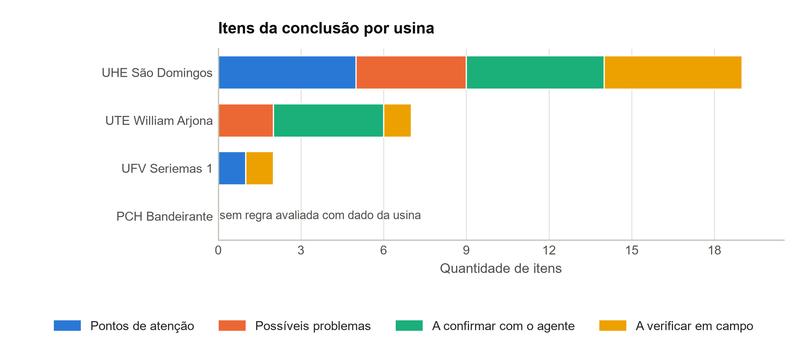
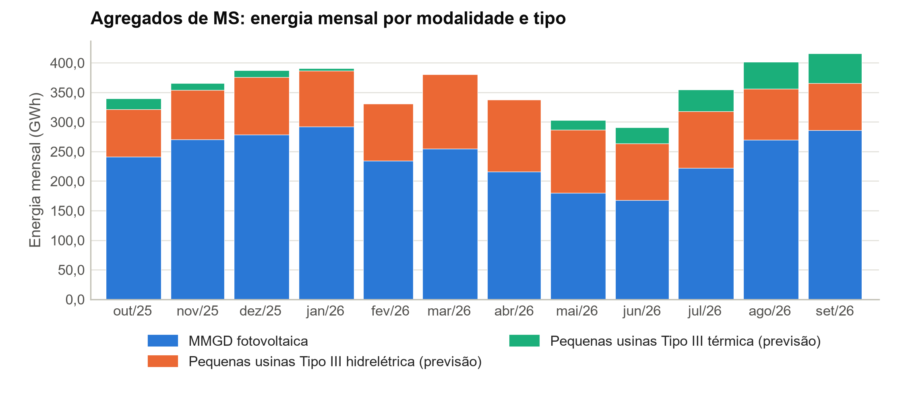

# Relatório de carteira — MS

Usinas do recorte a partir dos resultados gravados das análises

Recorte: usinas de MS no catálogo de usinas do ONS montado em 22/10/2026 12:46 UTC. As 22 linhas de conjunto de usinas do catálogo não contam como usina.

149 usinas no recorte: 4 com resultado e 145 sem resultado. Gerado em 22/10/2026 14:00, só a partir dos resultados gravados; nenhuma etapa foi executada.

## 1. Usinas com resultado

Usinas com perfil conferido e com as Análises concluídas, na ordem da seção 3.

| Usina | Tipo | Modalidade | Potência (MW) | Cobertura | Nível da geração | Período |
| --- | --- | --- | ---: | --- | --- | --- |
| UHE São Domingos | UHE | TIPO II-A | 48,0 | própria | usina | 28/08/2018 a 19/10/2026 |
| UTE William Arjona | UTE | TIPO I | 177,1 | própria | usina | 10/07/2021 a 18/10/2026 |
| UFV Seriemas 1 | UFV | TIPO II-C | 50,0 | própria | usina | 22/08/2026 a 19/10/2026 |
| PCH Bandeirante | PCH | TIPO II-C | 28,0 | conjunto | conjunto (CJU_MSCAO) | 22/08/2019 a 20/10/2026 |

Fonte dos dados: Modalidade das usinas (CEG de cada usina), publicado em 20/10/2026, pelo catálogo de usinas montado em 22/10/2026 12:46 UTC, com a cobertura de cada usina nos conjuntos de série do ONS; nome e potência: perfil de cada usina; período e nível da geração: resultados gravados das Análises de cada usina.

## 2. Indicadores comparáveis

Os indicadores da tabela anual do relatório de cada usina, no último ano completo da série, cada um do nível da usina, salvo os identificados.

| Usina | Ano | Fator de capacidade | Disponibilidade | TEIFa | Energia cortada | Atendimento ao despacho |
| --- | --- | ---: | ---: | ---: | ---: | ---: |
| UHE São Domingos | 2025 | 49,2% | 91,2% | 4,2% | — | — |
| UTE William Arjona | 2025 | — | 20,9% | 30,5% | — | 6,2% (2 de 32 h) |
| UFV Seriemas 1 | 2026\* | 17,2% | — | — | 16,3% | — |
| PCH Bandeirante | 2025 | — | — | — | — | — |

Calculado neste relatório a partir de: resultados gravados das Análises de cada usina, que vêm da série de referência e da Disponibilidade por usina (fator de capacidade e disponibilidade), das Taxas TEIFa e TEIP (TEIFa), da Restrição com detalhe (energia cortada) e da Geração térmica por motivo de despacho (atendimento ao despacho); o identificador e a data de obtenção de cada conjunto estão na legenda da tabela anual do relatório de cada usina.

\* Ano parcial: a série não tem ano completo. —: o indicador não se aplica ao tipo, ou a usina não tem a base.

## 3. Ordenação pelos itens da conclusão

Usinas ordenadas pela quantidade de itens em "Possíveis problemas" e, no empate, em "Pontos de atenção" e pelo nome.

| Posição | Usina | Tipo | Possíveis problemas | Pontos de atenção | A confirmar com o agente | A verificar em campo | Regras avaliadas |
| ---: | --- | --- | ---: | ---: | ---: | ---: | ---: |
| 1 | UHE São Domingos | UHE | 4 | 5 | 5 | 5 | 11 de 11 |
| 2 | UTE William Arjona | UTE | 2 | 0 | 4 | 1 | 7 de 8 |
| 3 | UFV Seriemas 1 | UFV | 0 | 1 | 0 | 1 | 2 de 4 |
| — | PCH Bandeirante | PCH | — | — | — | — | 0 de 11 |

Calculado neste relatório a partir de: itens da conclusão dos resultados gravados das Análises de cada usina (aba CONCLUSAO do relatório de cada usina).

Quantidade de todos os itens de cada lista da conclusão, inclusive os que passam do limite de 5 por lista do relatório da usina.

A conclusão de PCH Bandeirante não tem base no nível da usina: nenhuma regra foi avaliada com dado da usina, e a falta de itens não quer dizer falta de indício.

*Figura 1 – Itens da conclusão por usina, na ordem da ordenação (todos os itens de cada lista).*

Calculado neste relatório a partir de: itens da conclusão dos resultados gravados das Análises de cada usina (aba CONCLUSAO do relatório de cada usina).

## 4. Usinas sem resultado

145 usinas sem resultado, por motivo: só agregado no ONS (ver o panorama), 46; sem perfil, 99. A cobertura é a do catálogo: própria, conjunto, agregado ou ausente (sem série no ONS).

| Usina | Tipo | Modalidade | Cobertura | Motivo |
| --- | --- | --- | --- | --- |
| CGH BELA MIRAGEM | CGH | TIPO III | agregado | só agregado no ONS (ver o panorama) |
| CGH CHAPADÃO | CGH | TIPO III | agregado | só agregado no ONS (ver o panorama) |
| CGH CORREGO GER | CGH | TIPO III | agregado | só agregado no ONS (ver o panorama) |
| CGH ENERGIA MAIA | CGH | TIPO III | agregado | só agregado no ONS (ver o panorama) |
| CGH INDAIÁ | CGH | TIPO III | agregado | só agregado no ONS (ver o panorama) |
| CGH SANTA IZABEL | CGH | TIPO III | agregado | só agregado no ONS (ver o panorama) |
| CGH SÃO JOÃO I | CGH | TIPO III | agregado | só agregado no ONS (ver o panorama) |
| CGH SÃO JOÃO II | CGH | TIPO III | agregado | só agregado no ONS (ver o panorama) |
| CGH VITOR ANDRADE DE BRITO | CGH | TIPO III | agregado | só agregado no ONS (ver o panorama) |
| CGH CACHOEIRA BRANCA | PCH | TIPO III | agregado | só agregado no ONS (ver o panorama) |
| PCH ALTO SUCURIÚ | PCH | TIPO III | agregado | só agregado no ONS (ver o panorama) |
| PCH AQUARIUS | PCH | TIPO III | agregado | só agregado no ONS (ver o panorama) |
| PCH BURITI | PCH | TIPO III (EM DIT) | agregado | só agregado no ONS (ver o panorama) |
| PCH COSTA RICA | PCH | TIPO III | agregado | só agregado no ONS (ver o panorama) |
| PCH FUNDÃOZINHO | PCH | TIPO III | agregado | só agregado no ONS (ver o panorama) |
| PCH LAJEADO - MS | PCH | TIPO III | agregado | só agregado no ONS (ver o panorama) |
| PCH PARAÍSO I | PCH | TIPO III | agregado | só agregado no ONS (ver o panorama) |
| PCH PONTE ALTA | PCH | TIPO III | agregado | só agregado no ONS (ver o panorama) |
| PCH PORTO DAS PEDRAS | PCH | TIPO III (EM DIT) | agregado | só agregado no ONS (ver o panorama) |
| PCH VERDE 4 | PCH | TIPO III | agregado | só agregado no ONS (ver o panorama) |
| PCH VERDE 4A | PCH | TIPO III | agregado | só agregado no ONS (ver o panorama) |
| UFV CALCARIO BELA VISTA | UFV | TIPO III | agregado | só agregado no ONS (ver o panorama) |
| UFV CERGRAND - ITAPORÃ | UFV | TIPO III | agregado | só agregado no ONS (ver o panorama) |
| UFV CERGRAND - SANTA TEREZINHA | UFV | TIPO III | agregado | só agregado no ONS (ver o panorama) |
| UFV OROYTÊ | UFV | TIPO III | agregado | só agregado no ONS (ver o panorama) |
| UFV PLANACON | UFV | TIPO III | agregado | só agregado no ONS (ver o panorama) |
| PCH ASSIS CHATEAUBRIAND (SALTO MIMOSO) | UHE | TIPO III | agregado | só agregado no ONS (ver o panorama) |
| UTE ANGELICA | UTE | TIPO III | agregado | só agregado no ONS (ver o panorama) |
| UTE ANGELICA I | UTE | TIPO III | agregado | só agregado no ONS (ver o panorama) |
| UTE CAARAPÓ | UTE | TIPO III | agregado | só agregado no ONS (ver o panorama) |
| UTE CEDRO | UTE | TIPO III | agregado | só agregado no ONS (ver o panorama) |
| UTE CERRADINHO MS1 | UTE | TIPO III | agregado | só agregado no ONS (ver o panorama) |
| UTE ELDORADO BRASIL | UTE | TIPO III | agregado | só agregado no ONS (ver o panorama) |
| UTE INPASA DOURADOS | UTE | TIPO III | agregado | só agregado no ONS (ver o panorama) |
| UTE INPASA SIDROLÂNDIA | UTE | TIPO III | agregado | só agregado no ONS (ver o panorama) |
| UTE LAGUNA | UTE | TIPO III | agregado | só agregado no ONS (ver o panorama) |
| UTE LAR COOPERATIVA AGROINDUSTRIAL | UTE | TIPO III | agregado | só agregado no ONS (ver o panorama) |
| UTE LDC BIOENERGIA RIO BRILHANTE | UTE | TIPO III | agregado | só agregado no ONS (ver o panorama) |
| UTE MONTEVERDE | UTE | TIPO III | agregado | só agregado no ONS (ver o panorama) |
| UTE PASSA TEMPO | UTE | TIPO III | agregado | só agregado no ONS (ver o panorama) |
| UTE SIDROLÂNDIA | UTE | TIPO III | agregado | só agregado no ONS (ver o panorama) |
| UTE SONORA (SE SOZINHO) | UTE | TIPO III | agregado | só agregado no ONS (ver o panorama) |
| UTE VETORIAL CORUMBÁ | UTE | TIPO III | agregado | só agregado no ONS (ver o panorama) |
| UTE VETORIAL SIDERURGIA - UNIDADE RIBAS DO RIO PARDO | UTE | TIPO III | agregado | só agregado no ONS (ver o panorama) |
| UTE VISTA ALEGRE I | UTE | TIPO III | agregado | só agregado no ONS (ver o panorama) |
| UTE VISTA ALEGRE II | UTE | TIPO III | agregado | só agregado no ONS (ver o panorama) |
| PCH AREADO | PCH | TIPO II-C | conjunto | sem perfil |
| PCH INDAIAZINHO (EX GUATAMBU) | PCH | TIPO II-C | conjunto | sem perfil |
| PCH INDAIÁ GRANDE (EX FIGUEIRA) | PCH | TIPO II-C | conjunto | sem perfil |
| UFV CASSILÂNDIA 1 | UFV | TIPO II-C | ausente | sem perfil |
| UFV CASSILÂNDIA 2 | UFV | TIPO II-C | ausente | sem perfil |
| UFV CASSILÂNDIA 3 | UFV | TIPO II-C | ausente | sem perfil |
| UFV CASSILÂNDIA 4 | UFV | TIPO II-C | ausente | sem perfil |
| UFV CASSILÂNDIA 5 | UFV | TIPO II-C | ausente | sem perfil |
| UFV CASSILÂNDIA 6 | UFV | TIPO II-C | ausente | sem perfil |
| UFV CASSILÂNDIA 7 | UFV | TIPO II-C | ausente | sem perfil |
| UFV CASSILÂNDIA 8 | UFV | TIPO II-C | ausente | sem perfil |
| UFV CHAPADÃO 1 | UFV | TIPO II-C | ausente | sem perfil |
| UFV CHAPADÃO 10 | UFV | TIPO II-C | ausente | sem perfil |
| UFV CHAPADÃO 11 | UFV | TIPO II-C | ausente | sem perfil |
| UFV CHAPADÃO 12 | UFV | TIPO II-C | ausente | sem perfil |
| UFV CHAPADÃO 13 | UFV | TIPO II-C | ausente | sem perfil |
| UFV CHAPADÃO 14 | UFV | TIPO II-C | ausente | sem perfil |
| UFV CHAPADÃO 15 | UFV | TIPO II-C | ausente | sem perfil |
| UFV CHAPADÃO 16 | UFV | TIPO II-C | ausente | sem perfil |
| UFV CHAPADÃO 17 | UFV | TIPO II-C | ausente | sem perfil |
| UFV CHAPADÃO 18 | UFV | TIPO II-C | ausente | sem perfil |
| UFV CHAPADÃO 19 | UFV | TIPO II-C | ausente | sem perfil |
| UFV CHAPADÃO 2 | UFV | TIPO II-C | ausente | sem perfil |
| UFV CHAPADÃO 3 | UFV | TIPO II-C | ausente | sem perfil |
| UFV CHAPADÃO 4 | UFV | TIPO II-C | ausente | sem perfil |
| UFV CHAPADÃO 5 | UFV | TIPO II-C | ausente | sem perfil |
| UFV CHAPADÃO 6 | UFV | TIPO II-C | ausente | sem perfil |
| UFV CHAPADÃO 7 | UFV | TIPO II-C | ausente | sem perfil |
| UFV CHAPADÃO 8 | UFV | TIPO II-C | ausente | sem perfil |
| UFV CHAPADÃO 9 | UFV | TIPO II-C | ausente | sem perfil |
| UFV FÓTONS DE SANTA MARTA 01 | UFV | TIPO II-C | ausente | sem perfil |
| UFV FÓTONS DE SANTA MARTA 02 | UFV | TIPO II-C | ausente | sem perfil |
| UFV FÓTONS DE SANTA MARTA 03 | UFV | TIPO II-C | ausente | sem perfil |
| UFV FÓTONS DE SANTA MARTA 04 | UFV | TIPO II-C | ausente | sem perfil |
| UFV FÓTONS DE SANTA MARTA 05 | UFV | TIPO II-C | ausente | sem perfil |
| UFV FÓTONS DE SANTA MARTA 06 | UFV | TIPO II-C | ausente | sem perfil |
| UFV FÓTONS DE SANTA MARTA 07 | UFV | TIPO II-C | ausente | sem perfil |
| UFV FÓTONS DE SANTA MARTA 08 | UFV | TIPO II-C | ausente | sem perfil |
| UFV FÓTONS DE SÃO GEORGE 01 | UFV | TIPO II-C | própria | sem perfil |
| UFV FÓTONS DE SÃO GEORGE 02 | UFV | TIPO II-C | própria | sem perfil |
| UFV FÓTONS DE SÃO GEORGE 03 | UFV | TIPO II-C | própria | sem perfil |
| UFV FÓTONS DE SÃO GEORGE 04 | UFV | TIPO II-C | própria | sem perfil |
| UFV FÓTONS DE SÃO GEORGE 05 | UFV | TIPO II-C | própria | sem perfil |
| UFV FÓTONS DE SÃO PAULINO 01 | UFV | TIPO II-C | própria | sem perfil |
| UFV FÓTONS DE SÃO PAULINO 02 | UFV | TIPO II-C | própria | sem perfil |
| UFV MARAVILHAS III | UFV | TIPO II-C | ausente | sem perfil |
| UFV PARANAÍBA  3 | UFV | TIPO II-C | ausente | sem perfil |
| UFV PARANAÍBA 1 | UFV | TIPO II-C | ausente | sem perfil |
| UFV PARANAÍBA 10 | UFV | TIPO II-C | ausente | sem perfil |
| UFV PARANAÍBA 11 | UFV | TIPO II-C | ausente | sem perfil |
| UFV PARANAÍBA 2 | UFV | TIPO II-C | ausente | sem perfil |
| UFV PARANAÍBA 4 | UFV | TIPO II-C | ausente | sem perfil |
| UFV PARANAÍBA 5 | UFV | TIPO II-C | ausente | sem perfil |
| UFV PARANAÍBA 6 | UFV | TIPO II-C | ausente | sem perfil |
| UFV PARANAÍBA 7 | UFV | TIPO II-C | ausente | sem perfil |
| UFV PARANAÍBA 8 | UFV | TIPO II-C | ausente | sem perfil |
| UFV PARANAÍBA 9 | UFV | TIPO II-C | ausente | sem perfil |
| UFV SERIEMAS 2 | UFV | TIPO II-C | própria | sem perfil |
| UFV SERIEMAS 3 | UFV | TIPO II-C | própria | sem perfil |
| UFV SERIEMAS 4 | UFV | TIPO II-C | própria | sem perfil |
| UFV SERIEMAS 5 | UFV | TIPO II-C | própria | sem perfil |
| UFV SERIEMAS 6 | UFV | TIPO II-C | própria | sem perfil |
| UFV SERIEMAS 7 | UFV | TIPO II-C | própria | sem perfil |
| UFV SERIEMAS 8 | UFV | TIPO II-C | própria | sem perfil |
| UFV TALISMÃ CAMAPUÃ 1 | UFV | TIPO II-C | ausente | sem perfil |
| UFV TALISMÃ PARANAÍBA 1 | UFV | TIPO II-C | ausente | sem perfil |
| UFV TALISMÃ PARANAÍBA 2 | UFV | TIPO II-C | ausente | sem perfil |
| UFV TALISMÃ PARANAÍBA 3 | UFV | TIPO II-C | ausente | sem perfil |
| UFV TALISMÃ PARANAÍBA 4 | UFV | TIPO II-C | ausente | sem perfil |
| UFV TALISMÃ PARANAÍBA 5 | UFV | TIPO II-C | ausente | sem perfil |
| UFV TALISMÃ PARANAÍBA 6 | UFV | TIPO II-C | ausente | sem perfil |
| UFV TALISMÃ PARANAÍBA 7 | UFV | TIPO II-C | ausente | sem perfil |
| UFV TALISMÃ PARANAÍBA 8 | UFV | TIPO II-C | ausente | sem perfil |
| UFV TALISMÃ PARANAÍBA 9 | UFV | TIPO II-C | ausente | sem perfil |
| UFV TALISMÃ VMF 1 | UFV | TIPO II-C | ausente | sem perfil |
| UFV TALISMÃ VMF 2 | UFV | TIPO II-C | ausente | sem perfil |
| UFV TALISMÃ VMF 3 | UFV | TIPO II-C | ausente | sem perfil |
| UFV VERDÃO 1 | UFV | TIPO II-C | ausente | sem perfil |
| UFV VERDÃO 2 | UFV | TIPO II-C | ausente | sem perfil |
| UFV VERDÃO 3 | UFV | TIPO II-C | ausente | sem perfil |
| UFV VERDÃO 4 | UFV | TIPO II-C | ausente | sem perfil |
| UFV VERDÃO 5 | UFV | TIPO II-C | ausente | sem perfil |
| UFV VERDÃO 6 | UFV | TIPO II-C | ausente | sem perfil |
| UHE BAIXO VERDE I | UHE | TIPO II-B | ausente | sem perfil |
| UHE BAIXO VERDE III | UHE | TIPO II-B | ausente | sem perfil |
| UHE ILHA SOLTEIRA | UHE | TIPO I | própria | sem perfil |
| UTE AMANDINA | UTE | TIPO II-B | ausente | sem perfil |
| UTE AMANDINA II | UTE | TIPO II-B | própria | sem perfil |
| UTE COSTA RICA | UTE | TIPO II-B | própria | sem perfil |
| UTE ELDORADO | UTE | TIPO II-C | própria | sem perfil |
| UTE FIBRIA - MS (EX UTE VCP - MS) | UTE | TIPO II-C | conjunto | sem perfil |
| UTE FIBRIA MS-II | UTE | TIPO II-C | conjunto | sem perfil |
| UTE IACO AGRÍCOLA | UTE | TIPO II-B | própria | sem perfil |
| UTE ONÇA PINTADA | UTE | TIPO II-A | própria | sem perfil |
| UTE SANTA LUZIA I | UTE | TIPO II-C | própria | sem perfil |
| UTE STAR 3 | UTE | TIPO II-B | ausente | sem perfil |
| UTE SUCURIÚ | UTE | TIPO II-B | ausente | sem perfil |
| UTE SUZANO RRP1 | UTE | TIPO II-B | própria | sem perfil |
| UTE TRÊS LAGOAS | UTE | TIPO I | própria | sem perfil |

Calculado neste relatório a partir de: cobertura de cada usina no catálogo de usinas montado em 22/10/2026 12:46 UTC; perfis em usinas/ e etapa.json das Análises de cada usina.

## 5. Panorama dos agregados de MS

Geração das pequenas usinas e da MMGD de MS publicada pelo ONS de forma agregada, de out/2025 a set/2026 (os 12 últimos meses completos do catálogo). Os agregados são números do agregado, publicados por área do estado, e não são atribuídos a nenhuma usina; os valores das usinas Tipo III são previsão do ONS.

| Mês | MMGD fotovoltaica (MWh) | Pequenas usinas Tipo III hidrelétrica (previsão) (MWh) | Pequenas usinas Tipo III térmica (previsão) (MWh) | Usinas Tipo III térmica (previsão) (MWh) |
| --- | ---: | ---: | ---: | ---: |
| out/2025 | 240.770 | 80.732 | 18.418 | 0 |
| nov/2025 | 270.559 | 83.164 | 12.009 | 0 |
| dez/2025 | 278.263 | 97.154 | 11.929 | 0 |
| jan/2026 | 292.163 | 94.570 | 3.771 | 0 |
| fev/2026 | 234.200 | 96.274 | 225 | 0 |
| mar/2026 | 254.715 | 125.928 | 744 | 0 |
| abr/2026 | 215.981 | 121.860 | 720 | 0 |
| mai/2026 | 180.108 | 106.349 | 16.453 | sem valor |
| jun/2026 | 167.972 | 95.217 | 27.838 | sem valor |
| jul/2026 | 221.805 | 96.159 | 36.511 | sem valor |
| ago/2026 | 269.298 | 86.754 | 45.199 | sem valor |
| set/2026 | 285.744 | 79.993 | 50.313 | sem valor |

Fonte dos dados: Geração por usina (agregados de MS por modalidade, nível agregado), arquivos mensais de out/2025 a set/2026, lidos pelo catálogo de usinas montado em 22/10/2026 12:46 UTC.

Horas com valor: 71.496 das 78.840 horas dos grupos publicados em cada mês. Horas sem valor: 3.672 em UTE CAARAPO (de mai/2026 a set/2026) e 3.672 em UTE ELDORADO BR (de mai/2026 a set/2026). Horas ausentes: nenhuma. "sem valor": nenhum grupo da série tem hora com valor no mês.

*Figura 2 – Energia mensal dos agregados de MS por modalidade e tipo; os valores Tipo III são previsão do ONS.*

Fonte dos dados: Geração por usina (agregados de MS por modalidade, nível agregado), arquivos mensais de out/2025 a set/2026, lidos pelo catálogo de usinas montado em 22/10/2026 12:46 UTC.

## Notas

Fontes: o catálogo de usinas do ONS (data/catalogo/, montado em 22/10/2026 12:46 UTC), para o recorte, a cobertura e os agregados; e os resultados gravados das Análises de cada usina (data/usinas/<slug>/analises/), concluídas: UHE São Domingos em 22/10/2026 17:35 UTC, UTE William Arjona em 22/10/2026 17:31 UTC, UFV Seriemas 1 em 22/10/2026 17:31 UTC e PCH Bandeirante em 22/10/2026 17:32 UTC.

Indicadores: fator de capacidade e disponibilidade em % da potência instalada; TEIFa publicada pelo ONS para dezembro do ano (no ano parcial, a do último mês publicado, indicado); energia cortada em % da energia estimada nas semi-horas com a marca de restrição; atendimento ao despacho: horas com programação acima de 1 MW em que a geração ficou a até 5 MW da programada, em % das horas com programação.

Níveis dos dados: os números de conjunto de usinas ou de agregado não são divididos entre as usinas nem atribuídos a nenhuma delas.

A carteira não atribui nota nem parecer: a ordenação só conta os itens da conclusão de cada usina, que dependem das regras avaliadas e do período de cada uma.
