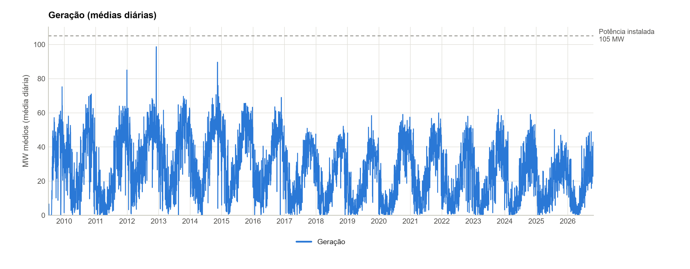
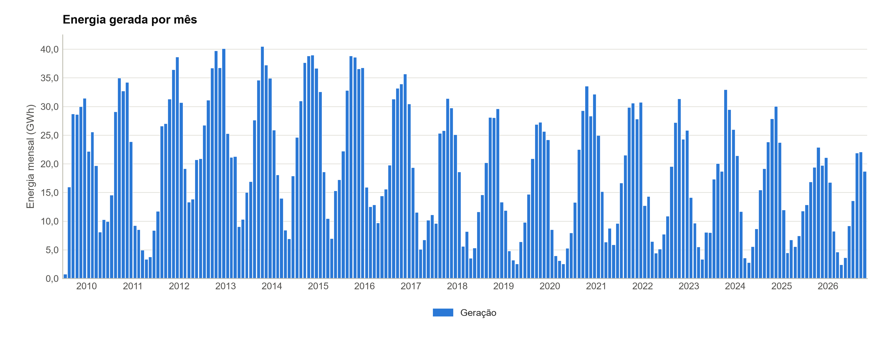
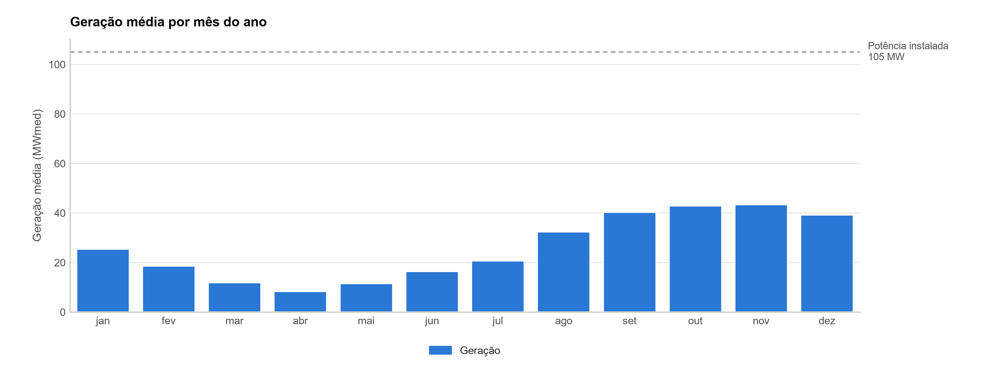
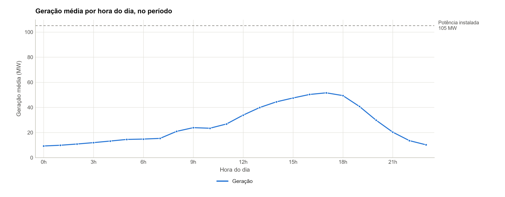
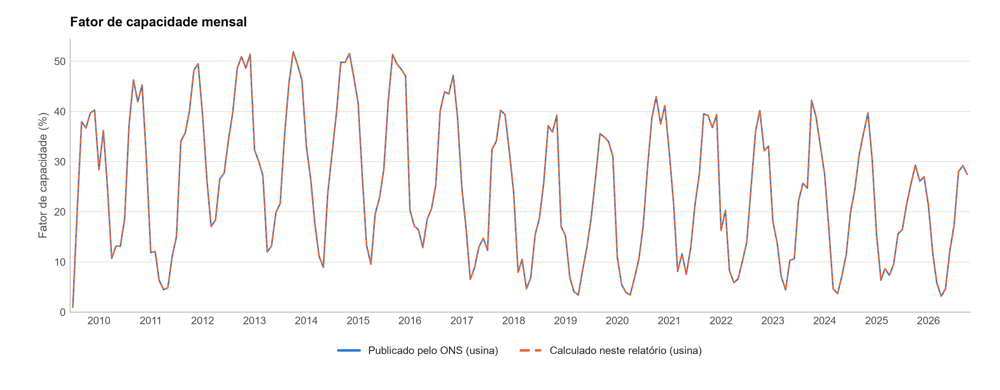
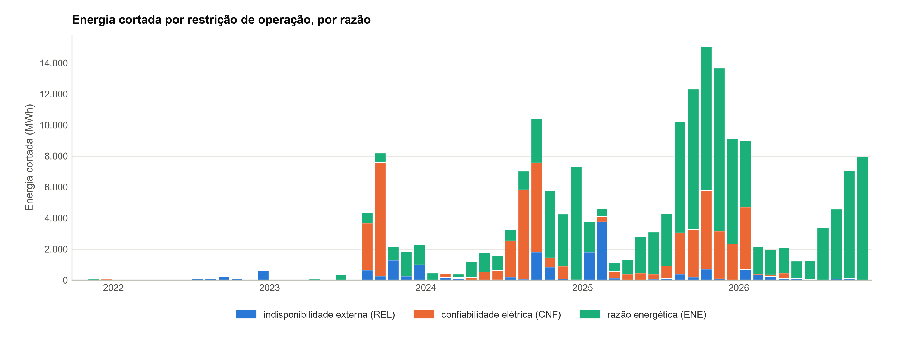
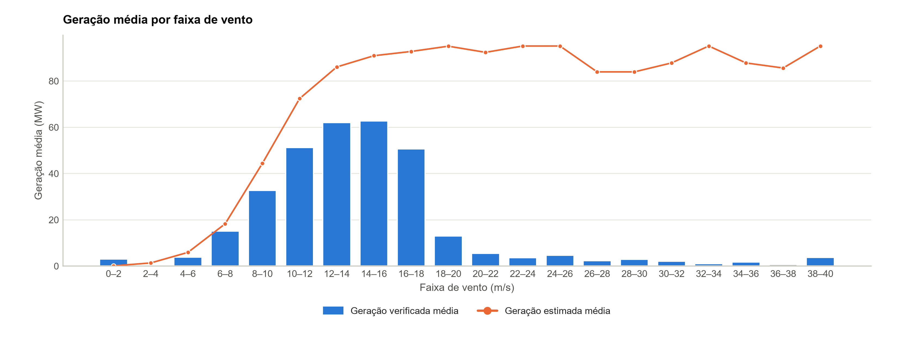
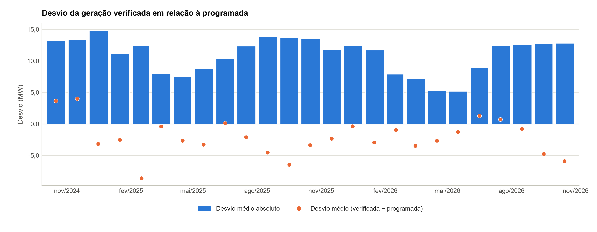

# EOL Praia Formosa — Análise do desempenho operacional

**Período**: 01/07/2009 00h a 27/10/2026 23h (151.790 registros horários da série de referência, Geração por usina (id ONS CEUFM))
**Gerado em**: 29/10/2026 08:00

### Identificação nos dados do ONS

| Item | Valor |
| --- | --- |
| Tipo · modalidade | EOL · TIPO I |
| CEG | EOL.CV.CE.028631-1.01 |
| id ONS | CEUFM |
| Programação diária | CEUFM |
| Estado | CE |
| Agente atual | CPFL ENERGIAS (proprietário e operador) |

Fonte dos dados: Modalidade das usinas (CEG EOL.CV.CE.028631-1.01), obtido em 29/10/2026; Geração por usina (id ONS CEUFM), obtido em 29/10/2026; Capacidade de geração (CEG EOL.CV.CE.028631-1.01), obtido em 29/10/2026.

### Cadastro no ONS

| Item | Valor |
| --- | --- |
| Usina | EOL PRAIA FORMOSA · CEG EOL.CV.CE.028631-1.01 · id ONS CEUFM |
| Modalidade de operação | TIPO I |
| Centro de operação | COSR-NE |
| Ponto de conexão | SE SOBRAL III 230,0 kV |
| Potência autorizada | 105,0 MW |
| Estado · situação na ANEEL | CE · A |
| Homônimos excluídos pelo CEG | 0 |

Fonte dos dados: Modalidade das usinas (CEG EOL.CV.CE.028631-1.01), obtido em 29/10/2026. Conferência: potência autorizada e estado conferidos com os parâmetros do projeto: sem divergência.

### Parâmetros técnicos da usina

| Item | Valor |
| --- | --- |
| Potência instalada | 105,0 MW (6 unidades: 16,8, 16,8, 16,8, 21,0, 16,8 e 16,8 MW) |
| Início da operação comercial | 2009 |

Fonte dos dados: parâmetros do projeto (origem na tabela de parâmetros).

### Indicadores principais

| Indicador | Valor | Detalhe |
| --- | --- | --- |
| Geração média | 26,1 MWmed | 3.956,8 GWh em 151.790 horas com valor |
| Fator de capacidade | 24,8% | geração média ÷ potência instalada |
| Energia cortada | 16,7% | 186.512 MWh por restrição de operação, da energia estimada nas semi-horas com a marca |

Indicadores calculados a partir da série de referência e da disponibilidade publicadas pelo ONS; não substituem os índices regulatórios. Ver notas metodológicas.

Calculado neste relatório a partir de: Geração por usina (id ONS CEUFM), obtido em 29/10/2026; Restrição com detalhe (constrained-off) (id ONS CEUFM; CEG EOL.CV.CE.028631-1.01), obtido em 29/10/2026. Sem outra fonte para conferir: geração.

## Sumário

1. [Fonte e cobertura dos dados](#1-fonte-e-cobertura-dos-dados)
2. [Indicadores anuais](#2-indicadores-anuais)
3. [Série temporal da geração](#3-série-temporal-da-geração)
4. [Geração mensal e sazonalidade](#4-geração-mensal-e-sazonalidade)
5. [Perfil horário da geração](#5-perfil-horário-da-geração)
6. [Fator de capacidade](#6-fator-de-capacidade)
7. [Energia cortada por restrição de operação (constrained-off)](#7-energia-cortada-por-restrição-de-operação-constrained-off)
8. [Recurso × geração](#8-recurso--geração)
9. [Programação diária × geração verificada](#9-programação-diária--geração-verificada)
10. [Qualidade dos dados](#10-qualidade-dos-dados)
11. [Conclusão](#11-conclusão)
12. [Notas metodológicas e limitações](#12-notas-metodológicas-e-limitações)

## 1. Fonte e cobertura dos dados

**Cobertura dos dados.** Série de referência: Geração por usina (id ONS CEUFM), de 01/07/2009 00h a 27/10/2026 23h: 151.790 horas com registro de 151.872 no período (99,95%). 82 horas ausentes, listadas na planilha, sem preenchimento.

| Item | Valor |
| --- | --- |
| Série de referência | Geração por usina (id ONS CEUFM) — Portal de Dados Abertos do ONS (https://dados.ons.org.br/dataset/geracao-usina-2) |
| Período | 01/07/2009 00h a 27/10/2026 23h |
| Registros | 151.790 de 151.872 horas do período; 82 horas ausentes em 13 intervalos; 0 horas sem valor |
| Níveis | usina: 151.790 horas |
| Anos parciais | 2009 e 2026 |

Fonte dos dados: Geração por usina (id ONS CEUFM), obtido em 29/10/2026.

### Conjuntos do ONS, nível e identificador

| Conjunto do ONS | Nível | Identificador | Obtenção |
| --- | --- | --- | --- |
| Geração por usina (série de referência) | usina | CEUFM | obtido em 29/10/2026 |
| Programação diária | usina | CEUFM | obtido em 29/10/2026 |
| Fator de capacidade | usina | CEUFM | obtido em 29/10/2026 |
| Restrição com a razão | usina | CEUFM | obtido em 29/10/2026 |
| Restrição com detalhe | usina | id ONS CEUFM; CEG EOL.CV.CE.028631-1.01 | obtido em 29/10/2026 |
| Modalidade das usinas | usina | CEG EOL.CV.CE.028631-1.01 | obtido em 29/10/2026 |

Fonte dos dados: Geração por usina (id ONS CEUFM), obtido em 29/10/2026; Programação diária (CEUFM), obtido em 29/10/2026; Modalidade das usinas (CEG EOL.CV.CE.028631-1.01), obtido em 29/10/2026; Fator de capacidade (id ONS CEUFM), obtido em 29/10/2026; Restrição com detalhe (constrained-off) (id ONS CEUFM; CEG EOL.CV.CE.028631-1.01), obtido em 29/10/2026; Restrição com a razão (constrained-off) (id ONS CEUFM), obtido em 29/10/2026.

## 2. Indicadores anuais

**Geração.** Geração média de 26,1 MWmed nas 151.790 horas com valor (3.956.839 MWh); geração até 1 MW em 15,5% das horas; entre os anos completos, maior média em 2012 (37,5 MWmed) e menor em 2025 (18,3 MWmed).

| Ano | Nível | Horas | Com valor | Geração média (MWmed) | Energia (MWh) | Máxima (MW) | Horas até 1 MW | % das horas | Fator de capacidade | Energia cortada (MWh, % est.) |
| --- | --- | --- | --- | --- | --- | --- | --- | --- | --- | --- |
| 2009* | usina | 4.415 | 4.415 | 30,7 | 135.468 | 95,9 | 985 | 22,3% | 29,2% | — |
| 2010 | usina | 8.759 | 8.759 | 30,3 | 265.052 | 102,7 | 1.057 | 12,1% | 28,8% | — |
| 2011 | usina | 8.759 | 8.759 | 24,0 | 209.921 | 102,5 | 1.783 | 20,4% | 22,8% | — |
| 2012 | usina | 8.783 | 8.783 | 37,5 | 329.785 | 102,0 | 476 | 5,4% | 35,8% | — |
| 2013 | usina | 8.735 | 8.735 | 33,6 | 293.743 | 100,6 | 722 | 8,3% | 32,0% | — |
| 2014 | usina | 8.735 | 8.735 | 34,2 | 298.778 | 102,3 | 716 | 8,2% | 32,6% | — |
| 2015 | usina | 8.735 | 8.735 | 35,1 | 306.781 | 101,0 | 695 | 8,0% | 33,4% | — |
| 2016 | usina | 8.783 | 8.783 | 30,2 | 265.172 | 100,3 | 829 | 9,4% | 28,8% | — |
| 2017 | usina | 8.759 | 8.759 | 24,1 | 210.836 | 90,6 | 1.178 | 13,4% | 22,9% | — |
| 2018 | usina | 8.759 | 8.759 | 21,3 | 186.604 | 82,1 | 1.587 | 18,1% | 20,3% | — |
| 2019 | usina | 8.760 | 8.760 | 20,3 | 178.187 | 87,7 | 1.715 | 19,6% | 19,4% | — |
| 2020 | usina | 8.784 | 8.784 | 21,7 | 190.459 | 94,0 | 1.938 | 22,1% | 20,7% | — |
| 2021 | usina | 8.760 | 8.760 | 26,0 | 227.800 | 95,8 | 1.281 | 14,6% | 24,8% | 122 (0,4%) |
| 2022 | usina | 8.760 | 8.760 | 21,7 | 189.864 | 89,4 | 1.621 | 18,5% | 20,6% | 1.210 (0,6%) |
| 2023 | usina | 8.760 | 8.760 | 22,0 | 193.081 | 97,0 | 1.764 | 20,1% | 21,0% | 19.339 (11,2%) |
| 2024 | usina | 8.784 | 8.784 | 22,1 | 193.711 | 99,3 | 1.727 | 19,7% | 21,0% | 43.866 (15,3%) |
| 2025 | usina | 8.760 | 8.760 | 18,3 | 160.559 | 91,4 | 1.817 | 20,7% | 17,5% | 81.354 (32,2%) |
| 2026* | usina | 7.200 | 7.200 | 16,8 | 121.037 | 91,3 | 1.630 | 22,6% | 16,0% | 40.620 (24,7%) |

\* Ano parcial. Geração média = média das horas com valor; horas até 1 MW = horas com geração até esse limiar, sobre as horas com valor; fator de capacidade = geração média ÷ potência instalada; energia cortada = por restrição de operação, nas semi-horas com a marca de restrição, e % da energia estimada nelas.

Calculado neste relatório a partir de: Geração por usina (id ONS CEUFM), obtido em 29/10/2026; Restrição com detalhe (constrained-off) (id ONS CEUFM; CEG EOL.CV.CE.028631-1.01), obtido em 29/10/2026; parâmetros do projeto (origem na tabela de parâmetros). Sem outra fonte para conferir: geração.

## 3. Série temporal da geração

Médias diárias da geração, de 01/07/2009 a 27/10/2026. Linha tracejada: potência instalada da usina (105 MW).

Calculado neste relatório a partir de: Geração por usina (id ONS CEUFM), obtido em 29/10/2026. Sem outra fonte para conferir: geração.

## 4. Geração mensal e sazonalidade

Energia gerada em cada mês (GWh), pela soma das horas com valor. Maior energia mensal: 40,5 GWh em out/2013.

Calculado neste relatório a partir de: Geração por usina (id ONS CEUFM), obtido em 29/10/2026. Sem outra fonte para conferir: geração.

Geração média por mês do ano, só com a série de pelo menos 12 meses distintos; cada barra junta os anos do período com aquele mês.

Calculado neste relatório a partir de: Geração por usina (id ONS CEUFM), obtido em 29/10/2026. Sem outra fonte para conferir: geração.

## 5. Perfil horário da geração

Geração média por hora do dia, no período, sobre as horas com valor.

Calculado neste relatório a partir de: Geração por usina (id ONS CEUFM), obtido em 29/10/2026. Sem outra fonte para conferir: geração.

## 6. Fator de capacidade

**Fator de capacidade.** Fator de capacidade publicado pelo ONS de 24,8% de 01/07/2009 a 27/10/2026, no nível usina, em 151.790 horas.

O fator de capacidade calculado neste relatório, da geração da usina e da potência instalada do perfil (105,0 MW), fica na tabela ao lado do publicado.

### Fator de capacidade por ano

| Ano | Nível | Horas | Geração verificada (MWh) | Capacidade média (MW) | FC publicado | FC calculado (usina) | Horas com FC fora de 0 a 1 | Horas acima da capacidade |
| --- | --- | --- | --- | --- | --- | --- | --- | --- |
| 2009* | usina | 4.415 | 135.468 | 105,0 | 29,2% | 29,2% | 0 | 0 |
| 2010 | usina | 8.759 | 265.052 | 105,0 | 28,8% | 28,8% | 0 | 0 |
| 2011 | usina | 8.759 | 209.921 | 105,0 | 22,8% | 22,8% | 0 | 0 |
| 2012 | usina | 8.783 | 329.785 | 105,0 | 35,8% | 35,8% | 0 | 0 |
| 2013 | usina | 8.735 | 293.743 | 105,0 | 32,0% | 32,0% | 0 | 0 |
| 2014 | usina | 8.735 | 298.778 | 105,0 | 32,6% | 32,6% | 0 | 0 |
| 2015 | usina | 8.735 | 306.781 | 105,0 | 33,4% | 33,4% | 0 | 0 |
| 2016 | usina | 8.783 | 265.172 | 105,0 | 28,8% | 28,8% | 0 | 0 |
| 2017 | usina | 8.759 | 210.836 | 105,0 | 22,9% | 22,9% | 0 | 0 |
| 2018 | usina | 8.759 | 186.604 | 105,0 | 20,3% | 20,3% | 0 | 0 |
| 2019 | usina | 8.760 | 178.187 | 105,0 | 19,4% | 19,4% | 0 | 0 |
| 2020 | usina | 8.784 | 190.459 | 105,0 | 20,7% | 20,7% | 0 | 0 |
| 2021 | usina | 8.760 | 227.800 | 105,0 | 24,8% | 24,8% | 0 | 0 |
| 2022 | usina | 8.760 | 189.864 | 105,0 | 20,6% | 20,6% | 0 | 0 |
| 2023 | usina | 8.760 | 193.081 | 105,0 | 21,0% | 21,0% | 0 | 0 |
| 2024 | usina | 8.784 | 193.711 | 105,0 | 21,0% | 21,0% | 0 | 0 |
| 2025 | usina | 8.760 | 160.559 | 105,0 | 17,5% | 17,5% | 0 | 0 |
| 2026* | usina | 7.200 | 120.586 | 105,0 | 16,0% | 16,0% | 0 | 0 |

\* Ano parcial. FC publicado = Σ geração verificada ÷ Σ capacidade instalada nas horas com os dois dados, no nível publicado pelo ONS; FC calculado = geração média da usina na série de referência ÷ potência instalada do perfil. Horas com FC fora de 0 a 1 ou geração acima da capacidade (folga de 1 MW) são sinalizadas e ficam nos totais.

Calculado neste relatório a partir de: Fator de capacidade (id ONS CEUFM), obtido em 29/10/2026; Geração por usina (id ONS CEUFM), obtido em 29/10/2026; parâmetros do projeto (origem na tabela de parâmetros). Conferência: geração conferida entre as fontes, duas a duas e no mesmo nível (G1): 367.896 de 374.150 horas coincidentes (98,3%) em 6 pares de fontes, detalhados na aba CONF_G1_PARES; 6.254 divergências, listadas na aba CONF_G1_DIVERGENCIAS; programação diária conferida com o programado do Fator de capacidade (G5): 16.719 de 17.688 horas coincidentes (94,5%), 969 divergências, listadas na aba CONF_G5_DIVERGENCIAS.

Fator de capacidade mensal publicado pelo ONS (usina) e o calculado neste relatório da geração da usina e da potência instalada do perfil (%), de jul/2009 a out/2026.

Calculado neste relatório a partir de: Fator de capacidade (id ONS CEUFM), obtido em 29/10/2026; Geração por usina (id ONS CEUFM), obtido em 29/10/2026; parâmetros do projeto (origem na tabela de parâmetros). Conferência: geração conferida entre as fontes, duas a duas e no mesmo nível (G1): 367.896 de 374.150 horas coincidentes (98,3%) em 6 pares de fontes, detalhados na aba CONF_G1_PARES; 6.254 divergências, listadas na aba CONF_G1_DIVERGENCIAS; programação diária conferida com o programado do Fator de capacidade (G5): 16.719 de 17.688 horas coincidentes (94,5%), 969 divergências, listadas na aba CONF_G5_DIVERGENCIAS.

## 7. Energia cortada por restrição de operação (constrained-off)

**Energia cortada.** Energia cortada por restrição de operação de 186.512 MWh nas 16.437 semi-horas com a marca de restrição (16,7% da energia estimada nas semi-horas com a marca); diferença bruta entre a estimada e a verificada de 356.918 MWh em todas as semi-horas. Sem a estimativa do ONS (estimada 0 com a usina gerando) em 10.500 semi-horas, 442 delas com a marca de restrição, em que o corte não pôde ser calculado.

Restrição com detalhe de 01/10/2021 a 27/10/2026 (88.944 semi-horas), com a marca de restrição em 16.437 (8.218,5 horas). Fora das semi-horas restritas, a diferença entre a estimada e a verificada é erro da estimativa e não entra no corte.

### Energia cortada por restrição de operação por ano

| Ano | Verificada (MWh) | Estimada (MWh) | Cortada (MWh) | % da estimada | Horas restritas | Restritas sem estimativa | Semi-horas sem a marca | Diferença bruta (MWh) |
| --- | --- | --- | --- | --- | --- | --- | --- | --- |
| 2021* | 31.782 | 33.725 | 122 | 0,4% | 17,0 | 9 | 0 | 3.066 |
| 2022 | 159.949 | 207.838 | 1.210 | 0,6% | 46,5 | 11 | 0 | 51.224 |
| 2023 | 149.105 | 173.363 | 19.339 | 11,2% | 884,5 | 334 | 0 | 34.924 |
| 2024 | 185.988 | 287.602 | 43.866 | 15,3% | 1.612,0 | 71 | 0 | 107.387 |
| 2025 | 159.781 | 252.380 | 81.354 | 32,2% | 3.269,5 | 15 | 0 | 103.163 |
| 2026* | 120.893 | 164.557 | 40.620 | 24,7% | 2.389,0 | 2 | 0 | 57.154 |

\* Ano parcial. Verificada e estimada nas semi-horas com a estimativa do ONS (estimada 0 com a usina gerando = estimativa ausente). Cortada = Σ máx(estimada − verificada, 0) × 0,5 h nas semi-horas com a marca de restrição; % sobre a estimada das semi-horas com a marca; restritas sem estimativa = semi-horas com a marca em que o corte não pôde ser calculado; diferença bruta = o mesmo cálculo em todas as semi-horas com estimativa, para comparação.

Calculado neste relatório a partir de: Restrição com detalhe (constrained-off) (id ONS CEUFM; CEG EOL.CV.CE.028631-1.01), obtido em 29/10/2026. Conferência: geração conferida entre as fontes, duas a duas e no mesmo nível (G1): 367.896 de 374.150 horas coincidentes (98,3%) em 6 pares de fontes, detalhados na aba CONF_G1_PARES; 6.254 divergências, listadas na aba CONF_G1_DIVERGENCIAS. Sem outra fonte para conferir: geração estimada e marca de restrição.

### Energia cortada por razão da restrição

| Razão | Semi-horas restritas | Energia cortada (MWh) | % da cortada |
| --- | --- | --- | --- |
| indisponibilidade externa (REL) | 1.641 | 16.656 | 8,9% |
| confiabilidade elétrica (CNF) | 4.491 | 50.981 | 27,3% |
| razão energética (ENE) | 10.305 | 118.875 | 63,7% |

Razão de cada semi-hora restrita na Restrição com a razão; sem razão publicada = semi-hora restrita sem o código.

Calculado neste relatório a partir de: Restrição com detalhe (constrained-off) (id ONS CEUFM; CEG EOL.CV.CE.028631-1.01), obtido em 29/10/2026; Restrição com a razão (constrained-off) (id ONS CEUFM), obtido em 29/10/2026. Conferência: geração conferida entre as fontes, duas a duas e no mesmo nível (G1): 367.896 de 374.150 horas coincidentes (98,3%) em 6 pares de fontes, detalhados na aba CONF_G1_PARES; 6.254 divergências, listadas na aba CONF_G1_DIVERGENCIAS. Sem outra fonte para conferir: geração estimada e marca de restrição.

Energia cortada por restrição de operação em cada mês (MWh), por razão, só nas semi-horas com a marca de restrição.

Calculado neste relatório a partir de: Restrição com detalhe (constrained-off) (id ONS CEUFM; CEG EOL.CV.CE.028631-1.01), obtido em 29/10/2026; Restrição com a razão (constrained-off) (id ONS CEUFM), obtido em 29/10/2026. Conferência: geração conferida entre as fontes, duas a duas e no mesmo nível (G1): 367.896 de 374.150 horas coincidentes (98,3%) em 6 pares de fontes, detalhados na aba CONF_G1_PARES; 6.254 divergências, listadas na aba CONF_G1_DIVERGENCIAS. Sem outra fonte para conferir: geração estimada e marca de restrição.

## 8. Recurso × geração

**Recurso × geração.** Medição de vento marcada como inválida pelo ONS em 13.151 das 88.944 semi-horas (14,8%), fora das faixas. Também fora das faixas, sem a marca do ONS: 111 semi-horas com vento acima de 40 m/s, acima do limite físico.

Geração por faixa de vento (2 m/s por faixa), nas 75.634 semi-horas com o vento válido.

### Geração por faixa de vento

| Faixa de vento (m/s) | Semi-horas | Geração verificada média (MW) | Geração estimada média (MW) |
| --- | --- | --- | --- |
| 0 a 2 | 574 | 3,0 | 0,1 |
| 2 a 4 | 5.172 | 0,3 | 1,3 |
| 4 a 6 | 19.373 | 3,8 | 5,9 |
| 6 a 8 | 24.068 | 15,1 | 18,2 |
| 8 a 10 | 12.393 | 32,7 | 44,3 |
| 10 a 12 | 6.927 | 51,2 | 72,4 |
| 12 a 14 | 4.541 | 62,0 | 86,1 |
| 14 a 16 | 1.986 | 62,6 | 90,9 |
| 16 a 18 | 353 | 50,6 | 92,8 |
| 18 a 20 | 65 | 13,0 | 95,0 |
| 20 a 22 | 35 | 5,5 | 92,4 |
| 22 a 24 | 43 | 3,5 | 95,1 |
| 24 a 26 | 14 | 4,6 | 95,1 |
| 26 a 28 | 17 | 2,3 | 83,9 |
| 28 a 30 | 17 | 2,8 | 83,9 |
| 30 a 32 | 13 | 2,0 | 87,8 |
| 32 a 34 | 11 | 1,0 | 95,1 |
| 34 a 36 | 13 | 1,7 | 87,8 |
| 36 a 38 | 10 | 0,6 | 85,6 |
| 38 a 40 | 9 | 3,7 | 95,1 |

Só as semi-horas com o vento válido, até o limite físico de 40 m/s, e a geração verificada; o valor negativo (ruído de medição) entra na primeira faixa.

Calculado neste relatório a partir de: Restrição com detalhe (constrained-off) (id ONS CEUFM; CEG EOL.CV.CE.028631-1.01), obtido em 29/10/2026. Conferência: geração conferida entre as fontes, duas a duas e no mesmo nível (G1): 367.896 de 374.150 horas coincidentes (98,3%) em 6 pares de fontes, detalhados na aba CONF_G1_PARES; 6.254 divergências, listadas na aba CONF_G1_DIVERGENCIAS. Sem outra fonte para conferir: vento ou irradiância.

Geração verificada e estimada médias por faixa de vento (m/s), sem as semi-horas com o vento inválido ou acima de 40 m/s.

Calculado neste relatório a partir de: Restrição com detalhe (constrained-off) (id ONS CEUFM; CEG EOL.CV.CE.028631-1.01), obtido em 29/10/2026. Conferência: geração conferida entre as fontes, duas a duas e no mesmo nível (G1): 367.896 de 374.150 horas coincidentes (98,3%) em 6 pares de fontes, detalhados na aba CONF_G1_PARES; 6.254 divergências, listadas na aba CONF_G1_DIVERGENCIAS. Sem outra fonte para conferir: vento ou irradiância.

## 9. Programação diária × geração verificada

**Programação diária do ONS.** Nas 17.688 horas com programação e geração verificada, geração verificada média de 20,1 MW e programada de 22,2 MW (desvio médio absoluto de 11,0 MW; correlação de 0,76); 2.005 horas com geração até 1 MW e programação acima de 5 MW.

Programação diária do ONS (usina) × geração verificada, de 01/10/2024 a 27/10/2026: 17.688 horas comuns; correlação de 0,76; 20 dias sem arquivo de programação.

### Geração programada × verificada por mês

| Mês | Horas comuns | Verificada (MW) | Programada (MW) | Desvio médio (MW) | Desvio absoluto (MW) | Horas parada c/ programação |
| --- | --- | --- | --- | --- | --- | --- |
| out/2024 | 744 | 37,4 | 33,8 | 3,6 | 13,2 | 27 |
| nov/2024 | 720 | 41,7 | 37,7 | 4,0 | 13,3 | 14 |
| dez/2024 | 744 | 31,9 | 35,1 | -3,2 | 14,8 | 23 |
| jan/2025 | 744 | 16,0 | 18,5 | -2,5 | 11,2 | 160 |
| fev/2025 | 672 | 6,7 | 15,3 | -8,6 | 12,4 | 249 |
| mar/2025 | 720 | 9,2 | 9,6 | -0,4 | 7,9 | 148 |
| abr/2025 | 720 | 7,7 | 10,4 | -2,7 | 7,5 | 141 |
| mai/2025 | 744 | 10,0 | 13,3 | -3,3 | 8,8 | 105 |
| jun/2025 | 696 | 16,4 | 16,3 | 0,1 | 10,4 | 62 |
| jul/2025 | 744 | 17,2 | 19,4 | -2,1 | 12,3 | 123 |
| ago/2025 | 720 | 22,5 | 27,1 | -4,5 | 13,8 | 74 |
| set/2025 | 720 | 26,9 | 33,4 | -6,5 | 13,6 | 66 |
| out/2025 | 744 | 30,7 | 34,1 | -3,4 | 13,5 | 35 |
| nov/2025 | 648 | 27,3 | 29,6 | -2,3 | 11,8 | 24 |
| dez/2025 | 744 | 28,3 | 28,7 | -0,4 | 12,4 | 24 |
| jan/2026 | 696 | 23,1 | 26,0 | -2,9 | 11,7 | 56 |
| fev/2026 | 528 | 11,5 | 12,4 | -1,0 | 7,9 | 81 |
| mar/2026 | 696 | 6,4 | 9,9 | -3,5 | 7,1 | 132 |
| abr/2026 | 696 | 3,5 | 6,1 | -2,7 | 5,2 | 117 |
| mai/2026 | 720 | 4,5 | 5,8 | -1,3 | 5,1 | 125 |
| jun/2026 | 672 | 13,1 | 11,8 | 1,3 | 8,9 | 79 |
| jul/2026 | 744 | 18,2 | 17,5 | 0,7 | 12,4 | 84 |
| ago/2026 | 744 | 29,4 | 30,2 | -0,8 | 12,6 | 26 |
| set/2026 | 720 | 30,7 | 35,4 | -4,8 | 12,7 | 29 |
| out/2026 | 648 | 28,8 | 34,7 | -5,9 | 12,8 | 1 |

Horas comuns às duas fontes, no mesmo nível. Desvio = verificada − programada; horas parada c/ programação = geração até 1 MW com programação acima de 5 MW.

Calculado neste relatório a partir de: Programação diária (CEUFM), obtido em 29/10/2026; Geração por usina (id ONS CEUFM), obtido em 29/10/2026. Conferência: programação diária conferida com o programado do Fator de capacidade (G5): 16.719 de 17.688 horas coincidentes (94,5%), 969 divergências, listadas na aba CONF_G5_DIVERGENCIAS. Sem outra fonte para conferir: geração.

### Horas consecutivas com geração até 1 MW e programação acima de 5 MW

| Início | Fim | Duração (h) | Programação média (MW) |
| --- | --- | --- | --- |
| 11/02/2025 07h | 13/02/2025 12h | 54 | 21,9 |
| 09/02/2025 22h | 11/02/2025 02h | 29 | 27,7 |
| 23/09/2025 15h | 24/09/2025 12h | 22 | 33,8 |
| 04/02/2025 03h | 04/02/2025 20h | 18 | 27,4 |
| 26/05/2026 13h | 27/05/2026 05h | 17 | 9,3 |
| 19/01/2025 06h | 19/01/2025 22h | 17 | 10,7 |
| 07/02/2025 18h | 08/02/2025 09h | 16 | 12,6 |
| 05/03/2025 22h | 06/03/2025 12h | 15 | 11,7 |
| 16/02/2025 14h | 17/02/2025 03h | 14 | 28,9 |
| 01/03/2025 09h | 01/03/2025 21h | 13 | 9,0 |
| 31/01/2025 09h | 31/01/2025 21h | 13 | 20,2 |
| 01/04/2025 09h | 01/04/2025 20h | 12 | 18,0 |
| 20/01/2025 13h | 20/01/2025 22h | 10 | 9,8 |
| 28/07/2026 16h | 29/07/2026 00h | 9 | 26,5 |
| 14/06/2025 06h | 14/06/2025 14h | 9 | 19,4 |

Até 15 eventos, os mais longos; a lista completa está na planilha.

Calculado neste relatório a partir de: Programação diária (CEUFM), obtido em 29/10/2026; Geração por usina (id ONS CEUFM), obtido em 29/10/2026. Conferência: programação diária conferida com o programado do Fator de capacidade (G5): 16.719 de 17.688 horas coincidentes (94,5%), 969 divergências, listadas na aba CONF_G5_DIVERGENCIAS. Sem outra fonte para conferir: geração.

### Maiores desvios entre a geração verificada e a programada

| Hora | Programada (MW) | Verificada (MW) | Desvio (MW) |
| --- | --- | --- | --- |
| 02/11/2024 16h | 0,0 | 96,9 | 96,9 |
| 02/11/2024 17h | 0,0 | 94,2 | 94,2 |
| 02/11/2024 18h | 0,0 | 92,4 | 92,4 |
| 02/11/2024 15h | 0,0 | 90,4 | 90,4 |
| 02/10/2024 15h | 0,0 | 89,6 | 89,6 |
| 02/11/2024 19h | 0,0 | 87,6 | 87,6 |
| 27/07/2026 15h | 0,0 | 85,8 | 85,8 |
| 27/07/2026 16h | 0,0 | 85,1 | 85,1 |
| 23/07/2026 16h | 0,0 | 84,7 | 84,7 |
| 23/09/2025 16h | 81,5 | 0,0 | -81,5 |
| 14/10/2025 07h | 0,0 | 80,8 | 80,8 |
| 23/07/2026 17h | 0,0 | 80,2 | 80,2 |
| 27/07/2026 17h | 0,0 | 79,0 | 79,0 |
| 14/12/2024 23h | 9,5 | 87,9 | 78,4 |
| 27/07/2026 18h | 0,0 | 78,1 | 78,1 |

Até 15 horas, as de maior desvio absoluto, no nível da programação; a lista completa está na planilha.

Fonte dos dados: Programação diária (CEUFM), obtido em 29/10/2026; Geração por usina (id ONS CEUFM), obtido em 29/10/2026. Conferência: programação diária conferida com o programado do Fator de capacidade (G5): 16.719 de 17.688 horas coincidentes (94,5%), 969 divergências, listadas na aba CONF_G5_DIVERGENCIAS.

Desvio médio e desvio médio absoluto mensais entre a geração verificada e a programada (MW), nas horas comuns às duas, no nível da programação.

Calculado neste relatório a partir de: Programação diária (CEUFM), obtido em 29/10/2026; Geração por usina (id ONS CEUFM), obtido em 29/10/2026. Conferência: programação diária conferida com o programado do Fator de capacidade (G5): 16.719 de 17.688 horas coincidentes (94,5%), 969 divergências, listadas na aba CONF_G5_DIVERGENCIAS.

## 10. Qualidade dos dados

**Qualidade dos dados.** Nenhuma hora sinalizada na base horária.

### Horas sinalizadas na base horária

Nenhuma hora sinalizada.

### Intervalos ausentes da série de referência

| Tipo | Início | Fim | Horas |
| --- | --- | --- | --- |
| horas | 18/10/2009 00h | 18/10/2009 00h | 1 |
| horas | 17/10/2010 00h | 17/10/2010 00h | 1 |
| horas | 16/10/2011 00h | 16/10/2011 00h | 1 |
| horas | 21/10/2012 00h | 21/10/2012 00h | 1 |
| horas | 20/10/2013 00h | 20/10/2013 00h | 1 |
| horas | 01/12/2013 00h | 01/12/2013 23h | 24 |
| horas | 01/02/2014 00h | 01/02/2014 23h | 24 |
| horas | 19/10/2014 00h | 19/10/2014 00h | 1 |
| horas | 09/04/2015 00h | 09/04/2015 23h | 24 |
| horas | 18/10/2015 00h | 18/10/2015 00h | 1 |
| horas | 16/10/2016 00h | 16/10/2016 00h | 1 |
| horas | 15/10/2017 00h | 15/10/2017 00h | 1 |
| horas | 04/11/2018 00h | 04/11/2018 00h | 1 |

Até 15 intervalos, os mais longos; nenhuma hora é preenchida. A lista completa está na planilha.

Fonte dos dados: Geração por usina (id ONS CEUFM), obtido em 29/10/2026.

## 11. Conclusão

Indícios a confirmar, gerados pelas regras descritas nas notas metodológicas a partir dos resultados das seções indicadas; não afirmam causa nem avaliam o desempenho da usina.

### Pontos de atenção

- Energia cortada por restrição de operação de 186.512 MWh, 16,7% da energia estimada nas semi-horas com a marca de restrição (seção 7).

### A verificar em campo

- Medição de vento marcada como inválida pelo ONS em 13.151 das 88.944 semi-horas da usina (14,8%) (seção 8).

## 12. Notas metodológicas e limitações

- Fonte: Portal de Dados Abertos do ONS. Série de referência: Geração por usina (id ONS CEUFM), varrida em todos os arquivos publicados; o período vai da primeira à última hora com valor. Os dados passam por consistência recorrente e podem ser revisados pelo ONS após a publicação.
- Base horária comum: uma linha por hora da série de referência, com a disponibilidade e a programação do ONS na mesma hora, quando há. Os horários são os publicados pelo ONS (hora de início do intervalo).
- Nenhum valor é preenchido: as 82 horas ausentes estão listadas na planilha, e as horas sinalizadas ficam na base e nos totais, com o código da regra.
- Energia cortada: só nas semi-horas com a marca de restrição da Restrição com detalhe, pela geração estimada menos a verificada, sem valores negativos; a semi-hora sem a marca (arquivo publicado sem a coluna) fica fora do total e é contada. A geração estimada 0 com a usina gerando é estimativa que o ONS não calculou: fica fora dos totais e das médias da estimada e, nas semi-horas com a marca de restrição, o corte não é calculado. As semi-horas são levadas à hora cheia pela média das duas meias-horas só nos cruzamentos com séries horárias; a hora com uma só meia-hora fica ausente. O recurso marcado como inválido pelo ONS ou acima do limite físico (40 m/s) fica fora das faixas do recurso × geração.
- Conclusão: indícios gerados pelas regras do catálogo para EOL, iguais para as usinas do tipo e só com dados do nível da usina, a partir dos resultados das seções: C16 energia cortada por restrição de operação ≥ 5% da energia estimada; C17 recurso (vento ou irradiância) inválido em ≥ 10% das semi-horas; C18 fator de capacidade publicado da usina, num ano completo, abaixo da razão entre a garantia física e a potência instalada; C19 desvio médio absoluto entre a geração programada e a verificada ≥ 15% da potência instalada. O relatório mostra até 5 itens por lista, na ordem das regras; todos estão na aba CONCLUSAO da planilha. Não avaliadas nesta usina: C18 (motivos na tabela abaixo).
- As seções e as regras sem base para a usina e as conferências que não se aplicam a ela estão nas tabelas abaixo, com o motivo de cada uma.

### Seções e regras sem base para a usina

| Seção ou regra | Motivo |
| --- | --- |
| Conferência da geração entre fontes | seção ainda não gerada pelo pipeline; os resultados da G1, da G2 e da G5, quando aplicáveis, estão nas legendas de fonte das seções de eólica e solar e nas abas CONF_G1, CONF_G2 e CONF_G5 da planilha |
| C18 | sem a garantia física no perfil da usina |

Calculado neste relatório a partir de: parâmetros do projeto (origem na tabela de parâmetros).

### Conferências que não se aplicam à usina

| Conferência | Motivo |
| --- | --- |
| geração da base de EVT × Geração por usina | não se aplica a EOL: conferência de UHE, PCH e CGH |
| disponibilidade declarada da base de EVT × Disponibilidade por usina | não se aplica a EOL: conferência de UHE, PCH e CGH |
| vazões da base de EVT × Dados hidrológicos | não se aplica a EOL: conferência de UHE, PCH e CGH |
| DISPF × horas por estado operativo | não se aplica a EOL: conferência de UHE, PCH, CGH, UTE e UTN |
| TEIFa e TEIP refeitas a partir das horas | não se aplica a EOL: conferência de UHE, PCH, CGH, UTE e UTN |
| G2. soma das usinas do conjunto × geração do conjunto | a usina não está em conjunto de usinas |
| G3. Programação diária × geração programada do despacho | não se aplica a EOL: conferência de UTE e UTN |
| G4. geração verificada do despacho × Geração por usina | não se aplica a EOL: conferência de UTE e UTN |

Calculado neste relatório a partir de: parâmetros do projeto (origem na tabela de parâmetros).

### Parâmetros utilizados

| Grupo | Parâmetro | Valor | Unidade | Origem |
| --- | --- | --- | --- | --- |
| Usina | Tipo · modalidade | EOL · TIPO I |  | perfil da usina |
| Usina | Potência instalada | 105,0 | MW | ONS, dados abertos: Capacidade de geração e Modalidade das usinas, publicados em 20/10/2026; conferidos pelo usuário em 21/10/2026 |
| Usina | Unidades geradoras | 6 |  | ONS, dados abertos: Capacidade de geração e Modalidade das usinas, publicados em 20/10/2026; conferidos pelo usuário em 21/10/2026 |
| Usina | Início da operação comercial | 2009 |  | ONS, dados abertos: Capacidade de geração e Modalidade das usinas, publicados em 20/10/2026; conferidos pelo usuário em 21/10/2026 |
| Análise | Geração até o limiar | geração ≤ 1,0 | MW | Parâmetro de análise |
| Análise | Indisponibilidade total | disponibilidade ≤ 0,001 | MW | Parâmetro de análise |
| Análise | Unidade sincronizada | disponibilidade sincronizada > 1,0 | MW | Parâmetro de análise |
| Análise | Desvio da programação | geração ≤ 1,0 e programação > 5,0 | MW | Parâmetro de análise |
| Análise | Sazonalidade | ≥ 12 meses distintos |  | Parâmetro de análise |
| Análise | Faixa de vento | 2 | m/s | Parâmetro de análise |
| Análise | Limite físico de vento | ≤ 40 | m/s | Parâmetro de análise |
| Validação | Tolerância de geração acima da disponibilidade (R7) | 1,0 | MW | Parâmetro de análise |
| Fonte | Série de referência | Geração por usina (id ONS CEUFM) |  | https://dados.ons.org.br/dataset/geracao-usina-2 |
| Fonte | Programação diária | usina: CEUFM |  | https://dados.ons.org.br/dataset/programacao_diaria |
| Fonte | Modalidade das usinas | CEG EOL.CV.CE.028631-1.01 |  | https://dados.ons.org.br/dataset/modalidade-usina |
| Fonte | Fator de capacidade | usina: CEUFM |  | https://dados.ons.org.br/dataset/fator-capacidade-2 |
| Fonte | Restrição com a razão | usina: CEUFM |  | https://dados.ons.org.br/dataset/restricao_coff_eolica_usi |
| Fonte | Restrição com detalhe | id ONS CEUFM; CEG EOL.CV.CE.028631-1.01 |  | https://dados.ons.org.br/dataset/restricao_coff_eolica_detail |

Fonte dos dados: parâmetros do projeto (origem na tabela de parâmetros).

