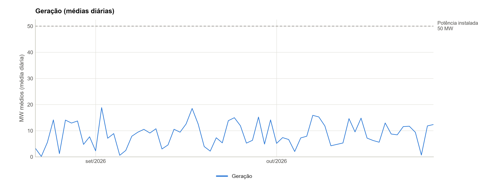
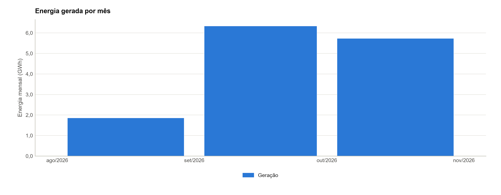
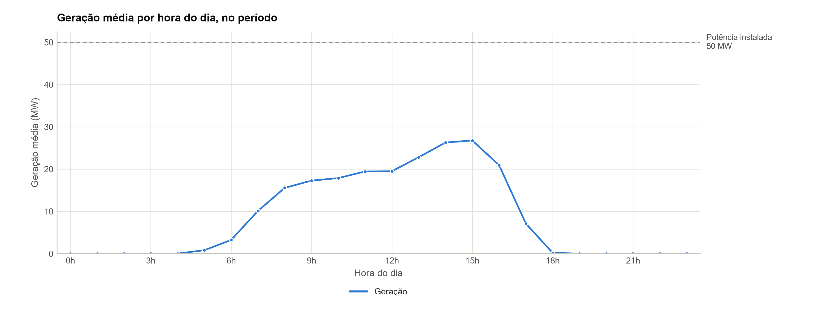
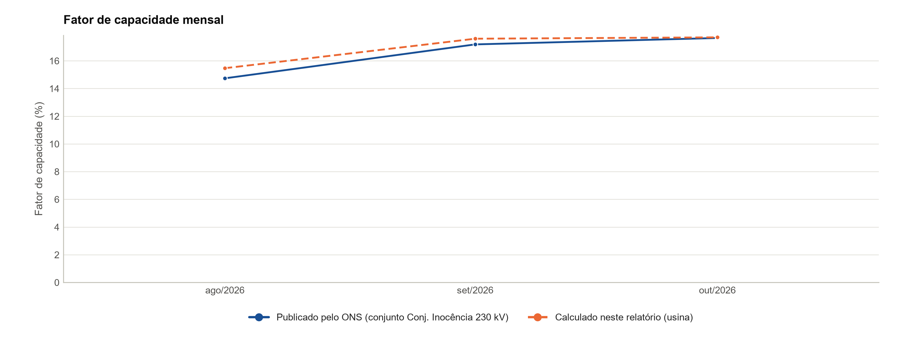
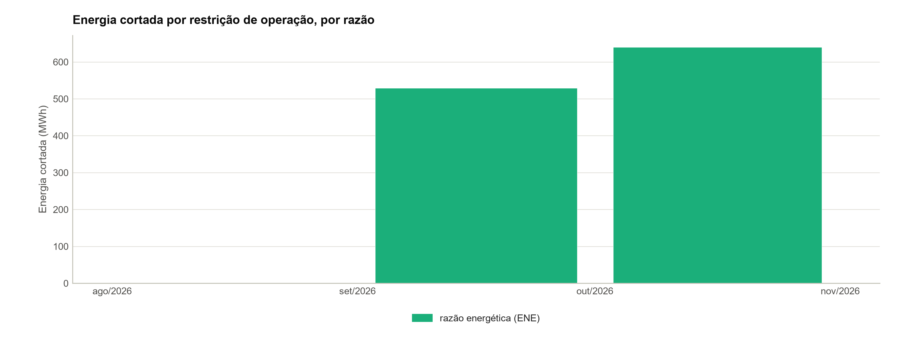
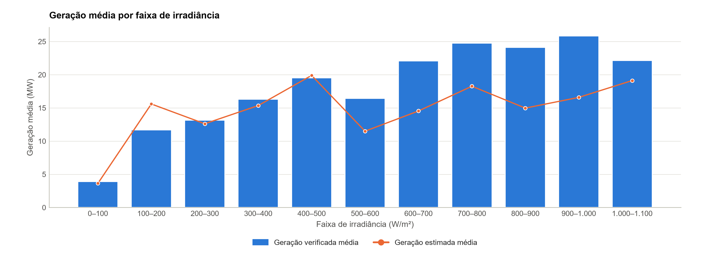
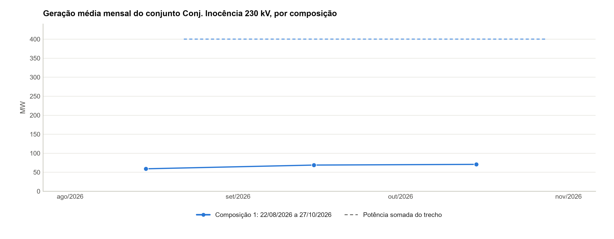
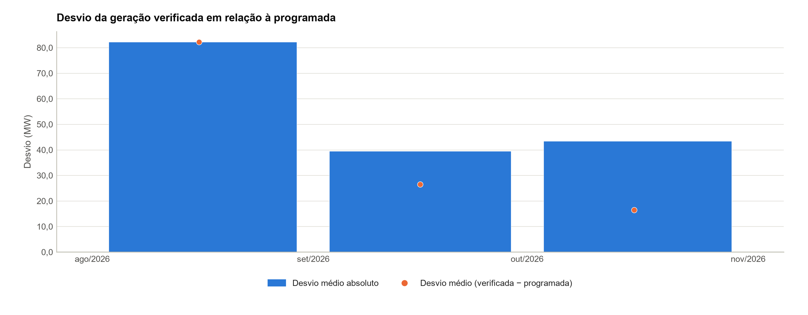

# UFV Seriemas 1 — Análise do desempenho operacional

**Período**: 22/08/2026 00h a 27/10/2026 23h (1.608 registros horários da série de referência, Restrição com detalhe (id ONS MSSRI1; CEG UFV.RS.MS.052257-0.01))
**Gerado em**: 29/10/2026 08:00

### Identificação nos dados do ONS

| Item | Valor |
| --- | --- |
| Tipo · modalidade | UFV · TIPO II-C |
| CEG | UFV.RS.MS.052257-0.01 |
| id ONS | MSSRI1 |
| Conjunto de usinas | CJU_MS4FINO (Conj. Inocência 230 kV) |
| Programação diária | MS4FINO |
| Estado | MS |
| Agente atual | SERIEMAS (proprietário); CVER (operador) |

Fonte dos dados: Modalidade das usinas (CEG UFV.RS.MS.052257-0.01), obtido em 29/10/2026; Restrição com detalhe (constrained-off) (id ONS MSSRI1; CEG UFV.RS.MS.052257-0.01), obtido em 29/10/2026; Capacidade de geração (CEG UFV.RS.MS.052257-0.01), obtido em 29/10/2026.

### Cadastro no ONS

| Item | Valor |
| --- | --- |
| Usina | UFV SERIEMAS 1 (SAE) · CEG UFV.RS.MS.052257-0.01 · id ONS MSSRI1 |
| Modalidade de operação | TIPO II-C |
| Centro de operação | COSR-S |
| Ponto de conexão | SE Inocência 230 kV |
| Potência autorizada | 2,5 MW |
| Estado · situação na ANEEL | MS · A |
| Homônimos excluídos pelo CEG | 0 |

Fonte dos dados: Modalidade das usinas (CEG UFV.RS.MS.052257-0.01), obtido em 29/10/2026. Conferência: potência autorizada e estado conferidos com os parâmetros do projeto: divergências (potência autorizada de 2,5 MW (projeto: 50 MW)).

### Parâmetros técnicos da usina

| Item | Valor |
| --- | --- |
| Potência instalada | 50,0 MW (2 unidades: 21,4 e 28,6 MW) |
| Garantia física | 16,1 MWmed |
| Início da operação comercial | 2026 |

Fonte dos dados: parâmetros do projeto (origem na tabela de parâmetros).

### Indicadores principais

| Indicador | Valor | Detalhe |
| --- | --- | --- |
| Geração média | 8,7 MWmed | 13,9 GWh em 1.608 horas com valor |
| Fator de capacidade | 17,3% | geração média ÷ potência instalada |
| Energia cortada | 16,6% | 1.169 MWh por restrição de operação, da energia estimada nas semi-horas com a marca |

Indicadores calculados a partir da série de referência e da disponibilidade publicadas pelo ONS; não substituem os índices regulatórios. Ver notas metodológicas.

Calculado neste relatório a partir de: Restrição com detalhe (constrained-off) (id ONS MSSRI1; CEG UFV.RS.MS.052257-0.01), obtido em 29/10/2026. Sem outra fonte para conferir: geração.

## Sumário

1. [Fonte e cobertura dos dados](#1-fonte-e-cobertura-dos-dados)
2. [Indicadores anuais](#2-indicadores-anuais)
3. [Série temporal da geração](#3-série-temporal-da-geração)
4. [Geração mensal e sazonalidade](#4-geração-mensal-e-sazonalidade)
5. [Perfil horário da geração](#5-perfil-horário-da-geração)
6. [Fator de capacidade](#6-fator-de-capacidade)
7. [Energia cortada por restrição de operação (constrained-off)](#7-energia-cortada-por-restrição-de-operação-constrained-off)
8. [Recurso × geração](#8-recurso--geração)
9. [Composição e geração do conjunto](#9-composição-e-geração-do-conjunto)
10. [Programação diária × geração verificada](#10-programação-diária--geração-verificada)
11. [Qualidade dos dados](#11-qualidade-dos-dados)
12. [Conclusão](#12-conclusão)
13. [Notas metodológicas e limitações](#13-notas-metodológicas-e-limitações)

## 1. Fonte e cobertura dos dados

**Cobertura dos dados.** Série de referência: Restrição com detalhe (id ONS MSSRI1; CEG UFV.RS.MS.052257-0.01), de 22/08/2026 00h a 27/10/2026 23h: 1.608 horas com registro de 1.608 no período (100,00%).

**Cadastro da usina no ONS.** No cadastro de modalidade das usinas do ONS (obtido em 29/10/2026), a usina consta como UFV SERIEMAS 1 (SAE), CEG UFV.RS.MS.052257-0.01, id ONS MSSRI1, modalidade TIPO II-C, centro de operação COSR-S, ponto de conexão SE Inocência 230 kV, potência autorizada de 2,5 MW, estado MS e situação na ANEEL "A". O cadastro tem 0 outras usinas com "Seriemas 1" no nome, excluídas pelo CEG. Divergências com os parâmetros do projeto: potência autorizada de 2,5 MW (projeto: 50 MW).

| Item | Valor |
| --- | --- |
| Série de referência | Restrição com detalhe (id ONS MSSRI1; CEG UFV.RS.MS.052257-0.01) — Portal de Dados Abertos do ONS (https://dados.ons.org.br/dataset/restricao_coff_fotovoltaica_detail) |
| Período | 22/08/2026 00h a 27/10/2026 23h |
| Registros | 1.608 de 1.608 horas do período; 0 horas ausentes em 0 intervalos; 0 horas sem valor |
| Níveis | usina: 1.608 horas |
| Anos parciais | 2026 |

Fonte dos dados: Restrição com detalhe (constrained-off) (id ONS MSSRI1; CEG UFV.RS.MS.052257-0.01), obtido em 29/10/2026.

### Conjuntos do ONS, nível e identificador

| Conjunto do ONS | Nível | Identificador | Obtenção |
| --- | --- | --- | --- |
| Restrição com detalhe (série de referência) | usina | id ONS MSSRI1; CEG UFV.RS.MS.052257-0.01 | obtido em 29/10/2026 |
| Geração por usina | conjunto | CJU_MS4FINO | obtido em 29/10/2026 |
| Programação diária | conjunto | MS4FINO | obtido em 29/10/2026 |
| Fator de capacidade | conjunto | CJU_MS4FINO | obtido em 29/10/2026 |
| Restrição com a razão | conjunto | CJU_MS4FINO | obtido em 29/10/2026 |
| Modalidade das usinas | usina | CEG UFV.RS.MS.052257-0.01 | obtido em 29/10/2026 |
| Composição dos conjuntos de usinas | conjunto | CJU_MS4FINO | obtido em 29/10/2026 |
| Capacidade de geração | usinas do conjunto | CEG das usinas de CJU_MS4FINO | obtido em 29/10/2026 |

Fonte dos dados: Restrição com detalhe (constrained-off) (id ONS MSSRI1; CEG UFV.RS.MS.052257-0.01), obtido em 29/10/2026; Geração por usina (conjunto de usinas, id ONS CJU_MS4FINO), obtido em 29/10/2026; Programação diária (conjunto de usinas, MS4FINO), obtido em 29/10/2026; Modalidade das usinas (CEG UFV.RS.MS.052257-0.01), obtido em 29/10/2026; Composição dos conjuntos de usinas (conjunto de usinas, id ONS CJU_MS4FINO), obtido em 29/10/2026; Fator de capacidade (conjunto de usinas, id ONS CJU_MS4FINO), obtido em 29/10/2026; Restrição com a razão (constrained-off) (conjunto de usinas, id ONS CJU_MS4FINO), obtido em 29/10/2026.

### Trechos do período

| Trecho | Início | Fim | Modalidade | Nível | Tipos |
| --- | --- | --- | --- | --- | --- |
| 1 | 22/08/2026 00h | 27/10/2026 23h | Tipo II-C | usina | UFV |

Trecho novo a cada mudança de modalidade, de composição do conjunto ou de código; as usinas de cada composição estão na seção do conjunto.

Calculado neste relatório a partir de: Restrição com detalhe (constrained-off) (id ONS MSSRI1; CEG UFV.RS.MS.052257-0.01), obtido em 29/10/2026; Composição dos conjuntos de usinas (conjunto de usinas, id ONS CJU_MS4FINO), obtido em 29/10/2026.

## 2. Indicadores anuais

**Geração.** Geração média de 8,7 MWmed nas 1.608 horas com valor (13.922 MWh); geração até 1 MW em 55,8% das horas.

| Ano | Nível | Horas | Com valor | Geração média (MWmed) | Energia (MWh) | Máxima (MW) | Horas até 1 MW | % das horas | Fator de capacidade | Energia cortada (MWh, % est.) |
| --- | --- | --- | --- | --- | --- | --- | --- | --- | --- | --- |
| 2026* | usina | 1.608 | 1.608 | 8,7 | 13.922 | 49,2 | 898 | 55,8% | 17,3% | 1.169 (16,6%) |

\* Ano parcial. Geração média = média das horas com valor; horas até 1 MW = horas com geração até esse limiar, sobre as horas com valor; fator de capacidade = geração média ÷ potência instalada; energia cortada = por restrição de operação, nas semi-horas com a marca de restrição, e % da energia estimada nelas.

Calculado neste relatório a partir de: Restrição com detalhe (constrained-off) (id ONS MSSRI1; CEG UFV.RS.MS.052257-0.01), obtido em 29/10/2026; parâmetros do projeto (origem na tabela de parâmetros). Conferência: soma das usinas do conjunto (Restrição com detalhe) conferida com a Geração por usina do conjunto (G2): 1.297 de 1.488 horas coincidentes (87,2%), 191 divergências, listadas na aba CONF_G2_DIVERGENCIAS; 120 horas sem todas as usinas, fora da soma. Sem outra fonte para conferir: geração.

## 3. Série temporal da geração

Médias diárias da geração, de 22/08/2026 a 27/10/2026. Linha tracejada: potência instalada da usina (50 MW).

Calculado neste relatório a partir de: Restrição com detalhe (constrained-off) (id ONS MSSRI1; CEG UFV.RS.MS.052257-0.01), obtido em 29/10/2026. Sem outra fonte para conferir: geração.

## 4. Geração mensal e sazonalidade

Energia gerada em cada mês (GWh), pela soma das horas com valor. Maior energia mensal: 6,3 GWh em set/2026.

Calculado neste relatório a partir de: Restrição com detalhe (constrained-off) (id ONS MSSRI1; CEG UFV.RS.MS.052257-0.01), obtido em 29/10/2026. Sem outra fonte para conferir: geração.

Sazonalidade omitida: a série tem 3 meses distintos, abaixo dos 12 necessários.

## 5. Perfil horário da geração

Geração média por hora do dia, no período, sobre as horas com valor.

Calculado neste relatório a partir de: Restrição com detalhe (constrained-off) (id ONS MSSRI1; CEG UFV.RS.MS.052257-0.01), obtido em 29/10/2026. Sem outra fonte para conferir: geração.

## 6. Fator de capacidade

**Fator de capacidade.** Fator de capacidade publicado pelo ONS de 17,0% de 22/08/2026 a 27/10/2026, no nível conjunto de usinas, em 1.608 horas.

O fator de capacidade calculado neste relatório, da geração da usina e da potência instalada do perfil (50,0 MW), fica na tabela ao lado do publicado.

### Fator de capacidade por ano

| Ano | Nível | Horas | Geração verificada (MWh) | Capacidade média (MW) | FC publicado | FC calculado (usina) | Horas com FC fora de 0 a 1 | Horas acima da capacidade |
| --- | --- | --- | --- | --- | --- | --- | --- | --- |
| 2026* | conjunto | 1.608 | 109.366 | 400,0 | 17,0% | 17,3% | 0 | 0 |

\* Ano parcial. FC publicado = Σ geração verificada ÷ Σ capacidade instalada nas horas com os dois dados, no nível publicado pelo ONS; FC calculado = geração média da usina na série de referência ÷ potência instalada do perfil. Horas com FC fora de 0 a 1 ou geração acima da capacidade (folga de 1 MW) são sinalizadas e ficam nos totais.

Calculado neste relatório a partir de: Fator de capacidade (conjunto de usinas, id ONS CJU_MS4FINO), obtido em 29/10/2026; Restrição com detalhe (constrained-off) (id ONS MSSRI1; CEG UFV.RS.MS.052257-0.01), obtido em 29/10/2026; parâmetros do projeto (origem na tabela de parâmetros). Conferência: geração conferida entre as fontes, duas a duas e no mesmo nível (G1): 4.824 de 4.824 horas coincidentes (100,0%) em 3 pares de fontes, detalhados na aba CONF_G1_PARES; programação diária conferida com o programado do Fator de capacidade (G5): 1.296 de 1.296 horas coincidentes (100,0%), 192 horas só numa das fontes.

Fator de capacidade mensal publicado pelo ONS (conjunto de usinas Conj. Inocência 230 kV, id ONS CJU_MS4FINO) e o calculado neste relatório da geração da usina e da potência instalada do perfil (%), de ago/2026 a out/2026.

Calculado neste relatório a partir de: Fator de capacidade (conjunto de usinas, id ONS CJU_MS4FINO), obtido em 29/10/2026; Restrição com detalhe (constrained-off) (id ONS MSSRI1; CEG UFV.RS.MS.052257-0.01), obtido em 29/10/2026; parâmetros do projeto (origem na tabela de parâmetros). Conferência: geração conferida entre as fontes, duas a duas e no mesmo nível (G1): 4.824 de 4.824 horas coincidentes (100,0%) em 3 pares de fontes, detalhados na aba CONF_G1_PARES; programação diária conferida com o programado do Fator de capacidade (G5): 1.296 de 1.296 horas coincidentes (100,0%), 192 horas só numa das fontes.

## 7. Energia cortada por restrição de operação (constrained-off)

**Energia cortada.** Energia cortada por restrição de operação de 1.169 MWh nas 919 semi-horas com a marca de restrição (16,6% da energia estimada nas semi-horas com a marca); diferença bruta entre a estimada e a verificada de 2.534 MWh em todas as semi-horas. Sem a estimativa do ONS (estimada 0 com a usina gerando) em 833 semi-horas, 473 delas com a marca de restrição, em que o corte não pôde ser calculado.

Restrição com detalhe de 22/08/2026 a 27/10/2026 (3.216 semi-horas), com a marca de restrição em 919 (459,5 horas). Fora das semi-horas restritas, a diferença entre a estimada e a verificada é erro da estimativa e não entra no corte. A razão é a do conjunto de usinas Conj. Inocência 230 kV, id ONS CJU_MS4FINO; a energia cortada é a da usina.

### Energia cortada por restrição de operação por ano

| Ano | Verificada (MWh) | Estimada (MWh) | Cortada (MWh) | % da estimada | Horas restritas | Restritas sem estimativa | Semi-horas sem a marca | Diferença bruta (MWh) |
| --- | --- | --- | --- | --- | --- | --- | --- | --- |
| 2026* | 7.297 | 7.054 | 1.169 | 16,6% | 459,5 | 473 | 0 | 2.534 |

\* Ano parcial. Verificada e estimada nas semi-horas com a estimativa do ONS (estimada 0 com a usina gerando = estimativa ausente). Cortada = Σ máx(estimada − verificada, 0) × 0,5 h nas semi-horas com a marca de restrição; % sobre a estimada das semi-horas com a marca; restritas sem estimativa = semi-horas com a marca em que o corte não pôde ser calculado; diferença bruta = o mesmo cálculo em todas as semi-horas com estimativa, para comparação.

Calculado neste relatório a partir de: Restrição com detalhe (constrained-off) (id ONS MSSRI1; CEG UFV.RS.MS.052257-0.01), obtido em 29/10/2026. Conferência: geração conferida entre as fontes, duas a duas e no mesmo nível (G1): 4.824 de 4.824 horas coincidentes (100,0%) em 3 pares de fontes, detalhados na aba CONF_G1_PARES; soma das usinas do conjunto (Restrição com detalhe) conferida com a Geração por usina do conjunto (G2): 1.297 de 1.488 horas coincidentes (87,2%), 191 divergências, listadas na aba CONF_G2_DIVERGENCIAS; 120 horas sem todas as usinas, fora da soma. Sem outra fonte para conferir: geração estimada e marca de restrição.

### Energia cortada por razão da restrição

| Razão | Semi-horas restritas | Energia cortada (MWh) | % da cortada |
| --- | --- | --- | --- |
| razão energética (ENE) | 919 | 1.169 | 100,0% |

Razão de cada semi-hora restrita na Restrição com a razão; sem razão publicada = semi-hora restrita sem o código. A razão é a do conjunto de usinas Conj. Inocência 230 kV, id ONS CJU_MS4FINO; a energia cortada é a da usina.

Calculado neste relatório a partir de: Restrição com detalhe (constrained-off) (id ONS MSSRI1; CEG UFV.RS.MS.052257-0.01), obtido em 29/10/2026; Restrição com a razão (constrained-off) (conjunto de usinas, id ONS CJU_MS4FINO), obtido em 29/10/2026. Conferência: geração conferida entre as fontes, duas a duas e no mesmo nível (G1): 4.824 de 4.824 horas coincidentes (100,0%) em 3 pares de fontes, detalhados na aba CONF_G1_PARES. Sem outra fonte para conferir: geração estimada e marca de restrição.

Energia cortada por restrição de operação em cada mês (MWh), por razão, só nas semi-horas com a marca de restrição. A razão é a do conjunto de usinas Conj. Inocência 230 kV, id ONS CJU_MS4FINO; a energia cortada é a da usina.

Calculado neste relatório a partir de: Restrição com detalhe (constrained-off) (id ONS MSSRI1; CEG UFV.RS.MS.052257-0.01), obtido em 29/10/2026; Restrição com a razão (constrained-off) (conjunto de usinas, id ONS CJU_MS4FINO), obtido em 29/10/2026. Conferência: geração conferida entre as fontes, duas a duas e no mesmo nível (G1): 4.824 de 4.824 horas coincidentes (100,0%) em 3 pares de fontes, detalhados na aba CONF_G1_PARES. Sem outra fonte para conferir: geração estimada e marca de restrição.

## 8. Recurso × geração

**Recurso × geração.** Medição de irradiância marcada como inválida pelo ONS em 564 das 3.216 semi-horas (17,5%), fora das faixas.

Geração por faixa de irradiância (100 W/m² por faixa), nas 2.652 semi-horas com a irradiância válida.

### Geração por faixa de irradiância

| Faixa de irradiância (W/m²) | Semi-horas | Geração verificada média (MW) | Geração estimada média (MW) |
| --- | --- | --- | --- |
| 0 a 100 | 1.801 | 3,9 | 3,6 |
| 100 a 200 | 89 | 11,7 | 15,6 |
| 200 a 300 | 61 | 13,1 | 12,6 |
| 300 a 400 | 68 | 16,3 | 15,3 |
| 400 a 500 | 41 | 19,5 | 19,9 |
| 500 a 600 | 67 | 16,4 | 11,5 |
| 600 a 700 | 63 | 22,1 | 14,5 |
| 700 a 800 | 83 | 24,7 | 18,3 |
| 800 a 900 | 146 | 24,1 | 15,0 |
| 900 a 1.000 | 158 | 25,8 | 16,6 |
| 1.000 a 1.100 | 75 | 22,1 | 19,1 |

Só as semi-horas com a irradiância válida, até o limite físico de 1.500 W/m², e a geração verificada; o valor negativo (ruído de medição) entra na primeira faixa.

Calculado neste relatório a partir de: Restrição com detalhe (constrained-off) (id ONS MSSRI1; CEG UFV.RS.MS.052257-0.01), obtido em 29/10/2026. Conferência: geração conferida entre as fontes, duas a duas e no mesmo nível (G1): 4.824 de 4.824 horas coincidentes (100,0%) em 3 pares de fontes, detalhados na aba CONF_G1_PARES. Sem outra fonte para conferir: vento ou irradiância.

Geração verificada e estimada médias por faixa de irradiância (W/m²), sem as semi-horas com a irradiância inválida ou acima de 1.500 W/m².

Calculado neste relatório a partir de: Restrição com detalhe (constrained-off) (id ONS MSSRI1; CEG UFV.RS.MS.052257-0.01), obtido em 29/10/2026. Conferência: geração conferida entre as fontes, duas a duas e no mesmo nível (G1): 4.824 de 4.824 horas coincidentes (100,0%) em 3 pares de fontes, detalhados na aba CONF_G1_PARES. Sem outra fonte para conferir: vento ou irradiância.

## 9. Composição e geração do conjunto

**Composição do conjunto.** O conjunto Conj. Inocência 230 kV (CJU_MS4FINO) teve 1 composição no período: de 22/08/2026 a 27/10/2026, 8 usinas (UFV), geração média do conjunto de 68,0 MWmed. Os números são do conjunto, sem divisão entre as usinas.

### Geração do conjunto Conj. Inocência 230 kV (CJU_MS4FINO) por trecho de composição

| Trecho | Início | Fim | Usinas | Tipos | Horas com valor | Energia (MWh) | Média (MWmed) | Máxima (MW) | Potência somada (MW) |
| --- | --- | --- | --- | --- | --- | --- | --- | --- | --- |
| 1 | 22/08/2026 00h | 27/10/2026 23h | 8 | UFV | 1.608 | 109.366 | 68,0 | 391,4 | 400,0 |

Trecho novo a cada mudança da composição do conjunto (Composição dos conjuntos); horas e médias da série do conjunto, sem divisão entre as usinas; potência somada = soma das unidades da Capacidade de geração em operação em algum momento do trecho, das usinas com unidade cadastrada (as demais aparecem com «—» na composição).

Calculado neste relatório a partir de: Geração por usina (conjunto de usinas, id ONS CJU_MS4FINO), obtido em 29/10/2026; Composição dos conjuntos de usinas (conjunto de usinas, id ONS CJU_MS4FINO), obtido em 29/10/2026; Capacidade de geração (CEG das usinas do conjunto CJU_MS4FINO), obtido em 29/10/2026. Conferência: soma das usinas do conjunto (Restrição com detalhe) conferida com a Geração por usina do conjunto (G2): 1.297 de 1.488 horas coincidentes (87,2%), 191 divergências, listadas na aba CONF_G2_DIVERGENCIAS; 120 horas sem todas as usinas, fora da soma. Sem outra fonte para conferir: geração.

Geração média mensal do conjunto Conj. Inocência 230 kV (CJU_MS4FINO) (MWmed), uma cor por trecho de composição; linhas verticais nas mudanças de composição. Linhas tracejadas: potência somada das usinas de cada trecho (unidades em operação). Os números são do conjunto, como o ONS publica.

Calculado neste relatório a partir de: Geração por usina (conjunto de usinas, id ONS CJU_MS4FINO), obtido em 29/10/2026; Composição dos conjuntos de usinas (conjunto de usinas, id ONS CJU_MS4FINO), obtido em 29/10/2026; Capacidade de geração (CEG das usinas do conjunto CJU_MS4FINO), obtido em 29/10/2026. Conferência: soma das usinas do conjunto (Restrição com detalhe) conferida com a Geração por usina do conjunto (G2): 1.297 de 1.488 horas coincidentes (87,2%), 191 divergências, listadas na aba CONF_G2_DIVERGENCIAS; 120 horas sem todas as usinas, fora da soma. Sem outra fonte para conferir: geração.

### Usinas da composição no período

| Usina | Tipo | CEG | Entrada no conjunto | Saída | Potência (MW) |
| --- | --- | --- | --- | --- | --- |
| Seriemas 1 | UFV | UFV.RS.MS.052257-0.01 | 13/04/2026 | — | 50,0 |
| Seriemas 2 | UFV | UFV.RS.MS.052258-9.01 | 13/04/2026 | — | 50,0 |
| Seriemas 3 | UFV | UFV.RS.MS.052259-7.01 | 13/04/2026 | — | 50,0 |
| Seriemas 4 | UFV | UFV.RS.MS.052260-0.01 | 13/04/2026 | — | 50,0 |
| Seriemas 5 | UFV | UFV.RS.MS.052261-9.01 | 13/04/2026 | — | 50,0 |
| Seriemas 6 | UFV | UFV.RS.MS.052262-7.01 | 13/04/2026 | — | 50,0 |
| Seriemas 7 | UFV | UFV.RS.MS.052263-5.01 | 13/04/2026 | — | 50,0 |
| Seriemas 8 | UFV | UFV.RS.MS.052264-3.01 | 13/04/2026 | — | 50,0 |

Entrada e saída da usina no conjunto, como o ONS publica na Composição dos conjuntos; tipo pelo prefixo do CEG; potência = maior soma das unidades em operação num trecho em que a usina está no conjunto.

Calculado neste relatório a partir de: Composição dos conjuntos de usinas (conjunto de usinas, id ONS CJU_MS4FINO), obtido em 29/10/2026; Capacidade de geração (CEG das usinas do conjunto CJU_MS4FINO), obtido em 29/10/2026.

## 10. Programação diária × geração verificada

**Programação diária do ONS.** Nas 1.488 horas com programação e geração verificada do conjunto Conj. Inocência 230 kV, geração verificada média de 70,6 MW e programada de 44,0 MW (desvio médio absoluto de 44,6 MW; correlação de 0,63); 16 horas com geração até 1 MW e programação acima de 5 MW.

Programação diária do ONS (conjunto) × geração verificada, de 27/08/2026 a 27/10/2026: 1.488 horas comuns; correlação de 0,63; 0 dias sem arquivo de programação.

### Geração programada × verificada por mês

| Mês | Horas comuns | Verificada (MW) | Programada (MW) | Desvio médio (MW) | Desvio absoluto (MW) | Horas parada c/ programação |
| --- | --- | --- | --- | --- | --- | --- |
| ago/2026 | 120 | 82,2 | 0,0 | 82,2 | 82,2 | 0 |
| set/2026 | 720 | 68,7 | 42,3 | 26,5 | 39,5 | 1 |
| out/2026 | 648 | 70,6 | 54,2 | 16,4 | 43,4 | 15 |

Horas comuns às duas fontes, no mesmo nível. Desvio = verificada − programada; horas parada c/ programação = geração até 1 MW com programação acima de 5 MW.

Calculado neste relatório a partir de: Programação diária (conjunto de usinas, MS4FINO), obtido em 29/10/2026; Geração por usina (conjunto de usinas, id ONS CJU_MS4FINO), obtido em 29/10/2026. Conferência: programação diária conferida com o programado do Fator de capacidade (G5): 1.296 de 1.296 horas coincidentes (100,0%), 192 horas só numa das fontes. Sem outra fonte para conferir: geração.

### Horas consecutivas com geração até 1 MW e programação acima de 5 MW

| Início | Fim | Duração (h) | Programação média (MW) |
| --- | --- | --- | --- |
| 16/10/2026 14h | 16/10/2026 17h | 4 | 108,2 |
| 09/10/2026 16h | 09/10/2026 17h | 2 | 183,2 |
| 23/10/2026 16h | 23/10/2026 17h | 2 | 107,5 |
| 15/10/2026 16h | 15/10/2026 17h | 2 | 100,8 |
| 30/09/2026 06h | 30/09/2026 06h | 1 | 8,0 |
| 13/10/2026 17h | 13/10/2026 17h | 1 | 67,5 |
| 19/10/2026 18h | 19/10/2026 18h | 1 | 6,0 |
| 20/10/2026 18h | 20/10/2026 18h | 1 | 7,0 |
| 21/10/2026 18h | 21/10/2026 18h | 1 | 6,0 |
| 25/10/2026 17h | 25/10/2026 17h | 1 | 46,5 |

Até 15 eventos, os mais longos; a lista completa está na planilha.

Calculado neste relatório a partir de: Programação diária (conjunto de usinas, MS4FINO), obtido em 29/10/2026; Geração por usina (conjunto de usinas, id ONS CJU_MS4FINO), obtido em 29/10/2026. Conferência: programação diária conferida com o programado do Fator de capacidade (G5): 1.296 de 1.296 horas coincidentes (100,0%), 192 horas só numa das fontes. Sem outra fonte para conferir: geração.

### Maiores desvios entre a geração verificada e a programada

| Hora | Programada (MW) | Verificada (MW) | Desvio (MW) |
| --- | --- | --- | --- |
| 02/09/2026 14h | 0,0 | 391,3 | 391,3 |
| 02/09/2026 15h | 0,0 | 388,6 | 388,6 |
| 03/09/2026 15h | 0,0 | 386,3 | 386,3 |
| 02/09/2026 08h | 0,0 | 377,8 | 377,8 |
| 02/09/2026 10h | 0,0 | 376,3 | 376,3 |
| 02/09/2026 11h | 0,0 | 375,0 | 375,0 |
| 28/08/2026 14h | 0,0 | 365,0 | 365,0 |
| 27/08/2026 11h | 0,0 | 352,7 | 352,7 |
| 27/08/2026 10h | 0,0 | 350,0 | 350,0 |
| 28/08/2026 15h | 0,0 | 350,0 | 350,0 |
| 29/08/2026 09h | 0,0 | 348,1 | 348,1 |
| 29/08/2026 10h | 0,0 | 347,9 | 347,9 |
| 27/08/2026 12h | 0,0 | 346,8 | 346,8 |
| 15/10/2026 10h | 37,0 | 383,1 | 346,1 |
| 27/08/2026 09h | 0,0 | 344,1 | 344,1 |

Até 15 horas, as de maior desvio absoluto, no nível da programação; a lista completa está na planilha.

Fonte dos dados: Programação diária (conjunto de usinas, MS4FINO), obtido em 29/10/2026; Geração por usina (conjunto de usinas, id ONS CJU_MS4FINO), obtido em 29/10/2026. Conferência: programação diária conferida com o programado do Fator de capacidade (G5): 1.296 de 1.296 horas coincidentes (100,0%), 192 horas só numa das fontes.

Desvio médio e desvio médio absoluto mensais entre a geração verificada e a programada (MW), nas horas comuns às duas, no nível da programação.

Calculado neste relatório a partir de: Programação diária (conjunto de usinas, MS4FINO), obtido em 29/10/2026; Geração por usina (conjunto de usinas, id ONS CJU_MS4FINO), obtido em 29/10/2026. Conferência: programação diária conferida com o programado do Fator de capacidade (G5): 1.296 de 1.296 horas coincidentes (100,0%), 192 horas só numa das fontes.

## 11. Qualidade dos dados

**Qualidade dos dados.** Nenhuma hora sinalizada na base horária.

### Horas sinalizadas na base horária

Nenhuma hora sinalizada.

### Intervalos ausentes da série de referência

Nenhuma hora ausente.

## 12. Conclusão

Indícios a confirmar, gerados pelas regras descritas nas notas metodológicas a partir dos resultados das seções indicadas; não afirmam causa nem avaliam o desempenho da usina.

### Pontos de atenção

- Energia cortada por restrição de operação de 1.169 MWh, 16,6% da energia estimada nas semi-horas com a marca de restrição (seção 7).

### A verificar em campo

- Medição de irradiância marcada como inválida pelo ONS em 564 das 3.216 semi-horas da usina (17,5%) (seção 8).

## 13. Notas metodológicas e limitações

- Fonte: Portal de Dados Abertos do ONS. Série de referência: Restrição com detalhe (id ONS MSSRI1; CEG UFV.RS.MS.052257-0.01), varrida em todos os arquivos publicados; o período vai da primeira à última hora com valor. Os dados passam por consistência recorrente e podem ser revisados pelo ONS após a publicação.
- Base horária comum: uma linha por hora da série de referência, com a disponibilidade e a programação do ONS na mesma hora, quando há. Os horários são os publicados pelo ONS (hora de início do intervalo).
- Nenhum valor é preenchido: as horas sinalizadas ficam na base e nos totais, com o código da regra.
- Granularidade: o ONS publica a geração, o fator de capacidade e a razão da restrição do conjunto Conj. Inocência 230 kV (CJU_MS4FINO), e a restrição com detalhe de cada usina; a série de referência é a da usina. Os números do conjunto são identificados como tais e não são divididos entre as usinas; a conclusão da usina não usa números do conjunto.
- Energia cortada: só nas semi-horas com a marca de restrição da Restrição com detalhe, pela geração estimada menos a verificada, sem valores negativos; a semi-hora sem a marca (arquivo publicado sem a coluna) fica fora do total e é contada. A geração estimada 0 com a usina gerando é estimativa que o ONS não calculou: fica fora dos totais e das médias da estimada e, nas semi-horas com a marca de restrição, o corte não é calculado. As semi-horas são levadas à hora cheia pela média das duas meias-horas só nos cruzamentos com séries horárias; a hora com uma só meia-hora fica ausente. O recurso marcado como inválido pelo ONS ou acima do limite físico (1.500 W/m²) fica fora das faixas do recurso × geração.
- A composição de cada trecho vem da Composição dos conjuntos e a potência, das unidades da Capacidade de geração (pelo CEG de cada usina, inclusive as cadastradas em outro estado); a geração do conjunto não é dividida pela potência somada nem entre as usinas.
- Conclusão: indícios gerados pelas regras do catálogo para UFV, iguais para as usinas do tipo e só com dados do nível da usina, a partir dos resultados das seções: C16 energia cortada por restrição de operação ≥ 5% da energia estimada; C17 recurso (vento ou irradiância) inválido em ≥ 10% das semi-horas; C18 fator de capacidade publicado da usina, num ano completo, abaixo da razão entre a garantia física e a potência instalada; C19 desvio médio absoluto entre a geração programada e a verificada ≥ 15% da potência instalada. O relatório mostra até 5 itens por lista, na ordem das regras; todos estão na aba CONCLUSAO da planilha. Não avaliadas nesta usina: C18 e C19 (motivos na tabela abaixo).
- As seções e as regras sem base para a usina e as conferências que não se aplicam a ela estão nas tabelas abaixo, com o motivo de cada uma.

### Seções e regras sem base para a usina

| Seção ou regra | Motivo |
| --- | --- |
| Sazonalidade (distribuição por mês do ano) | a série do nível usina tem menos de 12 meses distintos (3) |
| Conferência da geração entre fontes | seção ainda não gerada pelo pipeline; os resultados da G1, da G2 e da G5, quando aplicáveis, estão nas legendas de fonte das seções de eólica e solar e nas abas CONF_G1, CONF_G2 e CONF_G5 da planilha |
| C18 | sem o Fator de capacidade no nível da usina |
| C19 | sem a Programação diária no nível da usina |

Calculado neste relatório a partir de: parâmetros do projeto (origem na tabela de parâmetros).

### Conferências que não se aplicam à usina

| Conferência | Motivo |
| --- | --- |
| geração da base de EVT × Geração por usina | não se aplica a UFV: conferência de UHE, PCH e CGH |
| disponibilidade declarada da base de EVT × Disponibilidade por usina | não se aplica a UFV: conferência de UHE, PCH e CGH |
| vazões da base de EVT × Dados hidrológicos | não se aplica a UFV: conferência de UHE, PCH e CGH |
| DISPF × horas por estado operativo | não se aplica a UFV: conferência de UHE, PCH, CGH, UTE e UTN |
| TEIFa e TEIP refeitas a partir das horas | não se aplica a UFV: conferência de UHE, PCH, CGH, UTE e UTN |
| G3. Programação diária × geração programada do despacho | não se aplica a UFV: conferência de UTE e UTN |
| G4. geração verificada do despacho × Geração por usina | não se aplica a UFV: conferência de UTE e UTN |

Calculado neste relatório a partir de: parâmetros do projeto (origem na tabela de parâmetros).

### Parâmetros utilizados

| Grupo | Parâmetro | Valor | Unidade | Origem |
| --- | --- | --- | --- | --- |
| Usina | Tipo · modalidade | UFV · TIPO II-C |  | perfil da usina |
| Usina | Potência instalada | 50,0 | MW | ONS, dados abertos: Capacidade de geração e Modalidade das usinas, publicados em 20/10/2026; potência da UFV confirmada pelo usuário em 21/10/2026 |
| Usina | Unidades geradoras | 2 |  | ONS, dados abertos: Capacidade de geração e Modalidade das usinas, publicados em 20/10/2026; potência da UFV confirmada pelo usuário em 21/10/2026 |
| Usina | Garantia física | 16,1 | MWmed | Portaria nº 3.141, de 16 de junho de 2026 (EPE, Garantias físicas vigentes e futuras, planilha de 07/2026, referência 30/06/2026) |
| Usina | Início da operação comercial | 2026 |  | ONS, dados abertos: Capacidade de geração e Modalidade das usinas, publicados em 20/10/2026; potência da UFV confirmada pelo usuário em 21/10/2026 |
| Análise | Geração até o limiar | geração ≤ 1,0 | MW | Parâmetro de análise |
| Análise | Indisponibilidade total | disponibilidade ≤ 0,001 | MW | Parâmetro de análise |
| Análise | Unidade sincronizada | disponibilidade sincronizada > 1,0 | MW | Parâmetro de análise |
| Análise | Desvio da programação | geração ≤ 1,0 e programação > 5,0 | MW | Parâmetro de análise |
| Análise | Sazonalidade | ≥ 12 meses distintos |  | Parâmetro de análise |
| Análise | Faixa de irradiância | 100 | W/m² | Parâmetro de análise |
| Análise | Limite físico de irradiância | ≤ 1.500 | W/m² | Parâmetro de análise |
| Validação | Tolerância de geração acima da disponibilidade (R7) | 1,0 | MW | Parâmetro de análise |
| Fonte | Série de referência | Restrição com detalhe (id ONS MSSRI1; CEG UFV.RS.MS.052257-0.01) |  | https://dados.ons.org.br/dataset/restricao_coff_fotovoltaica_detail |
| Fonte | Programação diária | conjunto: MS4FINO |  | https://dados.ons.org.br/dataset/programacao_diaria |
| Fonte | Modalidade das usinas | CEG UFV.RS.MS.052257-0.01 |  | https://dados.ons.org.br/dataset/modalidade-usina |
| Fonte | Fator de capacidade | conjunto: CJU_MS4FINO |  | https://dados.ons.org.br/dataset/fator-capacidade-2 |
| Fonte | Restrição com a razão | conjunto: CJU_MS4FINO |  | https://dados.ons.org.br/dataset/restricao_coff_fotovoltaica |

Fonte dos dados: parâmetros do projeto (origem na tabela de parâmetros).

